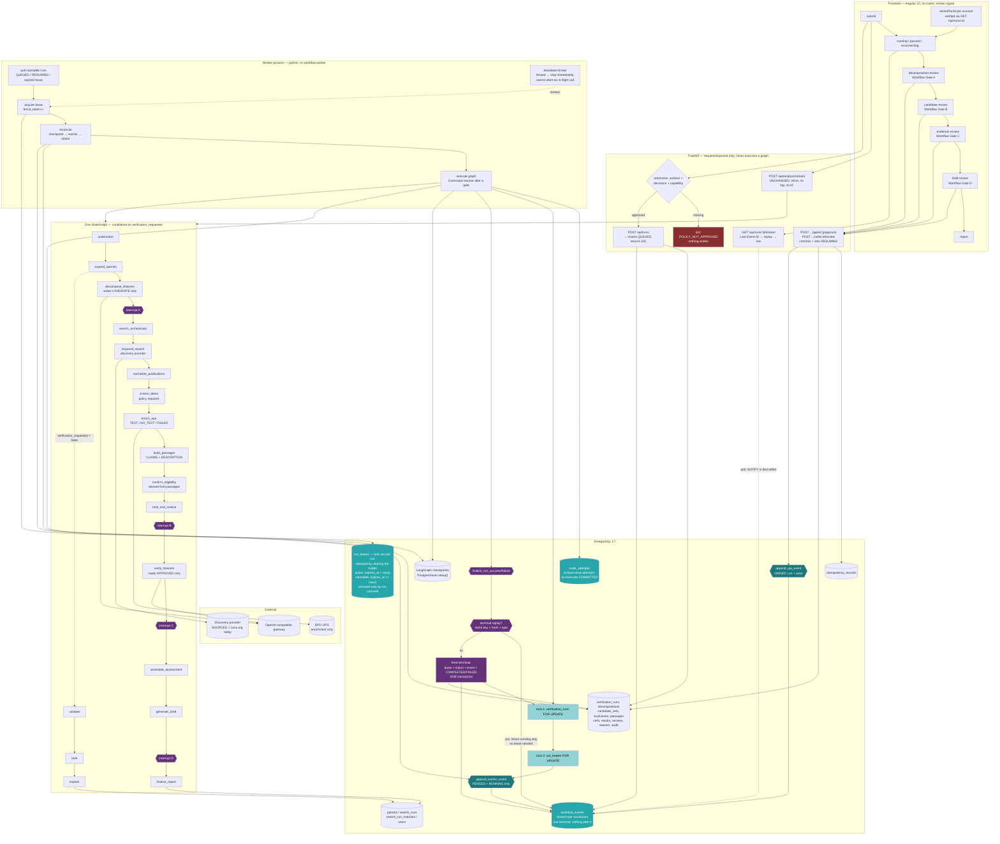

# Integrated Feature-Disclosure Verification Workflow — Implementation Prompt

**Status: authoritative implementation prompt. One document, no short version.**
**Audience: the implementation agent. Read this file completely before editing anything.**

You are integrating the already-built, standalone feature-disclosure verifier
(`backend/verification/`) into the running Novelty Lens application: EPO enrichment, evidence
passages, durable workflow execution, persistent workflow state, human review gates, a replayable
SSE event log, resumable LangGraph execution, frontend review screens, and tests.

**Reference convention.** `§N` on its own means a section of **this** document. A section of the
verifier specification (`docs/prompts/feature-disclosure-verification.md`) is always written
**`spec §N`**. The two documents both have a §7, a §8, a §9, a §10, a §12 and a §13, and they
mean entirely different things — do not read one as the other.

**The two documents you need open.** This one, and
`docs/prompts/feature-disclosure-verification.md`. Read the specification in full before Gate C;
its §1.2, §7, §9, §12 and §13 are the behaviour you are wiring up, and paraphrasing them from
memory is how the guarantees get lost.

---

## 0a. AMENDMENT — 2026-08-28 — deployment profiles and the development LLM

**Approved by the repository owner on 2026-08-28, in the request that authorized it.** This
amendment supersedes the environment assumptions written elsewhere in this document wherever
the two disagree. It changes *which provider development runs against*; it changes **no**
guarantee, no validation rule, and no acceptance criterion.

### The decision

1. **OpenAI is the development LLM.** Local development on personal machines uses the official
   OpenAI API through the project's existing LLM abstraction.
2. **The Aramco-hosted model is deferred.** It is considered and qualified only after the
   application is complete and ready to move into the Aramco environment. Until then the
   `aramco` profile exists, is configurable, and is **blocked** — it has no capability
   artifact and cannot admit a verified run.
3. **Embeddings do not move.** The Hugging Face embedding path stays exactly as approved. LLM
   provider configuration and embedding provider configuration are separate settings and are
   changed separately.
4. **Qdrant stays in its documented state.** A change of LLM provider is not a reason to enable
   semantic search.

### Why it is written down here rather than assumed

The previous assumption — that the configured gateway is the only one — is what left spec
§14.2.1 unrunnable from a personal machine and Implementation Gate C's acceptance blocked. That
was a *location* fact being carried as an *architecture* fact. Profiles make the distinction
explicit so neither one can be mistaken for the other again.

### What the amendment does NOT do

- It does **not** lower any Gate C or Gate D acceptance criterion.
- It does **not** make a local result stand in for an Aramco one. **Capability qualification is
  scoped to the exact runtime identity**, and a successful `local` OpenAI artifact can never
  qualify the `aramco` configuration — that is enforced in code and pinned by tests, not left
  to discipline.
- It does **not** introduce a bypass. There is no `SKIP_CAPABILITY_CHECK`, no debug flag, and
  no implicit auto-approval. Verified-run admission fails closed without a matching eligible
  artifact.
- It does **not** relax the zero-tolerance policy. A configured model that fails, or a provider
  that cannot be reached, fails the run. There is no automatic fallback to another model or
  another provider, and no silent model substitution.

### Profiles

`DEPLOYMENT_PROFILE` is explicit and has **no default**. It is never inferred from an endpoint
URL, a hostname, an API key, or a model name — inference is exactly how a machine ends up
believing it is somewhere it is not.

| Profile | LLM provider | Status |
|---|---|---|
| `local` | official OpenAI API | development; requires its own capability artifact |
| `aramco` | OpenAI-compatible gateway | **deferred and blocked** until qualified inside that network |
| `test` | in-process stub | fixtures only; its artifacts are unusable under the other two |

**Each environment is qualified independently.** See `backend/deployment.py`,
`backend/verification/capability.py`, and
`docs/measurements/structured-output-capability-STATUS.md`.

---

## 0b. AMENDMENT — 2026-08-29 — canonical and wire schemas

**Approved by the repository owner on 2026-08-29.** Recorded in full in
`docs/decisions/2026-08-29-canonical-and-wire-schemas.md`, and in the authoritative verifier
specification as §10.2, §14.2.3 and §14.2.4.

### The decision

Keep OpenAI strict Structured Outputs using `json_schema`. **Do not** downgrade to generic
`json_object`. Express the verifier's output contract as two explicit layers: a **canonical**
contract (spec §10/§10.1, unchanged, the authority, enforced after parsing on every response)
and a **provider-facing wire schema** generated from it by a deterministic, pure, versioned
transformation into the subset one adapter accepts. The wire schema may omit only keywords the
provider does not support, and only where the canonical validator enforces them.

**This is a compatibility adaptation, not a weakening of verification requirements.**

### Why it is written down here

Because §14.1 forbids exactly the thing this superficially resembles. "The schema we send is
smaller than the schema we specified" is one sentence away from "we relaxed validation for a
provider", and the difference between them is entirely in whether the omitted constraints are
enforced somewhere else. They are, they are tested one by one, and it is recorded here so that
nobody re-derives the change later from the code and reaches the wrong conclusion about it.

### What the amendment does NOT do

- It does **not** change spec §10 or §10.1, or weaken any constraint in them.
- It does **not** permit `json_object`. §14.2.2's generic-JSON decision remains open.
- It does **not** vary validation strictness by provider. §14.1 stands as written.
- It does **not** qualify any model, and it does **not** transfer between adapters or profiles:
  the wire schema and the canonical validator are both fields of the capability identity, so a
  change to either invalidates every prior artifact structurally.
- It does **not** touch discovery sources, EPO's enrichment-only role, the Hugging Face
  embedding path, or Qdrant's disabled status.

### It also fixes three gate defects found by the first real run

1. An HTTP 429 was classified as a provider rejection, and a rejection was scored as a **pass**
   for probes 3-5 — the third instance of an operational failure being read as evidence about
   the model.
2. The stability probe scored twelve HTTP 400s as `malformed_response_rate: 0.0` and
   `all_cases_stable: true`.
3. An HTTP 429 body printed the OpenAI organization id to stdout.

Spec §14.2.4 states the corrected rules; `backend/tests/test_capability_runner.py` and
`backend/tests/test_account_identifier_never_leaks.py` pin all three.

---

## 0. CRITICAL CONSTRAINTS — read these first, and re-read them at every gate

These override convenience, schedule, and your own judgment about what would be simpler. They
are repeated in condensed form at the end of this document because the middle of a long
document is where instructions go to die.

<CRITICAL_CONSTRAINTS>

1. **The zero-tolerance failure policy is absolute.** No silent fallback. No fabricated
   evidence. No repaired model output. No unlabelled degraded result. If a step cannot produce
   a genuine result, it fails loudly and says which step and why. CLAUDE.md calls adding a
   fallback back "the single most consequential way to break this project's contract with its
   users." That has not changed.

2. **Never weaken an existing verifier validation rule to make integration easier.** The 18
   response checks (spec §9), the 19 review checks (spec §13.4, checks 0–18), the passage
   rules (spec §7.3), the one canonicalization rule (spec §8), and the bare-JSON contract
   (spec §9 check 1) are fixed. If integration is hard because a check rejects something, the
   thing being rejected is wrong — not the check. Loosening one is an automatic gate failure.

3. **Read before you edit.** Do not speculate about a file you have not opened. Every gate
   below starts with a "files likely affected" list; confirm each against the actual code
   before changing it, and report any file where this document is stale.

4. **Stop after every gate.** Report what changed, paste the full test output, and wait for
   explicit approval before starting the next gate. Do not chain gates. Do not "get a head
   start" on the next one.

5. **The repository code is the authority, not the documentation.** CLAUDE.md and the
   specification are both stale in named places (§2.3 below). Where they disagree with the
   code, the code wins and the document is the bug — fix the document as part of the gate that
   touched the code.

6. **Do not expose secrets, provider response bodies, or stack traces to the frontend.** SerpAPI
   authenticates by query parameter and `requests`' `HTTPError` embeds the full URL; this
   already leaked a live API key into a browser console once
   (`tests/test_secrets_do_not_leak.py` pins the fix). EPO uses OAuth client credentials. Every
   new outbound call needs the same discipline: redact before the message can reach an `error`
   event or a stored `provider_detail` column.

7. **Machine output and human output are never merged.** A validated `machine_result` is
   immutable and stored as-is. Human decisions are a separate overlay row. Every surface — API,
   SSE, database, report, UI — keeps them visually and structurally distinct. Collapsing them
   presents a model guess and an expert judgment as the same thing.

8. **A waiver never manufactures a verdict.** A waived `VALIDATION_FAILURE` is still a
   `VALIDATION_FAILURE`, with its failing check, in the matrix, in the draft, and in the final
   report. A waived `NOT_EVALUATED` is still `NOT_EVALUATED`.

9. **At most one lease holder, and exactly one authorized writer at a time.** A database lease
   with a fencing token is the mechanism, and every state and event write carries that token.
   There is no in-memory registry, no advisory-only lock, and no "it will probably be fine
   because there is one pod today." **This does not make external calls exactly-once** — see
   §3.3.1 for what is and is not guaranteed, and never claim more than it says.

10. **A client disconnect never cancels, fails, or pauses a run.** Execution lives in a worker
    that has never heard of the HTTP connection. If you find yourself writing `request.
    is_disconnected()` anywhere near the graph, stop.

11. **The LangGraph checkpoint is not an event log and never becomes one.** The checkpoint knows
    where execution is; it cannot tell a reconnecting client what it missed. Those are two
    stores with two jobs (§3.4).

12. **Every persisted event declares whose authority wrote it** — admission, fenced worker,
    ownership-scoped API, or terminal finalization (§3.3.2). There is no generic "append an
    event" call, because one would let a fenced worker keep writing and would let a terminal
    event exist without the status transition that belongs with it. `result` and `error` are
    written **only** by the finalizers, atomically with `COMPLETED` / `FAILED`.

    **One lock order, held to commit:** `verification_runs` then `run_leases`, both
    `FOR UPDATE`, in every lease-sensitive operation (§8.3). Validating a lease and then writing
    without holding it is the same bug as not checking at all, one race window later.

13. **Every run belongs to exactly one authenticated account**, and every read, stream, mutation
    and resume is scoped by `run_id + authenticated user`. Authentication is not authorization.

14. **Small, reviewable stages.** No uncontrolled rewrite. Run `python -m pytest` from
    `backend/` after every stage, and add the stage's new tests before declaring it complete.

</CRITICAL_CONSTRAINTS>

---

## 1. Naming: three vocabularies that will blur if you let them

| Term used here | Meaning | Count |
|---|---|---|
| **Workflow Gate A / B / C / D** | A **human review pause** inside a run, defined by the specification's §11.1 and §12. Product behaviour the user sees. | 4 |
| **Implementation Gate A–G** | A **stage of your work**, defined by §5 of this document. Process, invisible to the user. | 7 |
| **Executor / worker / lease** | The durable machinery that *runs* a graph (§3.3). Not a gate, not a phase. | — |

Workflow Gate C (evidence review) is built during Implementation Gates D–F. They are not the
same "C". In code, name things `workflow_gate` / `WorkflowGate.A`, never bare `gate`.

---

## 2. Ground truth: the repository as it actually is

Verified by direct inspection. Confirm anything you depend on before relying on it.

### 2.1 Backend

- **Pipeline.** `backend/graph/pipeline.py` compiles one `StateGraph`, cached with
  `@lru_cache(maxsize=1)`. Topology today:
  `START → understand → expand_queries → search_orchestrator → keyword_search → validate →
  (conditional `_route_after_validate`) → rank → explain → END`.
  `semantic_search`, `index_patents` and `fuse` are commented out together. There is **no
  checkpointer**, **no `thread_id`**, and **no executor**: `run_graph_pipeline(description,
  claims)` calls `graph.stream(..., stream_mode=["custom", "values"])` inline and yields events
  as they arrive, driven entirely by the HTTP request that called it. **When that request
  disconnects, the generator is closed and the run stops.** That is the gap §3.3 exists to
  close.
- **SSE.** `backend/server.py`'s `analyze_stream` wraps the generator in a `try` and frames
  each event as `data: {json}\n\n` — **no `id:` line, no event log, no replay**. Event types are
  exactly `progress` | `result` | `error`. The stream must end with **exactly one** `result`.
- **Phase vocabulary.** `backend/graph/events.py`'s `PHASES` has ten entries: `understand`,
  `queries`, `search`, `filter`, `enrich`, `semantic_search`, `fuse`, `validate`, `compare`,
  `analyze`. `emit_progress` raises `SSEContractError` on anything else, and writes through
  LangGraph's `get_stream_writer()` — which means **it only works inside a graph run and only
  reaches the in-process consumer.** Nothing persists it.
- **Providers.** `backend/search/search.py`'s `SOURCES` currently enables **Lens.org only**.
  Google Patents and EPO search are both commented out. `search_all_providers_strict` fails the
  whole request if any provider call raises, wrapping it in `PatentSearchError`.
- **EPO.** `backend/search/epo.py` has `search_epo`, `get_patent_full_text`, and
  `enrich_with_full_text`. It is intact, credentialed from the environment, and **not wired
  into anything today**.
- **Persistence.** `backend/db.py` yields one autocommit `psycopg.Connection` per request.
  `backend/reports.py` is the whole read/write surface (`save_report`, `list_history`,
  `clear_history`). Migrations `0001`–`0005` exist (`patents`, `search_runs`,
  `search_run_matches`, `users`, `+key_overlap`). **The next migration number is `0006`.**
  yoyo runs via `python migrate.py`, with the `postgresql+psycopg://` scheme rewrite.
  PostgreSQL is **17.10** (docker-compose), so `UNIQUE NULLS NOT DISTINCT` and partial unique
  indexes are both available.
- **Models.** `PatentRecord` carries `claims: list[PatentClaim]` and `description: str`,
  populated **only by Lens.org**. Google's and EPO's enrichment produce one flat `full_text`.
  `PatentClaim` carries its own `number`, and `search/lens.py` raises `ClaimNumberingError`
  rather than emitting a duplicate or invented claim number.
- **Verifier.** `backend/verification/` is complete and standalone. Public entry point:
  `verify_feature_disclosure(*, decomposition, publication, passages, cell_id,
  result_version="1", retrieval_scores=None, retrieval_floor=None, max_passages=5)
  -> CellResult`. It raises `PassageSetIneligible` (publication-scoped exclusion, no cell is
  created) and `VerifierCapabilityError` (stage fails). Review side:
  `validate_review(overlay, *, cell_state, cell_id, result_version, machine_result,
  decomposition, publication_number, passages)` and
  `waive_cell(cell, waiver, *, decomposition)`.
  `verification.Passage` requires **non-empty** `chunk_id`, `publication_number`,
  `source_document_id`, `source`, `section`, `locator`, `language`, `text_version_date` and
  `text` (spec §7.3 check 5) — that last one is why §3.6 cannot be hand-waved.
- **LLM seam.** `backend/llm.py`'s `_llm_chat` accepts keyword-only `system` and
  `response_format`. `verification/verify.py` uses both.
- **Auth.** One seeded shared account (`testnovelty@gmail.com`, public password). `users` has
  **no ownership column anywhere else**, and `DELETE /api/history` is deliberately unscoped.
  Tokens are stateless HMAC; `require_user` returns the email.
- **Tests.** Baseline is **231 passed, 2 skipped, 0 failed** (`python -m pytest` from
  `backend/`). `tests/conftest.py` autouse-stubs embeddings, Qdrant and Postgres for every
  test. No credentials, no network, no running services.

### 2.2 Frontend

- Angular 22, standalone components, **no router**. `@angular/router` is in `package.json` but
  `app.config.ts` deliberately does not provide it; screens are cases of a `screen` signal in
  `app.ts`. Six screens today: `login`, `submit`, `running`, `report`, `history`, `error`.
- `services/analysis.ts` reads the SSE body with raw `fetch` + `getReader()` (EventSource can
  carry neither a POST body nor an auth header). **Consequence for §9: the browser will not send
  `Last-Event-ID` for you** — raw `fetch` has no automatic reconnection and no automatic header.
  The client must track and send it explicitly.
- `services/auth.ts`'s `authorizedFetch` attaches the bearer token and **ends the session on
  any 401**. Backends must return 401, never 403.
- Styling is global (`src/styles.css` → `styles/*.css`); components declare no `styleUrls`.
- Commands: `npm run build`, `npm run typecheck`. There are **no frontend unit tests**.

### 2.3 Documentation that is stale — treat with suspicion, and fix as you go

| Where | Claim | Reality |
|---|---|---|
| CLAUDE.md, Data sources | "Google Patents is the only enabled provider" | `SOURCES` has **Lens.org only** |
| CLAUDE.md, frontend deps | "8 runtime dependencies, all Angular framework packages" | also `mammoth`, `pdfjs-dist` |
| `graph/events.py` docstring | frontend phase list lives in `App.tsx` | it is `models/report.ts` (Angular) |
| Spec §17.1 / §17.5 / §17.8 | listed as prerequisites | **already done** |
| Spec §17.2 / §17.3 / §17.4 / §17.6 / §17.7 / §17.9 / §17.10 | listed as prerequisites | **still open — this work closes 17.2, 17.3, 17.6, 17.7 and must record 17.4** |

### 2.4 Dependencies you will need to add

- `langgraph-checkpoint-postgres` — **not installed.** `langgraph` 1.2.7 and
  `langgraph-checkpoint` 4.1.1 are present, but the Postgres saver is a separate package.
- `psycopg-pool` — **not installed**, required by `PostgresSaver`.

Add both to `backend/requirements.txt` in Implementation Gate A and say so in your report.

---

## 3. Fixed architectural decisions

These are settled. Do not relitigate them; if one turns out to be impossible, stop and report
rather than substituting your own.

1. **Discovery and verification stay separate.** Initial patent retrieval is unchanged.
   Verification is a downstream evidence stage over an approved candidate set.
2. **EPO is an enrichment source only, never a discovery source in this work.** Do not touch
   `SOURCES`. Whatever provider is enabled there does discovery; EPO supplies trustworthy full
   text for the candidates it found. Re-enabling Google or EPO *search* is a separate recorded
   decision.
3. **A publication without eligible full text never reaches verification.** It is
   `EXCLUDED_NO_FULL_TEXT`, it produces **no verification cells at all**, and it appears only
   in the exclusion surfaces.
4. **Only `CLAIMS` and `DESCRIPTION` passages are evidence.** `TITLE`, `ABSTRACT`, search-result
   snippets and `OTHER` are never disclosure evidence, whatever any flag says. This is already
   enforced structurally by `verification/passages.py`'s `EVIDENCE_SECTIONS`; do not route
   around it.
5. **Fabricate nothing.** Not a claim number, not a paragraph number, not a locator, not passage
   text, not a publication identity, not a date, not a text version, not a translation. Missing
   means excluded or failed, never invented.
6. **The validated machine result is immutable** — deeply, all the way down (tuples of frozen
   models). Store it verbatim.
7. **Human decisions are overlays stored beside the machine result**, never over it.
8. **Every review and waiver binds to run, cell, publication, feature identity and version, and
   result version**, and the binding is checked — declaratively in the schema where possible,
   and in code where not.
9. **A waiver discloses an unresolved limitation and never converts a validation failure into a
   verified result.**
10. **Interruption and resumption use persisted state, not process memory**, and are driven by
    the executor of §3.3 — not by an HTTP handler.
11. **Idempotency is a transactional mechanism, not a unique index** (§8.2).
12. **Stale reviews and wrong-cell / wrong-version reviews are rejected**, with the failing
    check named.
13. **No final report before every mandatory workflow gate is resolved.**
14. **SSE stays backward-safe where practical**, and backend and frontend event vocabularies
    change in the same commit.
15. **Do not re-enable Qdrant semantic search** as a side effect of this work.
16. **Do not change discovery providers, and do not add USPTO.**

### 3.1 One graph, conditional routing — not two pipelines behind a flag

CLAUDE.md is emphatic that the old `PIPELINE` flag and its two parallel implementations were
deleted on purpose. Do not reintroduce that shape.

- There is **one** `StateGraph`. It gains new nodes and **conditional edges**.
- `GraphState` gains `verification_requested: bool`.
- When it is `False`, the graph behaves **exactly as today** — same phases, same order, same
  terminal `result` payload keys. `tests/test_pipeline_contract.py` asserts
  `result["data"].keys() == RESULT_KEYS` with **set equality**, so a search-only run must not
  gain a single new key.
- When it is `True`, conditional edges take the gated evidence path.

### 3.2 Backward-safe SSE, and what "search-only" keeps

- `POST /api/analyze` and `POST /api/analyze/stream` keep their exact current behaviour,
  payload, framing and lifecycle: **inline execution, no run row, no lease, no event log, no
  `id:` lines, no `Last-Event-ID`.** They are not migrated onto the executor in this work.
  Existing tests must pass unchanged, with no edits to their assertions.
- Verified runs use the new endpoints in §10 and the new event vocabulary in §9.
- A verified run still ends with **exactly one** `result` event, emitted only after Workflow
  Gate D. Its `data` object is the existing envelope **plus** an additive `verification` object.
  Search-only runs never carry that key.

### 3.3 Durable execution: the executor, the lease, and the run state machine

**A LangGraph Postgres checkpoint stores state. It does not continue execution.** Nothing in
LangGraph restarts a run after the process that was driving `graph.stream()` goes away. Today
that driver is the HTTP request itself, so a closed browser tab ends the run. Verified runs pause
for human review measured in minutes to days; they cannot be driven by a socket.

**The executor is a separate, database-driven loop.**

- **A worker process** (`python -m workflow.worker`) polls for claimable runs, acquires a lease,
  reconciles, and executes. In production it is a **second workload** alongside the API — the
  Dockerfile and OpenShift manifests gain one, and you must say so in your Gate A report.
- **`WORKFLOW_EXECUTOR=worker|inprocess`** selects the *host process*, not the implementation.
  `inprocess` runs the identical loop on a daemon thread inside the API process for local
  development, and it is still lease-protected, still database-driven, and still recovers after
  a restart. **This is not the `PIPELINE` flag pattern** — there is one executor, deployed two
  ways. Production must run `worker`; the acceptance criteria require you to demonstrate that
  topology, not just `inprocess`.
- **FastAPI `BackgroundTasks` is forbidden as the executor.** It dies with the process, has no
  lease, no recovery, and no visibility. It may not be used even "temporarily".
- **A `MockExecutor`** drives the same state machine deterministically with no outbound HTTP,
  for tests and `run_mock.py`.

**Run states.** `QUEUED`, `RUNNING`, `WAITING_FOR_REVIEW`, `RESUMING`, `COMPLETED`, `FAILED`.

**Creation is not a transition.** A run is **born `QUEUED`** — that is an *insert invariant*,
enforced by a trigger, not a row in the transition table. Two reasons, and the second is the one
that matters: a primary-key column is implicitly `NOT NULL` in PostgreSQL, so a `(NULL, 'QUEUED')`
creation row simply cannot exist; and inventing a synthetic `NEW`/`CREATING` state purely to
satisfy the constraint would put a value in the enum that nothing ever observes at runtime. The
table below therefore describes **updates only**.

| From | To | Trigger |
|---|---|---|
| `QUEUED` | `RUNNING` | executor acquired the lease and started the graph |
| `QUEUED` | `FAILED` | a failure discovered **after** admission — the executor cannot start, or an adapter revision changed since the run was admitted. **Never policy validation**, which refuses the request before a run exists (§3.6) |
| `RUNNING` | `WAITING_FOR_REVIEW` | an `interrupt()` was reached and its checkpoint committed |
| `RUNNING` | `COMPLETED` | the terminal `result` event was persisted |
| `RUNNING` | `FAILED` | the run raised, or was fenced and could not continue |
| `WAITING_FOR_REVIEW` | `RESUMING` | a gate approval committed (**by the API, in the approval transaction**) |
| `WAITING_FOR_REVIEW` | `FAILED` | explicit abandon, with a recorded reason |
| `RESUMING` | `RUNNING` | executor acquired the lease and issued `Command(resume=…)` |
| `RESUMING` | `FAILED` | resume raised |

`COMPLETED` and `FAILED` are terminal: **no outgoing transitions at all.** Every other pair is
rejected. Transitions are guarded `UPDATE`s that name the expected current status and the
holder's fence token; zero affected rows is an error, never a retry-until-it-works loop.

**Lease takeover does not change status.** A `RUNNING` or `RESUMING` run whose lease has expired
is *reclaimable*; the new owner keeps the status and continues from the checkpoint. Status
tracks workflow position; the lease tracks who is allowed to advance it. Conflating them
produces a state machine with holes.

**Who calls `Command(resume=…)`.** The **executor**, and only the executor. A gate-approval
endpoint does three things in one transaction — persist the human decision, transition
`WAITING_FOR_REVIEW → RESUMING`, append the `resumed` event — and then returns. It never touches
the graph. The executor picks the run up on its next poll (or on a `NOTIFY`), acquires the lease,
and resumes. This is what makes a duplicate approval harmless and a crash mid-approval
recoverable.

**Fencing.** Every acquisition increments `run_leases.fence_token`. The holder passes its token
to every status transition and every event append; a stale token matches zero rows and the write
fails. A worker whose heartbeat fails to renew **must stop executing immediately** — it has been
fenced, and anything it writes from here is a second executor's output. The heartbeat runs on a
thread independent of node execution, because a single verifier call can take 60 seconds.

**When the checkpoint commits but the status or event write does not.** This will happen; design
for it rather than hoping.

- The **checkpoint** is the source of truth for *execution position*.
- The **event log** is the source of truth for *what the client has been told*.
- The **run row** is a derived index over both, for cheap querying.

On acquiring a lease the executor **reconciles** before doing anything else: read the checkpoint,
derive the true position, append any missing lifecycle events (idempotent through `dedupe_key`),
then transition the status to match. The event log is repaired **forward only** — never
rewritten, never deleted, never renumbered.

**No in-memory fallback anywhere.** If the lease store, the checkpointer, or the event log is
unreachable, the run fails with `CHECKPOINT_UNAVAILABLE` and says so. It does not continue in
memory and report success.

### 3.3.1 What the lease guarantees, and what it cannot

A lease and a fencing token control **who may commit**. They have no authority over a socket that
is already open to EPO or to the LLM gateway. A worker can lose its lease *while blocked inside an
outbound call* — the heartbeat thread fails to renew, the reclaim sweep hands the run to a
replacement, and the original call is still in flight, will still complete, and will still have
been billed. Nothing in this design can prevent that, and a document that claims otherwise is
lying to whoever reads it next.

**Guaranteed:**

- **At most one current lease holder** per run at any instant, and **fence tokens that only ever
  increase**: the lease row is created with the run and never deleted, so a token is burned the
  moment it is superseded and can never be handed out again.
- **Exactly one authorized state writer** at a time: only the current fencing token can commit.
- **At-most-once committed state transition** and **at-most-once committed result** per node
  attempt — the database enforces it, not the scheduler.
- **A fenced worker persists nothing**: not a status, not a checkpoint-adjacent artifact, not an
  event, not a review result, not a terminal result. Every write is guarded by its token.

**Not guaranteed, and must never be claimed:**

- **Exactly-once external side effects.** EPO enrichment, embedding and LLM calls are
  **at-least-once** across crash recovery.
- **Cancellation of an in-flight call.** Losing the lease does not abort a request already sent;
  at best the worker notices afterwards and discards the response.
- **A duplicate-free provider bill.** Recovery can repeat a read. That is a **cost and latency
  risk**, and it is disclosed rather than hidden.

**Recovery rules that keep at-least-once execution honest:**

1. **Reconcile against the committed LangGraph checkpoint before repeating anything.**
2. **Never repeat a node whose successful checkpoint is already committed.** The checkpoint is
   the record of what finished.
3. **A node interrupted before its checkpoint committed may run again.** That is the at-least-once
   case, and it is expected rather than exceptional.
4. **Only the current fencing token may commit output.** A fenced attempt's provider and LLM
   responses are **discarded and never become evidence** — not stored as a passage, not stored as
   a `machine_result`, not counted as an attempt that produced a result.
5. **Use a provider's idempotency key where the provider actually supports one**, and record that
   it was used. EPO OPS and the OpenAI-compatible chat endpoint this project targets do **not**
   offer one; do not pretend they do, and do not fabricate a header the provider ignores.

**Attempt identity.** Every node execution carries an `attempt_id` (a UUID minted when the
executor begins that node under a specific fence token), and every provider and LLM call logs
`(run_id, node, attempt_id, fence_token)`. That is what lets an operator see that EPO was queried
twice for one publication during a recovery — **two attempts, one committed result.** The
`node_attempts` table (§8) records both; the matrix shows one cell. An attempt whose token was
fenced is recorded as `fenced` and is never rendered as a result, never counted in coverage, and
never cited.

### 3.3.2 What is atomic, what is not, and what happens when the database is gone

**Three writers, three authorities.** Every persisted event declares whose authority it acts
under, and the database enforces it (§8):

| Writer | Authority | May append |
|---|---|---|
| `create_run(...)` | admission — no lease exists yet | the seq-1 `queued` progress event, with the run row |
| `append_worker_event(...)` | **worker, fenced** — owner + token must match a live lease | `progress`, `verification_progress`, `review_required`, `paused` |
| `append_api_event(...)` | **API, ownership-scoped** — `run_id + actor_email` | `resumed`, and nothing else |
| `finalize_run_success/failure(...)` | **worker, fenced** | `result` / `error` — **the only terminal writers** |

A fenced worker appends **nothing**: not telemetry, not a pause, not a terminal. The ordinary
event functions **reject** `result` and `error` outright, so a terminal event cannot exist
without the status transition that belongs with it.

**The interrupt transaction, in order.** Reaching a Workflow Gate is the one place where two
libraries' transactions meet, so the ordering is written out rather than assumed:

1. The executor reaches a LangGraph `interrupt()`.
2. **LangGraph commits its checkpoint.** This is `PostgresSaver`'s own transaction and **this
   work does not join it** — the checkpointer owns those tables and its commit boundary is not
   ours to reach into.
3. **Then one transaction of ours**, while the worker still holds its valid, *locked* lease —
   a single `pause_run_for_review(...)` call (§8) that does all of it:
   persist the current gate · append `review_required` · append `paused` ·
   transition `RUNNING → WAITING_FOR_REVIEW` · release the lease.
4. **Commit.**
5. The SSE connection closes **after** the persisted `paused` event has been delivered — the
   event is in the log first, so a client that missed it gets it on reconnect.

Step 3 is one function precisely so that steps 3a–3e cannot partially apply. Splitting them
across round trips would create intermediate states a crash could expose, and the pause is the
one place `paused` is legal *because* it accompanies the transition out of `RUNNING`.

**Steps 2 and 3 are not atomic with each other, and this document does not pretend they are.**
Three crash boundaries exist, each repaired **forward only** by reconcile on the next lease
acquisition, using dedupe keys that are functions of the checkpoint rather than of the attempt:

| Crash boundary | What is on disk | Repair |
|---|---|---|
| Checkpoint committed, pause transaction absent | interrupt in the checkpoint; run still `RUNNING`; no events | reconcile reads the checkpoint, sees the interrupt, calls `pause_run_for_review` with the same `checkpoint_id` |
| `review_required` committed, `paused` absent | impossible in isolation — both are inside one transaction — but a partial repair from an older revision could leave it | `review_required:{gate}:{checkpoint_id}` replays as a no-op; `paused:{gate}:{checkpoint_id}` is appended once |
| Both events committed, status transition absent | impossible in isolation, same reason | both keys replay as no-ops; the guarded `RUNNING → WAITING_FOR_REVIEW` applies once |

The second and third rows are listed even though the single-function pause makes them
unreachable today: reconcile must still handle them, because a future refactor that splits the
function would otherwise reintroduce them silently, and because a database restored from a
partial backup can present either shape.

The lease is released inside step 3, so a crash before it simply leaves an expiring lease that
the reclaim sweep collects.

**When the database itself is unreachable, there is no error event.** This is worth stating
plainly because the temptation is to promise otherwise:

- An `error` event **cannot** be persisted while the event log is unreachable. Saying the run
  "fails with a clear error event" in that scenario would be a claim the system cannot honour.
- The worker **stops**. It does not continue in memory, does not finish the graph, and above all
  **does not present success**. An unreachable database is not a reason to skip persistence.
- The run stays in whatever state was last committed. To a client, it stops emitting; the API
  returns `503 CHECKPOINT_UNAVAILABLE` for operations on it.
- **After the database recovers**, reconciliation either resumes from the committed checkpoint
  and run state, or — if the run cannot be advanced — records a **sanitized infrastructure
  failure** through `finalize_run_failure` at that point, when there is finally somewhere to
  write it.

### 3.3.3 Execution keys: telling a retry apart from a new unit of work

`attempt_id` identifies **one physical execution attempt**. It is not enough on its own, because
the same node legitimately runs many times in one run for *different* work: a cell rerun after a
context request, a second `result_version`, a re-verification against changed passage text, a
revisit after a new decomposition or candidate-set version, an ordinary LangGraph loop. Those are
not retries. Scoping "at most one committed" by node alone would forbid every one of them.

So every attempt also carries an **`execution_key`**: the identity of the **logical invocation**.

| Invocation | `execution_key` |
|---|---|
| General LangGraph node | the stable checkpoint task id |
| One verification cell | `cell:{cell_id}:result-version:{result_version}` |
| Decomposition processing | `decomposition:{decomposition_version}` |
| Candidate processing | `candidate-set:{candidate_set_version}` |
| Report generation | `report:{report_version}` |
| Gate processing | `gate:{gate}:version:{approved_artifact_version}` |

Rules:

- **Deterministic and stable across retries of the same logical invocation.** A recovery retry
  uses a **new `attempt_id` and the same `execution_key`**. That is what makes the partial unique
  index in §8 mean "one committed result per unit of work" rather than "one per node, forever".
- **It changes when the work genuinely changes.** A new `result_version`, a new passage text
  version, a new approved decomposition or candidate-set version each produce a new key, and each
  may have its own committed attempt.
- **At most one attempt per `execution_key` may become `COMMITTED`.** A `FENCED` attempt is
  recorded and can never be committed.
- **A new logical execution never overwrites or mutates prior attempt telemetry.** Old rows stay;
  the history of a recovered node is a readable sequence, not a moving target.
- **The executor derives the key from trusted graph state.** It is never accepted from an HTTP
  client, and a client-supplied key is ignored or rejected — otherwise a caller could collide two
  distinct executions or force a duplicate commit.
- **No secrets and no raw user text in the key.** Identifiers and versions only. It is logged, it
  reaches operators, and an invention description does not belong in a telemetry column.
- **The committed artifact carries or references the same logical identity**, so an auditor can
  join a `machine_result` back to the attempt that produced it.

Transaction behaviour:

- **Marking an attempt `COMMITTED` happens in the same transaction as persisting the result or
  event it describes**, wherever transaction boundaries permit — which they do for everything in
  §8, because it is all one database.
- **The LangGraph checkpoint commits separately** (it is another library's transaction, see
  §3.3.2). Reconciliation must therefore determine whether the logical execution **was already
  committed** before repeating it — by looking for a `COMMITTED` row with that `execution_key`,
  not by guessing.
- **Never infer commitment from a provider or LLM call returning.** A response arriving proves an
  external call happened; it proves nothing about whether this worker still held the lease or
  whether anything was written.

### 3.4 The event log is not the checkpoint

A checkpoint answers "where is execution?". A reconnecting client asks "what did I miss?" — a
different question the checkpoint structurally cannot answer, because it holds state, not a
history of emissions.

So every event a verified run emits is **appended to `workflow_events` in the same transaction
as the state change it describes**, with a per-run monotonic `sequence`. SSE frames carry
`id: <sequence>`. A reconnecting client sends the last sequence it saw and receives everything
after it. Full rules, retention, backpressure and terminal semantics are in §9.

`emit_progress`'s existing `get_stream_writer()` path stays exactly as it is for search-only
runs. Verified runs emit through a **persisting emitter** that writes the row and then (in the
worker) does not need a stream writer at all — nobody is listening in-process.

### 3.5 Run ownership: authentication is not authorization

Every run has an owner (`verification_runs.created_by`). Every read, stream, mutation and resume
of that run is scoped by **`run_id` + authenticated user**.

- **Every** `workflow/store.py` function that touches a run takes an `actor_email` and filters on
  it. There is no "get run by id" that skips ownership; if you need one for the executor, it is
  a separately named `_system_` function that is never reachable from an HTTP handler.
- **Another user's run returns `404 RUN_NOT_FOUND`, not 403.** 403 confirms the run exists, which
  lets an attacker enumerate ids; and the frontend treats 401 alone as "session gone", so 403
  would be a dead status anyway.
- **The executor uses a trusted internal identity to execute**, and that identity can never
  perform a user-triggered mutation. Approvals, reviews and waivers are committed by the API,
  under the authenticated human's email, before the executor ever sees them.
- **Audit records carry the authenticated actor**, never the worker identity.
- **The shared demo account limitation stays disclosed** (spec §16 decision 1): with one seeded
  account, ownership scoping is real but the trail attributes every decision to the same person.
  Say so in CLAUDE.md and in the run's audit appendix. Do not present it as solved.
- **Frontend:** `activeRunId` is namespaced per account (`novelty-lens-active-run:{email}`),
  cleared on sign-out, on any 401, and whenever the signed-in email changes. On restore, the app
  **asks the backend** (`GET /api/runs/{id}`) before showing anything; a 404 clears the key
  silently.

### 3.6 Date screening and text version — OPEN DECISIONS, and the run refuses to start without them

`cutoff_date`, `EXCLUDED_DATE` and `text_version_date` all encode rules with legal consequences.
**Do not choose one silently.** The structure is fixed here; the policy is not, and Gate B stops
and asks.

**Decision 1 — which date screens.** Options, to be chosen by the user:
(a) publication date of the evaluated publication; (b) earliest priority date; (c) publication
date screens while the priority date is displayed separately for the reviewer.

**Decision 2 — is the cutoff inclusive?** `date < cutoff` or `date <= cutoff`.

**Decision 3 — uncertain dates.** Missing, malformed, or conflicting provider dates. The default
this document fixes is: **never silently pass.** Such a publication is `EXCLUDED_DATE` with
`date_certainty = 'UNCERTAIN'` and a reason naming the conflict, surfaced at Workflow Gate B so a
human can challenge it. Whether an uncertain date should instead fail the run is the user's call.

**Decision 4 — text version.** EPO does not reliably supply a document text-version date.
Options: (a) the **publication date of the served document** from EPO biblio, recorded as
`text_version_source = 'PROVIDER_PUBLICATION_DATE'` — provider metadata, not retrieval time,
and honest about identifying the version only as coarsely as the publication does; (b) exclude
any passage with no trustworthy version, which given `Passage`'s non-empty requirement means
`EXCLUDED_INELIGIBLE` for that publication. **(a) is the recommendation**; the user decides.

**Retrieval time is never substituted for text-version time**, under any option. `retrieved_at`
is stored separately and clearly labelled.

**Mechanism — admission happens BEFORE the run exists.** `DATE_SCREENING_POLICY` and
`TEXT_VERSION_POLICY` are settings with **no working default**. `POST /api/runs` validates them,
their recorded decisions (`DATE_SCREENING_DECISION` / `TEXT_VERSION_DECISION`, each carrying
owner, date and rationale) and the verifier capability decision **before inserting anything**.

If any is unset, inconsistent, or unapproved the request is refused with
**`422 POLICY_NOT_APPROVED`** naming the missing decision in safe structured fields, and **no
`verification_runs` row, no lease, no checkpoint, no workflow event, and no successful
idempotency result is created.** There is nothing to clean up because nothing was written.

Once admission succeeds the run is inserted **directly as `QUEUED`** and its initial queued event
is appended in the same transaction, and the endpoint returns `201`.

**`QUEUED → FAILED` is reserved for failures discovered *after* admission** — an executor that
cannot start, or a capability mismatch caused by an external adapter revision changing between
admission and execution. It is not the policy-validation path, and using it as one would create
a row whose only purpose is to record that it should never have been created.

This is deliberately the same shape as the existing `VERIFIER_GENERIC_JSON_DECISION` gate, so the
codebase has one pattern for "a decision a human must record before the machine may act".

**Normalization and storage.** Patent dates are date-only and carry no timezone; normalize to a
plain `DATE` with **no timezone shift applied**, and store `date_original` (the provider string,
verbatim), `date_normalized`, `date_source` (which provider field), and `date_certainty`.

**Ordering.** Screen dates **before** the expensive EPO enrichment whenever discovery metadata
already carries a trustworthy date (Lens supplies `date_published`). When it does not, screening
happens after enrichment from EPO biblio, and which stage screened each publication is recorded
in `screened_at_stage`.

**Versioning.** Changing `cutoff_date` creates a **new run version**, re-derives date eligibility
for every publication, and marks every dependent result stale. Changing the text a passage was
built from changes `text_sha256`, which marks every verification result citing that passage
stale. Stale results are retained, never displayed as current, and never reach a report.

### 3.7 Description passages are mandatory — eligibility is derived from passages, not asserted

A publication that spec §1.2.3 calls eligible on a substantive description, but for which the
pipeline builds only claims passages, would enter the matrix with **zero passages** and every
cell would come back `NOT_EVALUATED`. That is an eligibility claim the evidence layer cannot
honour, and it is exactly the kind of unverifiable assertion the specification exists to prevent.

Two rules fix it:

1. **Description passages are built, in Gate B, with real locators** (§5, Gate B, item 8). The
   locator is either a provider-supplied paragraph identifier or a deterministic, reproducible
   source range — never an invented paragraph number.
2. **Eligibility is a *derived* property: a publication is eligible exactly when at least one
   valid passage was actually built for it.** The classifier proposes; passage construction
   disposes. A publication with retrieved text but no producible passage is
   `EXCLUDED_INELIGIBLE` with a reason naming why — not "eligible with nothing to cite".

This moves passage construction **before** Workflow Gate B, so the Gate B panel shows what can
actually be cited and its completion rule is checkable rather than asserted (spec §12.2 already
requires the panel to show which eligible sections were retrieved).

---

## 4. Complete data flow: retrieval to final reviewed report

```
POST /api/runs {description, claims?, cutoff_date?}     ← authenticated user U
  │
  ├─ admission (§3.6): policies + decisions + capability validated FIRST
  │     └─ any missing ──▶ 422 POLICY_NOT_APPROVED, and NOTHING is written:
  │                        no run row, no lease, no checkpoint, no event
  ├─ one transaction: INSERT verification_runs (status=QUEUED, created_by=U,
  │                   thread_id=id::text) + append seq 1 {"type":"progress","phase":"queued"}
  └─ 201 {run_id, stream_url}                    ← the HTTP request ENDS here

        ╭────────────────── worker process, independent of any client ───────────────────╮
        │  poll → acquire lease (fence_token++) → reconcile → execute                    │
        ╰───────────────────────────────────────────────────────────────────────────────╯
                                        │
understand ──▶ expand_queries ──▶ decompose_features (LLM)
                                        │   writes candidate_decomposition  ← NEVER approved
                                        ▼
                          ╔═════════════════════════════╗   RUNNING → WAITING_FOR_REVIEW
                          ║ WORKFLOW GATE A  interrupt() ║   human edits + approves
                          ╚═════════════════════════════╝   → approved_decomposition, v1
                                        │                    (API commits, sets RESUMING)
                                        ▼
search_orchestrator ──▶ keyword_search  (discovery: whatever SOURCES enables)
                                        │
                                        ▼
                          normalize_publications   (epodoc form, kind code stripped)
                                        │
                                        ▼
                          screen_dates  (§3.6 policy)  ──▶ EXCLUDED_DATE   (no LLM call)
                                        │
                                        ▼
                          enrich_epo               ──▶ TEXT | NO_TEXT | FAILED
                                        │                    │          │
                                        │                    │          └─▶ run FAILS
                                        │                    ▼
                                        │        EXCLUDED_NO_FULL_TEXT  (no cells)
                                        ▼
                          build_passages  (CLAIMS + DESCRIPTION, real locators, §3.7)
                                        │            ──▶ EXCLUDED_INELIGIBLE (no cells)
                                        ▼
                          confirm_eligibility  (derived: ≥1 passage actually built)
                                        │
                                        ▼
                          rank_and_reduce candidates
                                        │
                                        ▼
                          ╔═════════════════════════════╗   human curates 10–15
                          ║ WORKFLOW GATE B  interrupt() ║   → approved_candidate_set, v1
                          ╚═════════════════════════════╝
                                        │
                                        ▼
                          verify_features   ← reads ONLY approved_* state (§5, Gate C)
                                        │     features × publications, one call per cell
                                        │            ──▶ NOT_EVALUATED | VALIDATION_FAILURE
                                        ▼
                          ╔═════════════════════════════╗   approve / override / waive / rerun
                          ║ WORKFLOW GATE C  interrupt() ║
                          ╚═════════════════════════════╝
                                        │
                                        ▼
                          assemble_assessment ──▶ generate_draft  (DRAFT — NOT APPROVED)
                                        │
                                        ▼
                          ╔═════════════════════════════╗   preview, caveats, approve
                          ║ WORKFLOW GATE D  interrupt() ║   → report_version
                          ╚═════════════════════════════╝
                                        │
                                        ▼
                          finalize_report ──▶ persist ──▶ terminal `result` event
                                                          RUNNING → COMPLETED

  GET /api/runs/{id}/stream  (any time, any number of times, by owner U only)
      ├─ Last-Event-ID: N  ──▶ replay workflow_events WHERE sequence > N, then live
      └─ no Last-Event-ID  ──▶ `snapshot` frame at current max sequence, then live
```

**Scope rule that governs the whole diagram:** the three `EXCLUDED_*` states are properties of
a **publication** and create **no matrix cells**. `NOT_EVALUATED` and `VALIDATION_FAILURE` are
properties of a **cell** and always appear in the matrix. Never render either group as a blank.

**Approval boundary that governs the whole diagram:** `candidate_decomposition` and the ranked
candidate list are **machine output**. `approved_decomposition` and `approved_candidate_set` are
written by **exactly one code path each** — a Workflow Gate A/B approval transaction carrying a
real `approved_by` and `approved_at`. `verify_features` reads only the approved fields and raises
if they are absent. There is no third writer, no default, and no auto-approval.

---

## 5. Implementation Gates

Each gate below is a complete unit of work. **You stop at the end of each one.**

---

### Implementation Gate A — Contracts, persistence, and the durable executor

**Objective.** Every table, type, versioning rule, lease, event-log and idempotency mechanism the
rest of the work depends on, plus a working executor that survives a restart. No behaviour change
to any existing endpoint.

**Files likely affected**
- `backend/migrations/0006`–`0015` (+ rollbacks) — new
- `backend/workflow/__init__.py`, `backend/workflow/types.py` — run states, gates, versions
- `backend/workflow/store.py` — the only read/write surface for the new tables, **ownership-scoped**
- `backend/workflow/lease.py` — acquire / heartbeat / release / reclaim, fencing tokens
- `backend/workflow/events.py` — the persisting emitter, sequence allocation, dedupe
- `backend/workflow/idempotency.py` — the §8.2 transactional mechanism
- `backend/workflow/executor.py` — poll, reconcile, execute, transition
- `backend/workflow/worker.py` — `python -m workflow.worker` entry point
- `backend/checkpointer.py` — `PostgresSaver` construction and `setup()`
- `backend/requirements.txt` — `langgraph-checkpoint-postgres`, `psycopg-pool`
- `backend/config.py`, `backend/.env.example` — executor, lease, poll, retention settings, with
  **startup validation** of `LEASE_TTL_SECONDS > 0`, `LEASE_HEARTBEAT_SECONDS > 0` and
  `LEASE_HEARTBEAT_SECONDS < LEASE_TTL_SECONDS`
- `backend/Dockerfile`, `deploy/` manifests — the second workload
- `backend/tests/fakes.py`, `backend/tests/conftest.py` — doubles for the new surface
- `backend/tests/test_workflow_store.py`, `test_workflow_executor.py`, `test_workflow_events.py`,
  `test_idempotency.py` — new
- `CLAUDE.md` — Persistence section, and a new "Durable workflow execution" section

**Required implementation work**
1. Write the schema in **§8** as yoyo migrations from `0006`, each one coherent concern, each
   with a rollback.
2. Build `workflow/store.py` as the only surface for the new tables, mirroring how `reports.py`
   is the only surface for the old ones. **Every run-scoped function takes `actor_email` and
   filters on it** (§3.5). Executor-only readers are named `_system_*` and are unreachable from
   an HTTP handler — enforce that with a test that greps `backend/api/` for `_system_`.
3. **Validate the lease configuration at startup, and refuse to run without it.**
   `LEASE_TTL_SECONDS > 0`, `LEASE_HEARTBEAT_SECONDS > 0`, and
   `LEASE_HEARTBEAT_SECONDS < LEASE_TTL_SECONDS` — a heartbeat interval at or above the TTL
   guarantees the lease lapses between beats and the worker fences itself mid-run. An invalid
   value **stops the worker from starting**; it is never silently replaced with a default,
   because a default that quietly overrides a deliberate setting is how a misconfiguration
   survives a deploy unnoticed. The SQL functions validate the TTL again at their own boundary
   (`invalid_parameter_value`), because a function is not entitled to trust its caller.
4. Implement the lease protocol of **§8.3**: the mandatory lock order, `acquire_run_lease` as an
   **update of a row that already exists**, heartbeat on an independent thread, a fencing token
   on every state and event write, release by **clearing the holder**, and a reclaim sweep for
   unheld-or-expired leases on `RUNNING` / `RESUMING` runs. **Nothing deletes a `run_leases` row
   while its run exists, and no code path resets or lowers a fence token.**
5. Implement the run state machine of §3.3 as **guarded transitions** — `UPDATE … WHERE id = %s
   AND status = ANY(%s) AND fence_token = %s` — plus a trigger that rejects any transition not in
   the table. Zero affected rows raises; it never loops until it wins.
6. Implement the event log of **§9** through the **four authorized writers** of §8 —
   `create_run`, `append_worker_event`, `append_api_event`, and the two finalizers. Per-run
   monotonic sequence inside the insert's transaction, `dedupe_key` uniqueness with a payload
   hash, the single-terminal partial index, the compaction watermark. **There is no generic
   append function**, and application code never touches `workflow_events` directly.
7. Implement `node_attempts` with a **required `execution_key`** (§3.3.3) and the committed-
   attempt index scoped by `(run_id, node, execution_key)`. The executor derives the key from
   trusted graph state; a client-supplied key is ignored.
8. Implement idempotency per **§8.2**. **Do not implement it as a unique index and call it done**
   — the mechanism is the insert-then-mutate-then-record transaction with a blocking read for the
   loser of a race.
9. Implement `workflow/executor.py`: poll → acquire → **reconcile** → execute → transition →
   release. Reconcile reads the checkpoint first, repairs the event log forward-only, then sets
   status (§3.3). Ship `worker` and `inprocess` topologies of the same loop and a `MockExecutor`
   with no outbound HTTP.
10. Add the LangGraph Postgres checkpointer. Its tables are created by `PostgresSaver.setup()`,
   **not** by yoyo. Document that, point `migrate.py`'s docstring at it, and give it an explicit
   command. Do not let yoyo and LangGraph both try to own the same tables.
11. Extend `tests/fakes.py` so the whole new surface has an in-memory double. **State plainly in
   the module docstring that the double pins the call contract and nothing about the SQL** —
   CLAUDE.md already warns that a CHECK constraint or a foreign key is invisible to
   `FakeReportStore`, and that is equally true of every constraint added here. Schema-level rules
   must additionally be exercised against the Compose Postgres by hand, and you must report it.

At this gate the executor has no verification graph to run. Test it against a **trivial two-node
graph with one `interrupt()`**, defined in the test module. That is enough to exercise every
transition, the lease, the reconcile path and the event log, and it keeps Gate A independent of
Gates B–D.

**Data contracts.** **§8** (schema), **§8.1** (versioning and staleness), **§8.2** (idempotency),
**§8.3** (lease and state machine), **§9** (event-log rules — the table and writer, not the HTTP
surface). No API yet.

**Failure behavior.** An unreachable database fails the request — never a degraded in-memory run.
A migration that cannot apply stops the deployment. A checkpointer that cannot be constructed
fails run admission with `CHECKPOINT_UNAVAILABLE`. A worker that loses its lease stops executing
immediately and writes nothing further. A guarded transition affecting zero rows raises.

**Tests**
- Every new table: insert, read back, and the constraint that must reject the bad row.
- **Duplicate executor attempts:** two executors race for one run; exactly one acquires, the
  other gets zero rows and does not execute.
- **Lease expiration and takeover:** a lease past `expires_at` is reclaimed; `fence_token`
  increments; the old holder's next write affects zero rows and raises.
- **Fencing:** a stale-token status transition and a stale-token event append both fail.
- **Backend termination during execution:** kill the executor mid-graph; a new executor reclaims
  and continues from the checkpoint.
- **Backend restart while paused** and **while running:** both recover to the right status.
- **One committed result, one authorized writer:** the same run driven concurrently produces one
  set of committed events and one terminal event. Assert exactly that — **not** that no external
  HTTP request is ever duplicated, which no lease can deliver (§3.3.1).
- **Checkpoint written but event/status write fails:** inject a failure after the checkpoint
  commit; reconcile on the next acquisition repairs it, with no duplicate events (`dedupe_key`)
  and no rewritten sequences.
- **Run creation and transitions (§8's trigger):**
  - the migration applies cleanly on real PostgreSQL 17 — the old `(NULL, 'QUEUED')` row could
    not, because a primary-key column is implicitly `NOT NULL`;
  - a run inserted as anything other than `QUEUED` is rejected;
  - every one of the nine listed update transitions succeeds;
  - every unlisted pair is rejected;
  - `COMPLETED` and `FAILED` have **no outgoing transitions** — any update away from either
    raises.
- **Lease loss during a blocked provider call (§3.3.1):** stall a provider call past the lease
  TTL; a replacement worker acquires and starts the same node; the original returns afterwards
  and **every write it attempts is rejected**; exactly one attempt is `COMMITTED`, the other is
  `FENCED`; exactly one event is appended for that node; `node_attempts` shows **both attempts**
  and the report can tell them apart. Assert the honest guarantee — one committed result, one
  authorized writer — and **do not** assert that the provider was called once.
- **A fenced attempt's provider response never becomes evidence:** it is not stored as a passage,
  not stored as a `machine_result`, and not counted in coverage.
- **Event-writing authority (§3.3.2):**
  - an active worker appends a valid `progress` event;
  - a **wrong `owner_id`** is rejected (`FN001`);
  - a **wrong fence token** is rejected (`FN001`);
  - an **expired lease** is rejected (`FN001`);
  - an old worker returning after a takeover **cannot append anything at all** — not progress,
    verification progress, review-required, paused, or terminal;
  - `append_worker_event` **rejects `result` and `error`** (`FN005`) and rejects `resumed`;
  - `append_api_event` **rejects every worker-generated type** and accepts only `resumed`;
  - `append_api_event` **rejects the wrong owner** (`FN004`) and a stale `expected_status`
    (`FN005`);
  - the API event, the human mutation, the audit row, the idempotency record and the
    `WAITING_FOR_REVIEW → RESUMING` transition **commit together** — roll the transaction back
    and assert none of the five survives;
  - a grep test: no module outside `workflow/events.py` writes to `workflow_events`.
- **Terminal finalization:**
  - `finalize_run_success` produces exactly one `result` **and** `COMPLETED`;
  - `finalize_run_failure` produces exactly one `error` **and** `FAILED`;
  - terminal event and status **cannot disagree** — the trigger rejects `COMPLETED`+`error` and
    `FAILED`+`result`;
  - a transaction failure mid-finalization leaves **neither** the terminal event nor the terminal
    status;
  - concurrent success and failure finalizers yield **exactly one** terminal outcome, the loser
    raising `FN002`;
  - **no event of any type** can be stored after finalization;
  - an idempotent terminal replay (same dedupe key, identical payload) returns the **same**
    terminal sequence;
  - the same terminal dedupe key with a **different** payload is rejected (`FN003`);
  - a database outage during finalization produces **no fabricated success and no in-memory
    terminal result** — the worker stops, the run keeps its last committed state, and a later
    reconcile records the sanitized infrastructure failure.
- **Execution keys (§3.3.3):**
  - two physical attempts sharing one `execution_key` — only one may commit;
  - two attempts with **different** execution keys — both may commit;
  - a `FENCED` attempt can never become `COMMITTED`;
  - a recovery attempt reuses the `execution_key` and mints a new `attempt_id`;
  - a cell rerun at `result_version = 2` commits after version 1 already committed;
  - changed passage text, a changed decomposition version, and a changed candidate-set version
    each produce a **new** execution key;
  - duplicate recovery attempts cannot create duplicate machine results or duplicate events;
  - telemetry retains **every** physical attempt while exposing **one committed result per
    logical execution**;
  - an execution key supplied by an HTTP client is ignored or rejected.
- **Lease lifecycle and token monotonicity:**
  - `create_run` creates the lease row **unheld at token 0**;
  - the first acquisition returns token **1**, not 0;
  - acquire → release → acquire returns **3**, not a repeat of 1 — the counter never resets;
  - `release_run_lease` **leaves the row present** with the holder cleared and `released_at`
    stamped, and `fence_token` unchanged;
  - `pause_run_for_review` releases the same way, deleting nothing;
  - an `UPDATE` lowering a fence token raises `FN006`;
  - **source contract:** no module under `backend/` issues `DELETE FROM run_leases` — grep
    `workflow/store.py`, `workflow/lease.py` and the whole package. **There is no test that a
    trigger rejects lease deletion**, because that trigger is gone: a row-level `BEFORE DELETE`
    fires for cascaded rows too and would have made deleting an approved parent run impossible;
  - **cascade, real PostgreSQL:** deleting an approved parent `verification_runs` row succeeds
    and removes its lease row with it;
  - **permissions, where the deployment has roles:** the API and worker roles have no `DELETE`
    on `run_leases`, and the worker can `EXECUTE` the three lease functions. Skip with a clear
    message on a single-role local database rather than passing vacuously;
  - normal release leaves the row present;
  - a token released and superseded **can never be reissued** — replay an old
    `(owner_id, fence_token)` after several acquire/release cycles and assert every write still
    raises `FN001`, **including when the same `owner_id` is deliberately reused**;
  - a run whose lease row is missing (i.e. not created by `create_run`) raises `FN006` on
    acquisition rather than inserting one;
  - the lease row disappears only with its run, by cascade.
- **Expiration boundary — REAL PostgreSQL.** Set `expires_at = transaction_timestamp()` on a
  held lease and, in that same instant, assert **heartbeat fails and acquisition succeeds**.
  That is the equality case, and it is the one `expires_at < now()` got wrong: under the old
  comparison the lease was inactive *and* unclaimable at the same moment.
- **Heartbeat cannot revive a lease:**
  - a beat before expiry succeeds and extends;
  - a beat **exactly at** expiry fails;
  - a beat after expiry fails;
  - a beat after release fails;
  - every failed beat leaves `heartbeat_at`, `expires_at`, `owner_id`, `released_at` and
    `fence_token` **byte-identical** — snapshot the row before and after;
  - a failed beat returns `FALSE` (the documented asymmetry: every other lease-sensitive path
    raises `FN001`);
  - a late beat racing a takeover **does not** resurrect the old lease once the sweep is
    entitled to claim it;
  - only `acquire_run_lease` reactivates, and it increments the token.
- **Release is strict:**
  - an active holder releases, clearing the holder fields and stamping `released_at`;
  - `fence_token` is unchanged by release;
  - wrong owner → `FN001`; wrong token → `FN001`; expired → `FN001`; already released →
    `FN001`;
  - **a repeated release raises rather than silently succeeding**;
  - the next acquisition updates the same row and increments the token.
- **TTL validation:**
  - `NULL`, zero and negative TTLs are rejected by both `acquire_run_lease` and
    `heartbeat_run_lease` with `invalid_parameter_value`, and **the lease row is unchanged**
    — snapshot and compare;
  - a positive TTL is accepted;
  - startup config validation rejects `LEASE_TTL_SECONDS <= 0`,
    `LEASE_HEARTBEAT_SECONDS <= 0`, and `LEASE_HEARTBEAT_SECONDS >= LEASE_TTL_SECONDS`, and the
    worker **refuses to start** rather than substituting a default.
- **Lease-fencing races — REAL PostgreSQL, two connections, not the in-memory double.** The
  fake cannot exhibit a lock-ordering bug or a lost update; asserting these against it would be
  asserting nothing. Mark them so they are skipped when no database is configured, and **report
  that they ran**:
  - a worker validates its lease while another process attempts takeover;
  - the takeover **blocks** until the authorized transaction commits;
  - after the takeover commits, the old token can append **no** event;
  - after the takeover commits, the old token can transition **no** status;
  - after the takeover commits, the old token can commit **no** node attempt;
  - after the takeover commits, the old token can finalize **neither** success nor failure;
  - heartbeat racing takeover resolves to exactly one holder;
  - lease release racing terminal finalization serializes, and the terminal still commits;
  - every lease-sensitive function takes `verification_runs` **then** `run_leases` — assert the
    order by inspecting `pg_locks` during a held transaction, or by a static check over the
    function bodies;
  - **no deadlock** under repeated concurrent acquire / heartbeat / append / finalize, run in a
    loop and asserted by absence of SQLSTATE `40P01`.
- **Terminal replay, after the run is already terminal:**
  - successful finalization, then an **identical retry once the run is `COMPLETED`** — returns
    the same sequence, creates nothing, changes no status;
  - failed finalization, then an identical retry once the run is `FAILED`;
  - an identical retry **after the lease has been released** — the replay path must not need a
    lease, which is the whole reason the terminal check precedes the lease check;
  - the same dedupe key with a **different terminal type** → `FN003`;
  - the same dedupe key with a **different payload hash** → `FN003`;
  - the same failure payload with a **different failure code** → `FN003`;
  - a **different** dedupe key when a terminal already exists → `FN003`;
  - concurrent identical finalizers → one event, one status, both callers get the same sequence;
  - concurrent success and failure finalizers → exactly one terminal outcome;
  - a valid replay produces **exactly one** event sequence and **no** status mutation.
- **Worker events are `RUNNING`-only:**
  - `progress` while `QUEUED` → `FN005`;
  - `progress` while `RESUMING` → `FN005`;
  - `progress` while `WAITING_FOR_REVIEW` → `FN005`;
  - `progress` after a terminal → `FN002`;
  - `review_required` and `paused` succeed **inside** `pause_run_for_review`, and the whole pause
    transaction rolls back as a unit — assert no partial pause state survives a forced failure;
  - `resumed` from the worker path → `FN005`;
  - `result` / `error` from the worker path → `FN005`;
  - the seq-1 `queued` event can be produced **only** by `create_run`.
- **Reconciliation repairs each crash boundary** in §3.3.2's table without duplicating an event:
  checkpoint-committed-but-no-pause, `review_required`-without-`paused`, and
  events-without-transition.
- **Event log:** monotonic sequences; a `dedupe_key` collision with an identical payload is a
  no-op returning the existing sequence.
- **Terminal-event integrity (§8, §9.2):**
  - a `progress` row with `is_terminal = true` is rejected by the CHECK;
  - a `result` row with `is_terminal = false` is rejected by the CHECK;
  - a second terminal event of any type is rejected;
  - an `error` after a committed `result` is rejected;
  - a `progress`, `paused`, `resumed` or `verification_progress` after a terminal is rejected;
  - two concurrent terminal writers serialize on the run row — one commits, the other raises,
    and **the losing transaction leaves nothing behind**;
  - a status update to `COMPLETED` with an `error` terminal (or `FAILED` with `result`) is
    rejected, as is either before any terminal event exists;
  - the terminal event and the status transition commit **in one transaction** — a client can
    never observe `COMPLETED` with no result to fetch;
  - only `workflow/events.py` inserts into `workflow_events` (grep test).
- **Idempotency:** same scope/key/user/resource/payload → stored response; different payload →
  `409`; **concurrent identical requests produce exactly one mutation**; a rolled-back
  transaction leaves **no** idempotency record.
- **Ownership at the store layer:** a second user's `actor_email` sees nothing.
- `python migrate.py` applies cleanly on an empty database, and each rollback reverses.
- Existing `tests/test_history.py`, `test_auth.py`, `test_pipeline_contract.py` untouched, passing.

**Acceptance criteria**
- `python -m pytest` from `backend/`: **≥ 231 passed, 2 skipped, 0 failed**, plus the new tests.
- `python migrate.py` succeeds against the Compose Postgres; you report the real run.
- `PostgresSaver.setup()` succeeds and its tables are listed in your report.
- **A real `python -m workflow.worker` process is started, killed mid-run, and restarted, and the
  run completes** — transcript reported. `inprocess` alone does not satisfy this.
- **A fenced worker is shown writing nothing**: after a takeover, the old holder's attempts to
  append progress, to pause, to commit an attempt, and to finalize all raise `FN001`.
- **The lease-race suite ran against real PostgreSQL**, not the double, and you say so
  explicitly. A green run of these tests with no database configured is a skipped suite, not a
  passing one.
- **A terminal replay is demonstrated after the run is `COMPLETED` and its lease released** —
  same sequence returned, nothing created.
- **The equality-instant boundary test ran against real PostgreSQL** and is reported: at
  `expires_at = transaction_timestamp()`, heartbeat fails and acquisition succeeds.
- **Fence-token monotonicity is demonstrated across a full cycle**: several acquire/release
  rounds on one run, with the tokens printed in order, showing no reset and no reuse — and an
  old token failing to write after its `owner_id` has been reused verbatim.
- **A real lease takeover is demonstrated** against Postgres, with both fence tokens shown, and
  your report states the guarantee in §3.3.1's words — one authorized writer, one committed
  result, **at-least-once** external calls — and not "exactly once".
- No existing endpoint's behaviour changed. No existing test's assertions edited.
- CLAUDE.md gains a "Durable workflow execution" section and lists the new tables.

**Dependencies.** None.

**Do not proceed to Gate B until** the worker survives a real kill-and-restart against real
Postgres, a real lease takeover is demonstrated, the concurrent-idempotency test passes, and you
have reported all three.

---

### Implementation Gate B — EPO enrichment and evidence passages

**Objective.** Turn a discovered candidate into either trustworthy, section-aware, **citable**
full text or an honest exclusion — and never into something in between.

**Files likely affected**
- `backend/search/epo.py` — the largest change in this gate
- `backend/search/enrichment.py` — new, provider-neutral enrichment routing
- `backend/models.py` — `EnrichmentResult`, `SectionText`, `EnrichmentStatus`, `LocatorType`
- `backend/evidence/normalize.py` — new, publication-number normalization
- `backend/evidence/dates.py` — new, §3.6 screening policy and normalization
- `backend/evidence/segmenter.py` — new, deterministic description segmentation
- `backend/evidence/passages.py` — new, `PatentRecord` + `EnrichmentResult` → `Passage`
- `backend/evidence/eligibility.py` — new, spec §1.2.3 classifier, **derived from passages**
- `backend/config.py`, `backend/.env.example` — `DATE_SCREENING_POLICY`, `TEXT_VERSION_POLICY`
  and their recorded decisions
- `backend/tests/test_epo_enrichment.py`, `test_evidence_passages.py`, `test_date_screening.py`
- `CLAUDE.md` — Data sources section

**Required implementation work**

1. **Fix the source guard (spec §17.2 — the single most dangerous defect in the integration).**
   `epo.enrich_with_full_text` selects targets with `patent.source == "European Patent Office"`.
   Every candidate arrives from the discovery provider with a different `source`, so the target
   list would be **empty**, enrichment would **silently no-op**, and **every candidate would fall
   to `EXCLUDED_NO_FULL_TEXT`** — a total failure indistinguishable from a legitimate coverage
   result. Replace the provider-identity guard with explicit enrichment routing: a discovery
   source and an enrichment source are different roles.

2. **Distinguish "no text" from "call failed" (spec §17.3).** `get_patent_full_text` catches
   `Exception`, logs, and returns `""`, so a timeout and a genuine empty response are the same
   value. Introduce three states:

   ```python
   class EnrichmentStatus(StrEnum):
       TEXT = "TEXT"        # provider returned eligible sections
       NO_TEXT = "NO_TEXT"  # provider answered, and had none  → EXCLUDED_NO_FULL_TEXT
       FAILED = "FAILED"    # timeout / 5xx / transport / auth  → the run FAILS
   ```

   `FAILED` must **never** be recorded as an exclusion. Bounded retry is permitted for transient
   errors; converting exhaustion into an exclusion is not.

3. **Return sections, not a blob.** Report which eligible sections were retrieved and their
   extent, plus the **exact section text** and its SHA-256, because §5-item-8's source ranges are
   offsets into that exact text and must be reproducible.

4. **Normalize publication numbers before EPO lookup.** `epodoc` form — country + document
   number, **no kind code** (`EP4778509`, not `EP4778509A1`); the full-text endpoints 404 on the
   suffixed form. Record **both** forms.

5. **Refuse borrowed family text.** Carry back the identifier EPO actually served and compare it
   to the one requested. A mismatch is `EXCLUDED_INELIGIBLE` — never silently accepted, never
   "close enough". A family member is a different document with different content and a different
   date.

6. **Implement date screening (§3.6).** Read `DATE_SCREENING_POLICY` and its recorded decision;
   refuse admission if unset. Store `date_original`, `date_normalized`, `date_source`,
   `date_certainty`, `screened_at_stage`. Screen before enrichment when discovery metadata
   suffices. **Uncertain never silently passes.** **Stop at this gate and ask the user to choose
   the policy** (§3.6 decisions 1–3) — do not pick one and proceed.

7. **Implement the text-version rule (§3.6 decision 4).** Store `text_version_original`,
   `text_version_normalized`, `text_version_source`, and `retrieved_at` **separately**.
   Retrieval time is never substituted. **Stop and ask** which option governs.

8. **Build passages for both sections, with real locators.**

   ```python
   class LocatorType(StrEnum):
       CLAIM_NUMBER  = "CLAIM_NUMBER"   # PatentClaim.number      → "claim 4"
       EPO_PARAGRAPH = "EPO_PARAGRAPH"  # provider element id/num → "paragraph [0031]"
       SOURCE_RANGE  = "SOURCE_RANGE"   # derived char offsets    → "description characters 4120-5233"
   ```

   - **Prefer provider-supplied paragraph identifiers.** EPO full text carries `<p>` elements
     whose `id`/`num` attributes are the document's own numbering. Use them when present and
     record `locator_source = 'PROVIDER_ELEMENT_ID'` or `'PROVIDER_NUMBER_ATTR'`.
   - **When EPO supplies none, use `SOURCE_RANGE`** — character offsets into the *exact retrieved
     section text*, recorded alongside `section_text_sha256` so the range is reproducible by
     re-fetching the same text version and slicing the same offsets. Record
     `locator_source = 'DERIVED_SOURCE_OFFSET'` and `segmenter_version`.
   - **Never emit a `paragraph [NNNN]` locator the provider did not give you.** A range that says
     what it is beats a paragraph number that lies.
   - The segmenter is a **pure, documented, deterministic function** of the exact section text.
     Its version is stored; changing it is a visible version bump, not silent drift. This is the
     boundary-aware splitting spec §17.6 asks for, scoped to description passages.
   - **Stable chunk IDs**, pure functions of publication + section + locator:
     `PAT-{pub}-CLM-{number:03d}` · `PAT-{pub}-DESC-P{paragraph_id}` ·
     `PAT-{pub}-DESC-R{start:06d}-{end:06d}`. Re-running over the same text version yields the
     same IDs. If the source text changes, `text_sha256` changes, dependent results go stale, and
     a `SOURCE_RANGE` id may legitimately change — say so in the docstring rather than forcing
     stability that would lie.
   - Canonicalize once, per spec §8, and store `canonical_text` as the passage of record.

9. **These are pure modules, not graph nodes.** Everything in this gate is a function over
   explicit inputs, unit-testable without a graph. **Implementation Gate C registers them as
   nodes** (`normalize_publications`, `screen_dates`, `enrich_epo`, `build_passages`,
   `confirm_eligibility`, `rank_and_reduce`). Keeping the split means Gate B's tests do not need
   a `StateGraph`, and Gate C's wiring has nothing left to get wrong except the wiring.

10. **Eligibility is derived from passages (§3.7).** A publication is eligible **exactly when at
   least one valid passage was built**. Claims-only, description-only and mixed all have explicit
   behaviour. Retrieved text with no producible trustworthy locator is `EXCLUDED_INELIGIBLE` with
   a reason naming why — **never "eligible" with an empty passage set**. Keep the "substantive
   description" heuristic (spec §16 decision 13) explicitly provisional and surfaced at Gate B,
   but note it can now only *reject*; it can never assert eligibility on its own.

11. **Measure EPO coverage — without spending discovery quota (spec §16 decision 4).** EPO's
    full-text service holds text only for EP/WO-family documents, so this measurement decides
    whether the approved workflow excludes most of what discovery finds. It is also the easiest
    place in this whole plan to burn a month's SerpAPI or Lens trial allowance by accident, so
    the sample is **taken, not generated**.

    **`python -m evidence.coverage`**, with these rules:

    - **The sample comes from data that already exists.** In priority order: publication numbers
      the user supplies as a file; then `patents.id` rows already stored from past runs; then
      previously persisted discovery candidates. **Never a fresh discovery call.**
    - **If no suitable stored or supplied sample exists, STOP and request approval** before making
      any live discovery call. Do not construct a sample "just this once".
    - **It calls EPO enrichment and nothing else.** No SerpAPI, no Lens, no embeddings, no
      ranking, no LLM. Those are not needed to answer "does EPO hold text for this number?", and
      spending them to find out is the exact waste this rule prevents. The `run_mock.py`
      outbound-HTTP guard's reasoning applies here: a boundary nobody meant to cross should fail
      loudly, so the tool asserts its own call profile.
    - **`--dry-run` performs zero HTTP calls** and prints exactly which publication numbers would
      be queried, in order, after normalization and deduplication. Run it first, every time.
    - **Deduplicate before querying.** Normalize to epodoc form, drop repeats, and report how
      many duplicates were collapsed — a sample of 50 rows that is 30 distinct patents is a
      sample of 30.
    - **Report:** sample source, sample size (raw and deduplicated), jurisdiction breakdown, the
      date it was run, EPO response category counts (`TEXT` split into claims-available /
      description-available / both, plus `NO_TEXT` and `FAILED` **kept separate**), and the
      resulting coverage percentage. A `FAILED` call is not a coverage data point and must never
      be counted as `NO_TEXT` — that would understate coverage using the provider's own outage.
    - **Write the artifact to `docs/measurements/epo-coverage-{date}.md`.** It is a dated report,
      not a cache: nothing in the pipeline reads it, and it never short-circuits a provider call.
      That distinction matters — CLAUDE.md records that this repository has no caching of any kind
      and that adding one is a fresh design decision.
    - **No credentials, no raw `Authorization` headers, and no unsafe provider bodies** in the
      artifact or the console output.

    If most candidates come back `NO_TEXT`, the workflow excludes most of what discovery finds —
    a product decision for the user, not something to absorb quietly.

**Data contracts**

```python
@dataclass(frozen=True, slots=True)
class SectionText:
    section: Literal["CLAIMS", "DESCRIPTION", "ABSTRACT", "OTHER"]
    text: str                      # EXACT provider text, pre-canonicalization
    text_sha256: str               # over `text`; SOURCE_RANGE offsets are into it
    language: str
    paragraph_ids: tuple[str, ...] # provider-supplied ids, in order; empty if none

@dataclass(frozen=True, slots=True)
class EnrichmentResult:
    requested_publication: str      # as discovery gave it, e.g. "US1234567B2"
    normalized_publication: str     # epodoc form, e.g. "US1234567"
    served_publication: str         # what the provider says it answered for
    source_document_id: str         # e.g. "epo:US1234567"
    status: EnrichmentStatus
    sections: tuple[SectionText, ...]
    sections_available: tuple[str, ...]
    sections_retrieved: tuple[str, ...]
    language_attempted: str
    text_version_original: str      # provider value, verbatim; "" if none
    text_version_normalized: str    # ISO date, or "" if none
    text_version_source: Literal["PROVIDER_PUBLICATION_DATE", "PROVIDER_REVISION_ID", "NONE"]
    retrieved_at: str               # NEVER used as text_version_*
    provider_detail: str            # REDACTED: no URL with a key, no stack trace
```

**Failure behavior.** `FAILED` propagates and fails the run. A served-publication mismatch, an
unproducible locator, or `text_version_source = NONE` under a policy that requires one is
`EXCLUDED_INELIGIBLE`. An abstract-only response is `EXCLUDED_NO_FULL_TEXT`. A claim set whose
numbering cannot be resolved raises `ClaimNumberingError` and fails the provider call rather than
emitting duplicate locators. An unset or unapproved date/text-version policy fails admission.

**Tests**
- EPO full text available → `TEXT`; sections recorded; passages built with real locators.
- EPO full text unavailable (successful response, no eligible sections) → `NO_TEXT` →
  `EXCLUDED_NO_FULL_TEXT`; no cells.
- EPO call fails (timeout / 5xx / transport / auth) → `FAILED`; run fails; **never** an exclusion
  (spec case Q).
- Abstract-only → `EXCLUDED_NO_FULL_TEXT` (case P); an abstract marked `evidence_eligible=True`
  is still refused (already covered — keep it passing).
- Family-member mismatch → `EXCLUDED_INELIGIBLE`; text never borrowed (cases R, AQ).
- **EPO paragraph identifiers present** → `EPO_PARAGRAPH` locators, `paragraph [0031]` form,
  `locator_source` recorded.
- **No paragraph identifiers** → `SOURCE_RANGE` locators; slicing the stored offsets out of the
  stored section text reproduces the passage exactly; **no `paragraph [...]` string is emitted**.
- **Stable IDs:** re-running the builder over the same text version yields byte-identical
  `chunk_id`s.
- **Changed source text:** new `text_sha256`; dependent results marked stale; old passages
  retained.
- **Description-only publication verifies:** claims absent, description passages present, the
  verifier receives a non-empty passage set.
- **Claims-only** and **mixed** publications each have their own test.
- **No trustworthy locator producible** → `EXCLUDED_INELIGIBLE`, **not** eligible-with-no-passages.
- Duplicate / ambiguous claim numbering → `ClaimNumberingError`; no duplicate `chunk_id`.
- Invalid passage provenance → `PassageSetIneligible` with the spec §7.3 check named; no LLM call.
- Provider-neutral routing: a candidate whose `source` is the discovery provider **is** enriched.
  Pin this specifically — it is the spec §17.2 defect.
- **Dates:** boundary date exactly at the cutoff (both inclusive and exclusive policies); missing
  date; malformed date; two provider fields disagreeing; changed cutoff creating a new version and
  marking dependents stale; uncertain never silently passing.
- **Text version:** missing → the configured outcome; changed → new hash and stale dependents;
  `retrieved_at` never written into a `text_version_*` field (assert the columns differ).
- **Policy admission (§3.6, §4):**
  - a missing `DATE_SCREENING_POLICY` (or `TEXT_VERSION_POLICY`, or either recorded decision, or
    the verifier capability decision) returns `422 POLICY_NOT_APPROVED` and creates **no run row,
    no lease, no checkpoint, no workflow event, and no successful idempotency record** — assert
    each table is empty afterwards;
  - a policy set but with **no recorded decision** returns `422` and creates no run;
  - approved policies create **exactly one** `QUEUED` run and **exactly one** initial queued
    event, in one transaction;
  - a **post-admission** capability failure (an adapter revision that changed after the run was
    admitted) transitions the existing run `QUEUED → FAILED` and emits **one sanitized terminal
    `error`** — this is the only path that edge serves.
- **EPO coverage measurement is cost-safe:**
  - `--dry-run` performs **zero** HTTP calls and lists the numbers it would query;
  - duplicate publication numbers are normalized and queried **once**, and the collapse count is
    reported;
  - the measurement uses supplied or stored identifiers and **never invokes discovery** — assert
    the discovery providers, embeddings and the LLM are not called at all;
  - a missing sample **fails clearly and asks for approval** rather than silently running
    discovery;
  - `FAILED` responses stay distinct from `NO_TEXT` in the report and are never counted as
    coverage;
  - the artifact contains no credential, no `Authorization` header, and no raw provider body.
- Secrets: no credential, URL with a key, or stack trace in `provider_detail`, a raised message,
  or anything reachable from an `error` event. Extend `tests/test_secrets_do_not_leak.py`.

**Acceptance criteria**
- Full suite green, no existing assertion edited.
- The EPO coverage measurement is reported with real numbers and a recommendation, **naming its
  sample source**, and your report shows the `--dry-run` output that preceded it. No discovery,
  embedding or LLM quota was spent to build the sample.
- **The date-screening and text-version policies are chosen by the user and recorded** before this
  gate closes; the code refuses to run without them.
- Every passage that reaches `verification` passes spec §7.3 unchanged.
- No publication is ever both "eligible" and passage-less.
- CLAUDE.md's Data sources section describes the enrichment routing, the three-state result, the
  locator types and the date policy.

**Dependencies.** Gate A (tables, ownership-scoped store, event log for the exclusion events).

**Do not proceed to Gate C until** the coverage number is reported, **the user has chosen the
date and text-version policies**, and a description-only publication demonstrably produces citable
passages.

---

### Implementation Gate C — Verifier and LangGraph integration, behind the approval boundary

**Objective.** The verifier runs inside the graph over real passages and produces real cells —
driven by a **test harness that supplies already-approved artifacts**, because Workflow Gates A
and B do not exist yet and **auto-approval is forbidden**.

> **This gate resolves a contradiction, so read it twice.** `verify_features` requires an
> *approved* decomposition and an *approved* candidate set. Those are produced by Workflow Gates
> A and B, which Implementation Gate D builds. The only safe way to integrate and test the
> verifier first is with artifacts a **test harness** approves explicitly — never with an
> auto-approval code path, and never by treating LLM output or ranked candidates as approved.
> **A production verified run cannot complete end to end at this gate, and its acceptance criteria
> must not claim it can.**

**Files likely affected**
- `backend/graph/verification_nodes.py` — new
- `backend/graph/evidence_nodes.py` — new; wraps Gate B's pure modules as graph nodes
- `backend/graph/state.py` — new fields, with the approval boundary explicit
- `backend/graph/pipeline.py` — node registration and conditional edges
- `backend/graph/events.py` — new phase names in `PHASES`
- `backend/workflow/store.py` — persist cells and results
- `backend/workflow/approvals.py` — new; the **only** writer of approved artifacts
- `backend/tests/harness.py` — new; explicit approval fixtures for tests
- `backend/run_mock.py` — extend the existing verifier double for a matrix
- `backend/tests/test_verification_integration.py`, `test_approval_boundary.py` — new
- `frontend/src/app/models/report.ts` — `PHASE_ORDER` additions
- `CLAUDE.md` — `backend/graph/` section

**Required implementation work**
1. **Register Gate B's evidence modules as graph nodes** — `normalize_publications`,
   `screen_dates`, `enrich_epo`, `build_passages`, `confirm_eligibility`, `rank_and_reduce` — in
   the order §4's data flow shows. They are thin wrappers: the logic and its tests already exist
   from Gate B, and a node that contains logic of its own is a node whose behaviour is only
   reachable through a graph run.
2. Add `decompose_features` — an LLM call producing a **candidate** decomposition. It writes
   `candidate_decomposition` and **nothing else**. Spec §16 decision 8 leaves the owner of this
   component open; name the component and its prompt explicitly and record that it is unresolved.
3. **Separate candidate from approved everywhere.** In `GraphState`, in `workflow/store.py`, in
   the schema, in the API and in the UI:
   - `candidate_decomposition` / `ranked_candidates` — machine output, never sufficient.
   - `approved_decomposition` / `approved_candidate_set` — written **only** by
     `workflow/approvals.py`, which requires a real `approved_by` and `approved_at` and is
     reachable from exactly two callers (the Gate A and Gate B approval endpoints, built in
     Gate D) plus `tests/harness.py`.
4. `verify_features` reads **only** the approved fields and **raises `UnapprovedArtifactError`**
   if either is missing, unapproved, or version-mismatched. It never falls back to the candidate
   fields, and there is no flag that lets it.
5. Add the new phases to `PHASES` **and** to the frontend's `PHASE_ORDER` in the same commit.
   `test_every_phase_is_in_the_frontend_vocabulary` catches a backend-only addition; nothing
   catches a frontend-only omission except a stalled checklist in a browser.
6. Wire conditional edges on `verification_requested`. A search-only run must traverse exactly the
   nodes it does today and emit exactly today's phases.
7. Run the matrix: one `verify_feature_disclosure` call per approved feature × approved
   publication. **Approve the cap and the concurrency as reviewed constants** (spec §16 decision
   5); Lens's trial tier already forced a global request lock, so gateway concurrency must be
   measured, not assumed. Emit one `verification_progress` event per completed cell, through the
   persisting emitter of §9.
8. Pass `retrieval_floor=None` with a comment: spec §16 decision 6 blocks the floor on the Qdrant
   / Qwen3-Embedding-4B recalibration CLAUDE.md flags as outstanding. **Do not invent a threshold.**
9. Run the spec §14.2.1 structured-output capability test against the configured model **and**
   adapter and record the result (spec §17.4, §16 decisions 11–12). `minimaxm3`'s eligibility is
   unverified — CLAUDE.md records only that `json_object` was *accepted*, which is not evidence of
   `json_schema` support. If the model cannot do it, the verifier raises `VerifierCapabilityError`
   and the stage fails; either record the generic-JSON decision in `VERIFIER_GENERIC_JSON_DECISION`
   or select another model explicitly. Never silently downgrade.
10. Persist every cell and result through `workflow/store.py`, machine result verbatim.

**Data contracts.** New `GraphState` fields — note the deliberate asymmetry between candidate and
approved:

```python
run_id: str
verification_requested: bool
cutoff_date: str | None

# --- machine output. NEVER sufficient to verify against. ---
candidate_decomposition: dict | None
ranked_candidates: list[str]

# --- human-approved. Written ONLY by workflow/approvals.py. ---
approved_decomposition: dict | None        # spec §2 wire shape + approved_by/approved_at
decomposition_version: int | None
approved_candidate_set: list[str] | None
candidate_set_version: int | None

# --- evidence layer ---
normalized_publications: dict[str, str]
enrichment: dict[str, dict]                # publication → EnrichmentResult payload
passages_by_publication: dict[str, list[dict]]
publication_exclusions: list[dict]         # EXCLUDED_* records; never cells
cells: list[dict]                          # cell_id, state, outcome, failed_check
```

**Failure behavior.** A raising node propagates to the executor, which transitions the run to
`FAILED` and persists one terminal `error` event. `PassageSetIneligible` is caught **at the matrix
level only**, recorded as a publication exclusion, and removes that publication from the matrix —
it does not fail the run and creates no cells. `VerifierCapabilityError` and
`UnapprovedArtifactError` fail the run. `LLMTruncatedError` is never retried at the same ceiling.

**Tests**
- **Approval boundary (the point of this gate):**
  - `verify_features` with `approved_decomposition = None` → `UnapprovedArtifactError`, **no LLM
    call**.
  - `verify_features` with only `candidate_decomposition` populated → same, and assert the
    candidate field is never read as a substitute.
  - `verify_features` with `approved_candidate_set = None` → same.
  - An approved artifact whose `approved_by`/`approved_at` is absent is refused by
    `workflow/approvals.py` at write time.
  - A version mismatch between the approved decomposition and the cells being built → refused.
  - Grep test: `workflow/approvals.py` is the only module that writes `approved_*` columns.
- Malformatted LLM JSON → `VALIDATION_FAILURE` check 1; raw response retained.
- Fenced LLM JSON → `VALIDATION_FAILURE` check 1; **not** unwrapped.
- Retry exhaustion: two malformed responses → one failed cell, exactly two calls, no repair.
- Immutable machine result: collection mutation refused; a persistence round-trip re-validates the
  stored JSONB unchanged.
- A search-only run emits the same phases and the same `result.data` keys as today.
- `PassageSetIneligible` removes a publication and creates zero cells (spec cases S, AH).
- Matrix cell count equals approved features × approved publications, exactly.
- Provider outage mid-matrix → run fails; no partial matrix presented as complete.
- `run_mock.py` serves a harness-driven matrix with no outbound HTTP.

**Acceptance criteria**
- Full suite green; the capability-test result recorded with model and adapter revisions.
- Backend `PHASES` and frontend `PHASE_ORDER` agree, and you have checked both files.
- **A harness-driven matrix run completes** over explicitly approved fixtures.
- **A production run provably cannot reach `verify_features` without approvals** — the
  approval-boundary tests above are green, and you state in your report that end-to-end production
  verification is **not** yet possible and will not be until Gate D.
- CLAUDE.md's graph section describes the new nodes, the conditional routing, and the approval
  boundary.

**Dependencies.** Gates A and B.

**Do not proceed to Gate D until** the approval-boundary tests are green and you have explicitly
reported that no auto-approval path exists anywhere in the diff.

---

### Implementation Gate D — Human-in-the-Loop interruption and resumption

**Objective.** The four workflow gates pause the run in persisted state, a human decision is
committed transactionally, and **the executor** — not an HTTP handler — resumes it.

**Files likely affected**
- `backend/graph/gates.py` — new, the four `interrupt()` nodes
- `backend/graph/pipeline.py` — gate nodes and their edges
- `backend/workflow/approvals.py` — the Gate A/B approval transactions
- `backend/workflow/review.py` — new, binds `verification.validate_review` / `waive_cell`
- `backend/workflow/store.py` — reviews, waivers, audit, gate completion rules
- `backend/workflow/executor.py` — the resume path
- `backend/tests/test_workflow_gates.py`, `test_workflow_resume.py` — new
- `CLAUDE.md` — new HITL section

**Required implementation work**
1. Implement the gates with LangGraph's `interrupt()` and resume with `Command(resume=…)`, keyed
   by `thread_id = run_id`, against the Postgres checkpointer. Follow §3.3.2's interrupt ordering
   exactly — checkpoint first (its own transaction), then **our** transaction appending
   `review_required` and `paused` through `append_worker_event` and transitioning
   `RUNNING → WAITING_FOR_REVIEW`, then release the lease. **Do not claim the checkpoint joins
   our transaction**; use the deterministic dedupe keys so reconcile repairs the gap instead.
2. **The approval endpoint never resumes the graph.** One transaction, through
   `append_api_event` (§8): persist the human decision (approval / review / waiver), write the
   audit row and the idempotency record, append the `resumed` event **ownership-scoped by
   `run_id + actor_email`**, and transition `WAITING_FOR_REVIEW → RESUMING`. Commit. Return.
   All five succeed together or none does. The **executor** picks the run up, acquires
   the lease, and issues `Command(resume=…)`, transitioning `RESUMING → RUNNING`. This is why a
   duplicate approval is harmless and a crash mid-approval is recoverable (§3.3).
3. Enforce every completion rule in spec §12.1–§12.4:
   - **Gate A:** ≥ 1 element; unique stable IDs across elements *and* relationships; non-empty
     text; explicit version approval.
   - **Gate B:** every approved candidate is date-eligible, enrichment **completed**, and has
     **at least one built passage** (§3.7). `EXCLUDED_DATE` and `EXCLUDED_NO_FULL_TEXT` are **not
     overridable** — the only path is correcting the input, which creates a new version.
   - **Gate C:** no `PENDING`, no unresolved `UNCLEAR`, no outstanding context request, and every
     `VALIDATION_FAILURE` either rerun or **waived** — never overridden, approved, or converted.
   - **Gate D:** a draft exists and was presented; every unresolved cell and every excluded
     publication is listed; every waiver appears with its unresolved limitation.
4. **No auto-approval anywhere.** No timeout advances a gate. No configuration disables one. No
   code path outside `workflow/approvals.py` writes an `approved_*` field.
5. Route review submission through `verification.validate_review` with the real `cell_id` and
   `result_version` — spec §13.4 checks 15–18 are the binding, and they are why a stale or
   wrong-cell review is rejected rather than silently applied.
6. Waivers go through `verification.waive_cell` and are persisted per §8's `cell_waivers`, with
   the **composite foreign key to `verification_results (cell_id, result_version)`** and the
   composite key to `verification_cells` that pins run, publication, feature and feature version.
   A waiver changes no cell state, no machine result, no outcome.
7. Every mutating endpoint uses the §8.2 idempotency mechanism — approvals, reviews, waivers,
   candidate additions, reruns, report approval.
8. Write an append-only `review_audit` row for every human change, carrying the **authenticated**
   reviewer, timestamp, previous value, new value, reason, result version, workflow stage, and —
   for requirement-level changes — `requirement_type` and `requirement_id`.
9. **Disclose the identity limitation.** Spec §16 decision 1 makes per-user accounts a
   prerequisite for a real audit trail; the repository has one shared seeded account. Ownership
   scoping (§3.5) is implemented and real, but with one account the trail attributes every
   decision to the same identity. State that in CLAUDE.md and in the run's audit appendix.

**Data contracts.** Review, waiver and approval payloads in **§10** (API catalogue). Idempotency
per **§8.2**. Run states and the resume protocol per **§3.3** and **§8.3**.

**Failure behavior.** A review failing any spec §13.4 check is rejected wholesale with the failing
check named — never partially saved. A checkpoint that cannot be written fails the pause rather
than continuing in memory. An approval for a gate the run is not at is `409 WRONG_GATE`. An
approval for a run the caller does not own is `404 RUN_NOT_FOUND`. A resume attempted by anything
other than the lease holder affects zero rows and raises.

**Tests**
- **Backend restart while awaiting review:** kill the worker *and* the API, restart both, resume
  from Postgres, run completes.
- **Duplicate resume requests:** two identical approvals → one mutation, one `resumed` event, one
  `RESUMING` transition; the second returns the stored response.
- **Approval does not resume:** assert the approval endpoint makes no graph call — patch the graph
  and assert it was not invoked.
- Duplicate review submission: same key and payload → stored response; different payload → `409`.
- Wrong-cell review → rejected, check 15. Stale-result review → rejected, check 16. Wrong feature
  version / publication → rejected, check 17.
- Invalid waiver (wrong cell, wrong reviewer, unapproved requirement, wrong result version) →
  rejected, check 18; and the composite FK rejects a waiver naming a non-existent result version.
- Valid human override → machine result unchanged and still retrievable; overlay records both
  statuses; `reviewed_outcome` recomputed; audit row written with the authenticated actor.
- Resume after review approval; resume after override; resume with an unresolved context request
  (blocked until fulfilled or waived).
- Gate C cannot complete with a `PENDING` cell, a `VALIDATION_FAILURE`, or an unresolved `UNCLEAR`
  (spec case AA).
- A waived `VALIDATION_FAILURE` still renders as a validation failure everywhere (case AJ); a
  waived `NOT_EVALUATED` stays `NOT_EVALUATED`.
- Database / checkpoint outage during a pause → run fails cleanly; no partial state presented as
  complete.
- **Ownership:** user B cannot approve, review, waive, or complete a gate on user A's run — `404`
  in every case.

**Acceptance criteria**
- Full suite green.
- **A paused run survives a real restart of both the API and the worker** — transcript reported.
- The approval endpoint provably never calls the graph.
- No code path can advance a gate without an explicit recorded human action.

**Dependencies.** Gates A–C.

**Do not proceed to Gate E until** the restart-while-paused test passes against real Postgres with
a real worker process, and the duplicate-resume test shows exactly one mutation.

---

### Implementation Gate E — SSE replay, backend APIs, and ownership enforcement

**Objective.** The workflow is drivable over HTTP by its owner, and a client that disconnects for
an hour can reconnect and miss nothing.

**Files likely affected**
- `backend/api/runs.py` — new router
- `backend/api/deps.py` — new, ownership-scoping dependency
- `backend/server.py` — mount the router; existing endpoints untouched
- `backend/workflow/stream.py` — new, replay + live tail + backpressure
- `backend/workflow/events.py` — the reader side, compaction watermark
- `backend/tests/test_workflow_sse.py`, `test_workflow_api.py`, `test_run_ownership.py` — new
- `frontend/src/app/models/report.ts` — `StreamEvent` union, `PHASE_ORDER`
- `CLAUDE.md` — SSE contract section

**Required implementation work**
1. Implement **§9** (SSE catalogue, `id:` framing, replay, snapshot, backpressure, terminal
   semantics) and **§10** (API catalogue, including §10.2's error codes) exactly as specified.
2. **Reattachment.** `GET /api/runs/{run_id}/stream` accepts `Last-Event-ID` as a header **or** a
   `?last_event_id=` query parameter — the frontend uses raw `fetch`, so the browser will not send
   the header for it (§2.2). Replay `sequence > last_event_id` from `workflow_events`, then tail
   live. With no id, emit a `snapshot` frame carrying the current max sequence as its `id:`, then
   tail from there.
3. **Delivery across processes.** The API pod streaming a run is usually **not** the worker
   executing it. Correctness comes from **polling `workflow_events`**; `LISTEN`/`NOTIFY` may be
   added to cut latency but is best-effort and never the mechanism. If you use `NOTIFY`, note that
   psycopg3 needs a dedicated connection for it — not the autocommit-per-request one in `db.py`.
4. **A disconnect never touches the run.** No cancellation, no status change, no event. Assert it.
5. Return **401, never 403**, for auth failures. Return **404 `RUN_NOT_FOUND`** for a run the
   caller does not own — including on the stream endpoint (§3.5).
6. Sanitize every error surface. A provider quota message (429, 402) is exactly what the user
   needs and passes through; a stack trace, a URL carrying a key, or a raw provider body does not,
   and is replaced by a stable `code` plus a safe sentence.
7. Update `frontend/src/app/models/report.ts`'s `StreamEvent` union and `PHASE_ORDER` **in the
   same commit** as the backend vocabulary.

**Data contracts.** **§9** (SSE event catalogue with worked payloads and framing) and **§10**
(API catalogue and error codes). Both are the contract, not a sketch: an event or endpoint that
differs has to be proposed and approved, not quietly shipped, because Gate F is written against
exactly these shapes.

**Failure behavior.** An unknown phase still raises `SSEContractError`. A verified run that fails
persists exactly one terminal `error` event and no `result`. A client disconnect is not an error.
A slow client is disconnected, never buffered unboundedly and never allowed to stall the worker.

**Tests**
- **Missed-event replay:** disconnect, let the run emit N events, reconnect with `Last-Event-ID`,
  receive exactly the missed N in order and nothing else.
- **Reconnect with no id:** receive a `snapshot` then only subsequent events.
- **Duplicate prevention:** reconnecting twice with the same id yields the same frames; no event
  is delivered twice within one connection.
- **Multiple backend processes:** an event written by process 1 is delivered by process 2's
  stream. Simulate with two connections and a direct store write.
- **Disconnect during execution:** the run reaches `COMPLETED` with the client gone; the terminal
  event is persisted exactly once.
- **Terminal semantics:** reconnecting to a `COMPLETED` run with `last_event_id` **at or above**
  the terminal sequence delivers nothing and closes; **below** it, the single persisted terminal
  is delivered exactly once. Assert both directions, and assert that no non-terminal event was
  stored after the terminal sequence.
- **Backpressure:** a stalled reader is disconnected within the configured bound; the run is
  unaffected; reconnecting catches up.
- **Compaction:** a client reconnecting with an id below `events_compacted_below` receives a
  `snapshot` instead of a broken partial replay.
- **Ownership, every category:** user B gets `404` on `GET /api/runs/{A}`, the stream, every gate
  read, every approval, cell read, review, waiver, rerun, report read and report approval.
- Existing `tests/test_sse_transport.py` passes unchanged; `POST /api/analyze/stream` frames are
  byte-comparable to today for the same deterministic input, **with no `id:` line added**.
- No final report before required gates complete: Gate D approval before a draft exists is refused
  (case AC); the `result` event never appears while any mandatory gate is outstanding.
- Auth: every new endpoint returns 401 without a token.
- Secrets: no new endpoint or event can carry a credential, provider body, or traceback.

**Acceptance criteria**
- Full suite green; existing SSE assertions unedited.
- **Replay demonstrated against a real running backend and worker**: disconnect, wait through a
  real gate pause, reconnect, receive the backlog — transcript reported.
- **Two-user authorization is demonstrated** for every endpoint category and the stream.
- CLAUDE.md's SSE section documents the full vocabulary, the `id:` framing, replay, and which
  events belong to which run type.

**Dependencies.** Gates A–D.

**Do not proceed to Gate F until** missed-event replay and two-user ownership both pass against a
real backend, not only a `TestClient`.

---

### Implementation Gate F — Frontend review workflow

**Objective.** A person can drive the four gates, resume after a reload, and the machine/human
distinction is visible at every step.

**Files likely affected**
- `frontend/src/app/app.ts` — new `screen` cases, run state, resume, account-scoped `activeRunId`
- `frontend/src/app/models/report.ts` — verification types
- `frontend/src/app/services/verification.ts` — new, run lifecycle + `Last-Event-ID` tracking
- `frontend/src/app/screens/decomposition-review.ts` — new (Workflow Gate A)
- `frontend/src/app/screens/candidate-review.ts` — new (Workflow Gate B)
- `frontend/src/app/screens/evidence-review.ts` — new (Workflow Gate C)
- `frontend/src/app/screens/draft-review.ts` — new (Workflow Gate D)
- `frontend/src/app/screens/running-screen.ts` — paused and reconnecting states
- `frontend/src/styles/globals.css` — new classes **and their dark-mode counterparts**

**Required implementation work**
1. **No router.** `app.config.ts` says so deliberately. Add screens as `screen` signal cases. To
   survive a reload on a paused run, persist `activeRunId` **namespaced by account**
   (`novelty-lens-active-run:{email}`) and restore it on startup. **If you believe routing is
   genuinely required, stop and ask; adding it is new behaviour, not a port.**
2. **Ownership on the client (§3.5).** Clear `activeRunId` on sign-out, on any 401, and whenever
   the signed-in email changes. On restore, call `GET /api/runs/{id}` **before rendering
   anything**; a `404` clears the key silently and returns to `submit`. Never render a run from
   localStorage alone.
3. **Track `lastEventId`** in the stream reader and send it as `?last_event_id=` on every
   reconnect. Reconnect with bounded backoff on transport failure; a disconnect is a client
   problem, never a run failure, so the UI says "reconnecting", not "failed".
4. Every screen keeps **loading, failed, and empty as three distinct states**. Collapsing a failed
   fetch into "nothing here" reports a broken backend as an ordinary empty list — the same
   substitution the backend policy forbids, moved into the UI.
5. Add a **stale-review** state: the run advanced, or the result version changed, while this
   screen was open. Say so and offer a refetch. Never submit a review composed against a version
   that no longer exists.
6. Render every non-verdict state **distinctly** (spec §16 decision 9): `UNCLEAR`,
   `NOT_EVALUATED`, `VALIDATION_FAILURE` in the matrix; `EXCLUDED_DATE`,
   `EXCLUDED_NO_FULL_TEXT`, `EXCLUDED_INELIGIBLE` in a **separate exclusion table**, never as
   matrix cells. None may render as a blank, a neutral, or "not disclosed".
7. Show machine and human side by side wherever a human overrode something.
8. Evidence review shows each cited passage **in place**, with the exact quote highlighted, and
   **shows the locator and its type** — a reviewer needs to know whether "paragraph [0031]" came
   from EPO or whether the citation is a reproducible source range.
9. Overrides are made at requirement level. **The reviewed outcome is derived and displayed
   read-only — there is no control that lets a user type an outcome.**
10. Waivers require a reason and an unresolved-limitation statement before the control enables.
11. Two-step in-app confirm for anything irreversible; do not reintroduce `confirm()`.
12. **CSS specificity trap.** `:root[data-theme="dark"] .foo` is (0,3,0) and sits later in the
    file, so it silently beats state classes. This has bitten four times. Every new state class
    needs an explicit dark counterpart in the same commit, and renaming a class means grepping the
    dark block for the old name.
13. Use the existing tokens: `--teal` family for decoration, the existing green scale for
    High/Medium/Low semantics. Do not recolour a status.

**Data contracts.** The SSE and API catalogues in **§9** and **§10**, mirrored as TypeScript
types, including `snapshot` and the `id:`-derived `lastEventId`.

**Failure behavior.** A 401 ends the session (existing `authorizedFetch`) and clears
`activeRunId`. A 404 on restore clears it silently. A failed submission shows the backend's
failing check verbatim in a mono block, the way `ErrorScreen` already does.

**Tests**
- `npm run build` and `npm run typecheck` both clean. There are no frontend unit tests today;
  **do not invent a test framework in this gate.** If you add one, that is its own proposal.
- Manual verification script, executed and reported, against `python run_mock.py --fast` plus a
  mock executor: drive all four gates; **reload the browser mid-pause**; **close the tab for a
  minute and reopen** to prove replay; sign out and back in to prove `activeRunId` scoping.
  `run_mock.py` must be extended to serve the workflow or the pass cannot be done without spending
  quota.
- Every new class has a dark-mode rule — grep and report.

**Acceptance criteria**
- Build and typecheck clean.
- The manual pass is reported step by step, including the reload, the tab-close replay, and the
  account switch.
- A screenshot or transcript showing machine vs human distinction, locator types, and all six
  non-verdict states rendering distinctly.

**Dependencies.** Gates A–E.

**Do not proceed to Gate G until** the manual pass has been executed and reported, including the
tab-close-and-reopen replay.

---

### Implementation Gate G — End-to-end hardening and acceptance

**Objective.** Prove the whole thing under failure, not only under success.

**Files likely affected**
- `backend/tests/test_workflow_end_to_end.py`, `test_workflow_failures.py` — new
- `backend/run_mock.py`
- `CLAUDE.md` — final reconciliation

**Required implementation work**
1. Complete the full test matrix in §6; every row must have a named test.
2. Failure injection: provider outage, database outage, checkpoint outage, event-log outage, lease
   loss mid-run, worker kill, API kill, LLM capability failure, LLM truncation, client disconnect,
   slow client, restart mid-pause, restart mid-run.
3. Confirm `run_mock.py` serves the full workflow with **zero** outbound HTTP — the
   `PaidCallAttempted` guard stays armed and unbypassed.
4. Reconcile CLAUDE.md against the code one final time, including the §2.3 stale items this work
   did not otherwise touch.
5. Report every remaining open decision from spec §16 and from §3.6 with its current status.

**Data contracts.** No new ones. This gate changes no schema, no event, and no endpoint — if you
find yourself needing to, a contract was wrong in an earlier gate and that gate should be reopened
rather than patched here.

**Failure behavior.** Any failure-path test that passes only because the code degraded gracefully
instead of failing loudly is a **bug in the code**, not a passing test. Fix the code.

**Tests.** The complete matrix in §6.

**Acceptance criteria.** The definition of done in **§12**, in full.

**Dependencies.** Gates A–F.

**Do not declare the work complete until** every box in §12 is ticked with evidence — a real test
transcript, real restart and lease-takeover transcripts, a real replay transcript, real two-user
authorization output, a real coverage number, and a real capability-test record. A box ticked from
memory or from intent is not ticked. If any box cannot be ticked, report which one and why instead
of shipping around it.

---

## 6. Required test matrix

Every row must exist as a named test before the owning gate is complete.

| # | Case | Gate | Must assert |
|---|---|---|---|
| 1 | EPO full text available | B | `TEXT`; sections recorded; passages carry real locators |
| 2 | EPO full text unavailable | B | `NO_TEXT` → `EXCLUDED_NO_FULL_TEXT`; **no cells** |
| 3 | Abstract-only patent rejection | B | `EXCLUDED_NO_FULL_TEXT`; refused even with `evidence_eligible=True` |
| 4 | Family-member text mismatch | B | `EXCLUDED_INELIGIBLE`; text never borrowed |
| 5 | Duplicate / ambiguous claim numbering | B | `ClaimNumberingError`; no duplicate `chunk_id`; no invented number |
| 6 | Invalid passage provenance | B | `PassageSetIneligible` with the spec §7.3 check named; **no LLM call** |
| 7 | EPO paragraph identifiers present | B | `EPO_PARAGRAPH` locators; `locator_source` recorded |
| 8 | No paragraph identifiers | B | `SOURCE_RANGE`; offsets reproduce the text; **no invented `paragraph [...]`** |
| 9 | Stable passage IDs across reruns | B | same text version → byte-identical `chunk_id`s |
| 10 | Changed source text | B | new `text_sha256`; dependents stale; old passages retained |
| 11 | Description-only verification | B | claims absent, description passages present, verifier gets a non-empty set |
| 12 | No trustworthy locator producible | B | `EXCLUDED_INELIGIBLE`; **never eligible-with-no-passages** |
| 13 | Boundary date at the cutoff | B | matches the approved inclusive/exclusive policy |
| 14 | Missing / malformed / conflicting date | B | `EXCLUDED_DATE`, `date_certainty=UNCERTAIN`; never silently passes |
| 15 | Changed cutoff date | B | new run version; eligibility re-derived; dependents stale |
| 16 | Missing text version | B | the approved outcome; `retrieved_at` never substituted |
| 17 | Changed text version | B | new hash; dependent results stale |
| 18 | Malformatted or fenced LLM JSON | C | `VALIDATION_FAILURE` check 1; not unwrapped; raw retained |
| 19 | Verifier retry exhaustion | C | exactly two calls; failed cell; no repair; no machine result |
| 20 | Immutable machine result | C | collection mutation refused; stored JSONB re-validates unchanged |
| 21 | Unapproved decomposition cannot verify | C | `UnapprovedArtifactError`; **no LLM call** |
| 22 | Unapproved candidate set cannot verify | C | `UnapprovedArtifactError`; **no LLM call** |
| 23 | Candidate decomposition is never a substitute | C | candidate field never read by `verify_features` |
| 24 | Only `approvals.py` writes approved artifacts | C | grep test over the backend |
| 25 | Valid human override | D | machine result unchanged; overlay records both; outcome recomputed; audit row |
| 26 | Wrong-cell review | D | rejected, spec §13.4 check 15 |
| 27 | Stale-result review | D | rejected, check 16 |
| 28 | Invalid waiver | D | rejected, check 18; composite FK rejects a bad result version |
| 29 | Duplicate review submission | D | idempotent for same payload; `409` for different |
| 30 | Duplicate resume requests | D | one mutation, one `resumed` event, one transition |
| 31 | Approval does not resume the graph | D | the graph is provably not invoked by the endpoint |
| 32 | Resume after review approval | D | advances to the next node exactly once |
| 33 | Resume after override | D | reviewed statuses drive the assessment |
| 34 | Resume with unresolved context request | D | blocked until fulfilled or waived |
| 35 | Backend restart while paused | D | resumes from Postgres; nothing lost |
| 36 | Duplicate executor attempts | A | exactly one acquires; the other does not execute |
| 37 | Lease expiration and takeover | A | reclaimed; `fence_token` increments; old holder's write fails |
| 38 | Backend termination during execution | A | reclaimed and continued from the checkpoint |
| 39 | Backend restart while running | A | recovers to the correct status |
| 40 | Checkpoint written, event/status write fails | A | reconcile repairs forward-only; no duplicates |
| 41 | One committed result under concurrency | A | one committed node result; one terminal; **not** an exactly-once external claim |
| 42 | Invalid state transition rejected | A | every pair outside §3.3's table |
| 43 | Concurrent identical idempotent requests | A | exactly one mutation; both get the same response |
| 44 | Rolled-back transaction leaves no idempotency record | A | the key is reusable afterwards |
| 45 | Migration applies on PostgreSQL 17 | A | `run_status_transitions` has no NULL creation row; trigger installs |
| 46 | A run can only be inserted as `QUEUED` | A | any other insert status raises |
| 47 | Every permitted update transition | A | all nine listed pairs succeed |
| 48 | Every unlisted transition | A | rejected by the trigger |
| 49 | `COMPLETED` / `FAILED` have no outgoing transitions | A | any update away from either raises |
| 50 | Lease expires during a blocked provider call | A | replacement acquires; original is fenced |
| 51 | Replacement worker starts the same node | A | second attempt recorded; first cannot commit |
| 52 | Fenced worker returns and tries to write | A | every write rejected; response never becomes evidence |
| 53 | One committed node result and one event | A | one `COMMITTED` attempt; one event; both attempts visible |
| 54 | Attempt telemetry distinguishes retries | A | `node_attempts` shows two; the matrix shows one result |
| 55 | `progress` marked terminal | A | rejected by the CHECK |
| 56 | `result` marked non-terminal | A | rejected by the CHECK |
| 57 | Second terminal event | A | rejected by the partial unique index |
| 58 | `error` after `result` | A | rejected inside the append function |
| 59 | `progress` after `result` | A | rejected: nothing follows a terminal |
| 60 | Concurrent terminal writers | A | serialized on the run row; one commits, one raises |
| 61 | Run status / terminal-event mismatch | A | `COMPLETED`+`error` and `FAILED`+`result` both rejected |
| 62 | Active worker appends a progress event | A | accepted under a live lease |
| 63 | Wrong `owner_id` | A | rejected `FN001`; nothing appended |
| 64 | Wrong fence token | A | rejected `FN001` |
| 65 | Expired lease | A | rejected `FN001` |
| 66 | Old worker returns after takeover | A | cannot append **any** event type |
| 67 | Worker function rejects terminals | A | `result` / `error` raise `FN005` |
| 68 | API function rejects worker events | A | only `resumed` accepted |
| 69 | API event with wrong owner | A | rejected `FN004`, indistinguishable from unknown run |
| 70 | API event + mutation + audit + idempotency + `RESUMING` | D | all five commit together or none |
| 71 | Successful finalization | A | one `result` **and** `COMPLETED`, one transaction |
| 72 | Failed finalization | A | one `error` **and** `FAILED`, one transaction |
| 73 | Terminal event / status disagreement | A | `COMPLETED`+`error`, `FAILED`+`result` rejected |
| 74 | Transaction failure mid-finalization | A | neither terminal event nor terminal status survives |
| 75 | Concurrent success and failure finalizers | A | exactly one terminal; loser raises `FN002` |
| 76 | Idempotent terminal replay | A | same dedupe key + identical payload returns the same terminal |
| 77 | Conflicting terminal replay | A | same key, different payload rejected `FN003` |
| 78 | Database outage during finalization | A | no fabricated success, no in-memory terminal |
| 79 | Two attempts, one execution key | A | only one may commit |
| 80 | Two attempts, different execution keys | A | both may commit |
| 81 | Fenced attempt cannot commit | A | stays `FENCED`; never `COMMITTED` |
| 82 | Recovery reuses the execution key | A | same `execution_key`, new `attempt_id` |
| 83 | Cell rerun at `result_version=2` | A/D | commits after version 1 committed |
| 84 | Changed passage text / decomposition / candidate-set version | A/B | each yields a new execution key |
| 85 | Duplicate recovery attempts | A | no duplicate machine result, no duplicate event |
| 86 | Attempt telemetry retains all attempts | A | every physical attempt kept; one committed per logical execution |
| 87 | Client-supplied execution key | E | ignored or rejected; never trusted |
| 88 | Validate-lease races takeover **(real PG)** | A | takeover blocks until the authorized txn commits |
| 89 | Old token cannot append after takeover **(real PG)** | A | `FN001` |
| 90 | Old token cannot transition status after takeover **(real PG)** | A | `FN001` |
| 91 | Old token cannot commit a node attempt after takeover **(real PG)** | A | `FN001` |
| 92 | Old token cannot finalize after takeover **(real PG)** | A | `FN001`, success and failure |
| 93 | Heartbeat races takeover **(real PG)** | A | exactly one holder survives |
| 94 | Lease release races finalization **(real PG)** | A | serialized; terminal still commits |
| 95 | Uniform lock order **(real PG)** | A | run row then lease row, in every lease-sensitive function |
| 96 | No deadlock under concurrent load **(real PG)** | A | no SQLSTATE `40P01` across a repeated mixed workload |
| 97 | Identical retry after `COMPLETED` | A | same sequence; nothing created; status unchanged |
| 98 | Identical retry after `FAILED` | A | same sequence; nothing created |
| 99 | Identical retry after lease release | A | replay needs no lease |
| 100 | Same dedupe key, different terminal type | A | `FN003` |
| 101 | Same dedupe key, different payload hash | A | `FN003` |
| 102 | Same failure payload, different failure code | A | `FN003` |
| 103 | Different dedupe key when a terminal exists | A | `FN003` |
| 104 | Concurrent identical finalizers **(real PG)** | A | one event, one status, same sequence to both |
| 105 | Valid replay mutates nothing | A | one sequence; no status change; no new row |
| 106 | Worker `progress` while `QUEUED` | A | `FN005` |
| 107 | Worker `progress` while `RESUMING` | A | `FN005` |
| 108 | Worker `progress` while `WAITING_FOR_REVIEW` | A | `FN005` |
| 109 | Worker `progress` after terminal | A | `FN002` |
| 110 | Pause transaction rollback | A/D | no partial pause state survives |
| 111 | Seq-1 `queued` event only from `create_run` | A | the worker path cannot produce it |
| 112 | Reconcile repairs each pause crash boundary | A/D | all three §3.3.2 rows, no duplicated event |
| 113 | Missing policy at admission | B | `422`; **no** run, lease, checkpoint, event or idempotency success |
| 114 | Unrecorded decision at admission | B | `422`; no run created |
| 115 | Approved policies admit a run | B | exactly one `QUEUED` run and one queued event, one transaction |
| 116 | Post-admission capability failure | B | existing run `QUEUED → FAILED`; one sanitized terminal `error` |
| 117 | Coverage dry-run | B | zero HTTP calls; lists the numbers it would query |
| 118 | Coverage deduplication | B | duplicates normalized and queried once; collapse count reported |
| 119 | Coverage uses stored/supplied IDs | B | discovery, embeddings and LLM never invoked |
| 120 | Coverage with no sample | B | fails clearly and requests approval; no discovery call |
| 121 | Coverage keeps `FAILED` distinct from `NO_TEXT` | B | a provider outage never counts as absent text |
| 122 | Missed-event replay | E | exactly the missed events, in order, once |
| 123 | Reconnect with `Last-Event-ID` | E | no snapshot; nothing re-delivered |
| 124 | Reconnect with no id | E | `snapshot` at current max, then live |
| 125 | Multiple backend processes | E | an event written by one is delivered by another |
| 126 | SSE client disconnect during execution | E | run unaffected; terminal persisted exactly once |
| 127 | No second terminal after reconnection | E | closed without re-emitting |
| 128 | Slow-client backpressure | E | disconnected within bound; run unaffected; catch-up works |
| 129 | Two-user authorization, every category | E | `404 RUN_NOT_FOUND`, never 403, never data |
| 130 | Provider outage | G | run fails; no partial result; no exclusion invented |
| 131 | Database / checkpoint outage | G | run fails cleanly; no in-memory continuation |
| 132 | No final report before required gates complete | E/G | no `result` while any mandatory gate is outstanding |
| 133 | Successful final reviewed report | G | one `result`; verification block present; machine/human distinct |
| 134 | Existing search and history regression | every gate | `test_pipeline_contract.py`, `test_sse_transport.py`, `test_history.py`, `test_auth.py` pass **unedited** |
| 135 | Frontend build and type checking | F | `npm run build` and `npm run typecheck` clean |
| 136 | Lease row created unheld at token 0 | A | `create_run` makes it; `owner_id IS NULL` |
| 137 | First acquisition returns token 1 | A | never 0 |
| 138 | Acquire / release / acquire | A | returns 3; the counter never resets |
| 139 | Release keeps the row | A | holder cleared, `released_at` stamped, token unchanged |
| 140 | Pause releases without deleting | A | row still present after `pause_run_for_review` |
| 141 | No application lease-delete path | A | source contract: no `DELETE FROM run_leases` anywhere in `backend/` |
| 142 | Fence token lowered by update | A | `FN006` |
| 143 | Superseded token with a **reused `owner_id`** | A | still `FN001`; no coincidental match |
| 144 | Run with no lease row | A | `FN006` on acquisition; never an insert |
| 145 | Lease row removed only by run cascade | A | deleting the run removes it; nothing else does |
| 146 | Equality instant `expires_at = transaction_timestamp()` **(real PG)** | A | heartbeat fails **and** acquisition succeeds |
| 147 | Heartbeat before expiry | A | succeeds and extends |
| 148 | Heartbeat exactly at expiry | A | fails |
| 149 | Heartbeat after expiry | A | fails |
| 150 | Heartbeat after release | A | fails |
| 151 | Failed heartbeat changes nothing | A | row byte-identical before and after |
| 152 | Late heartbeat races takeover **(real PG)** | A | cannot revive the old lease |
| 153 | Only acquisition reactivates | A | and it increments the token |
| 154 | Active holder releases | A | holder cleared, `released_at` stamped, token unchanged |
| 155 | Release with wrong owner | A | `FN001` |
| 156 | Release with wrong token | A | `FN001` |
| 157 | Release of an expired lease | A | `FN001` |
| 158 | Release of an already-released lease | A | `FN001`, **not** a silent no-op |
| 159 | Acquisition after release | A | same row updated; token incremented |
| 160 | Parent-run delete cascades **(real PG)** | A | approved retention removes the run and its lease row |
| 161 | Lease-delete privilege revoked | A | API and worker roles cannot `DELETE`; worker can `EXECUTE` the lease functions |
| 162 | NULL / zero / negative TTL | A | `invalid_parameter_value` from acquire and heartbeat; lease row unchanged |
| 163 | Positive TTL | A | accepted |
| 164 | Invalid lease configuration | A | worker refuses to start; no default substituted |

---

## 7. Architecture diagram



---

## 8. Proposed database schema

Starting at migration `0006`. Split across several migrations, each one concern. Every table
carries a `COMMENT ON TABLE` explaining what it is **and what it is not**, matching the house
style in `migrations/0001`–`0005`. PostgreSQL is 17.10, so `UNIQUE NULLS NOT DISTINCT` and
partial unique indexes are both available and are used deliberately below.

```sql
-- 0006 --- vocabulary and the run itself --------------------------------
CREATE TYPE workflow_gate AS ENUM ('A', 'B', 'C', 'D');
CREATE TYPE run_status AS ENUM
    ('QUEUED', 'RUNNING', 'WAITING_FOR_REVIEW', 'RESUMING', 'COMPLETED', 'FAILED');
CREATE TYPE cell_state AS ENUM ('VERIFIED', 'NOT_EVALUATED', 'VALIDATION_FAILURE');
CREATE TYPE exclusion_state AS ENUM
    ('EXCLUDED_DATE', 'EXCLUDED_NO_FULL_TEXT', 'EXCLUDED_INELIGIBLE');
CREATE TYPE review_status AS ENUM
    ('PENDING', 'APPROVED', 'REJECTED', 'OVERRIDDEN', 'NEEDS_EXPERT_REVIEW');
CREATE TYPE date_certainty AS ENUM ('CERTAIN', 'UNCERTAIN');
CREATE TYPE locator_type AS ENUM ('CLAIM_NUMBER', 'EPO_PARAGRAPH', 'SOURCE_RANGE');
CREATE TYPE text_version_source AS ENUM
    ('PROVIDER_PUBLICATION_DATE', 'PROVIDER_REVISION_ID', 'NONE');

CREATE TABLE verification_runs (
    id                      UUID PRIMARY KEY DEFAULT gen_random_uuid(),
    description             TEXT NOT NULL,
    claims                  TEXT,
    cutoff_date             DATE,
    date_policy             TEXT NOT NULL,   -- the approved DATE_SCREENING_POLICY, frozen per run
    text_version_policy     TEXT NOT NULL,   -- the approved TEXT_VERSION_POLICY, frozen per run
    status                  run_status NOT NULL DEFAULT 'QUEUED',
    current_gate            workflow_gate,
    thread_id               TEXT NOT NULL UNIQUE,   -- LangGraph thread; = id::text
    created_by              TEXT NOT NULL REFERENCES users(email),
    next_sequence           BIGINT NOT NULL DEFAULT 0,  -- event-log allocator (§9)
    events_compacted_below  BIGINT NOT NULL DEFAULT 0,  -- replay watermark (§9)
    failure_code            TEXT,
    failure_detail          TEXT,            -- sanitized; never a traceback
    created_at              TIMESTAMPTZ NOT NULL DEFAULT now(),
    updated_at              TIMESTAMPTZ NOT NULL DEFAULT now(),
    CHECK (status <> 'WAITING_FOR_REVIEW' OR current_gate IS NOT NULL),
    CHECK (status <> 'FAILED' OR failure_code IS NOT NULL)
);
CREATE INDEX verification_runs_owner_idx ON verification_runs (created_by, created_at DESC);
CREATE INDEX verification_runs_claimable_idx ON verification_runs (status, updated_at)
    WHERE status IN ('QUEUED', 'RUNNING', 'RESUMING');
-- created_by is the ownership key (§3.5): every run-scoped query filters on it, and another
-- user's run answers 404, never 403. The policy columns are FROZEN at admission so changing a
-- setting cannot retroactively reinterpret a finished run's date screening.

-- The state machine of §3.3, as data rather than as prose in a docstring.
--
-- This table describes UPDATES ONLY. Creation is not a transition and is not represented
-- here: a primary key column is implicitly NOT NULL in PostgreSQL, so a `(NULL, 'QUEUED')`
-- creation row cannot exist, and inventing a synthetic 'NEW'/'CREATING' state purely to
-- satisfy the constraint would put a status in the enum that nothing ever observes at
-- runtime. Creation is an INSERT INVARIANT instead, enforced by the trigger below.
CREATE TABLE run_status_transitions (
    from_status  run_status NOT NULL,
    to_status    run_status NOT NULL,
    PRIMARY KEY (from_status, to_status),
    CHECK (from_status <> to_status)
);
INSERT INTO run_status_transitions (from_status, to_status) VALUES
    ('QUEUED',             'RUNNING'),
    -- QUEUED -> FAILED is for failures discovered AFTER admission only: an executor that
    -- cannot start, or an adapter revision that changed between admission and execution.
    -- Policy validation never reaches this edge -- it refuses the request before a run row
    -- exists at all (§3.6, §4).
    ('QUEUED',             'FAILED'),
    ('RUNNING',            'WAITING_FOR_REVIEW'),
    ('RUNNING',            'COMPLETED'),
    ('RUNNING',            'FAILED'),
    ('WAITING_FOR_REVIEW', 'RESUMING'),
    ('WAITING_FOR_REVIEW', 'FAILED'),
    ('RESUMING',           'RUNNING'),
    ('RESUMING',           'FAILED');
-- COMPLETED and FAILED appear only as targets: they are terminal, with no outgoing rows.
-- Lease takeover does NOT appear here because it does not change status (§3.3).

-- Creation invariant: a run is born QUEUED and nothing else. Admission (§3.6, §4) has
-- already validated every policy by the time this INSERT runs, so there is no legitimate
-- reason to insert a run in any other state -- and a run inserted directly as RUNNING or
-- COMPLETED would bypass the lease and the event log entirely.
CREATE FUNCTION enforce_run_status_rules() RETURNS trigger AS $$
BEGIN
    IF TG_OP = 'INSERT' THEN
        IF NEW.status <> 'QUEUED' THEN
            RAISE EXCEPTION 'a run must be inserted as QUEUED, not %', NEW.status
                USING ERRCODE = 'check_violation';
        END IF;
        RETURN NEW;
    END IF;

    IF NEW.status IS DISTINCT FROM OLD.status THEN
        IF NOT EXISTS (SELECT 1 FROM run_status_transitions
                        WHERE from_status = OLD.status AND to_status = NEW.status) THEN
            RAISE EXCEPTION 'illegal run status transition % -> %', OLD.status, NEW.status
                USING ERRCODE = 'check_violation';
        END IF;
    END IF;
    RETURN NEW;
END;
$$ LANGUAGE plpgsql;

CREATE TRIGGER verification_runs_status_rules
    BEFORE INSERT OR UPDATE ON verification_runs
    FOR EACH ROW EXECUTE FUNCTION enforce_run_status_rules();
-- One trigger, two rules: born QUEUED on INSERT, and only a listed pair on UPDATE. Because
-- COMPLETED and FAILED have no outgoing rows, any UPDATE that changes their status raises --
-- which is what makes "terminal" a database property rather than a convention.

-- 0007 --- the executor lease -------------------------------------------
-- ONE ROW PER RUN, CREATED WITH THE RUN, AND NEVER DELETED WHILE THE RUN EXISTS.
--
-- The row is the run's PERMANENT fencing counter, not a record of a current holder that comes
-- and goes. An earlier revision had release_run_lease() DELETE the row; the next acquisition
-- then INSERTed a fresh one at fence_token = 1, and monotonicity was gone. A recycled token is
-- indistinguishable from a live one: an attempt fenced at token 3, whose owner_id happens to
-- be reused (a restarted pod on the same host and pid, a deterministic worker id, a container
-- scheduled back onto the same slot), would match a LATER lease that had cycled back through
-- 3 and could write under authority it never held.
--
-- So: created once by create_run(), released by CLEARING THE HOLDER, never by removing the
-- row, and fence_token only ever goes up. It is deleted only with its run, by cascade.
CREATE TABLE run_leases (
    run_id       UUID PRIMARY KEY REFERENCES verification_runs(id) ON DELETE CASCADE,
    owner_id     TEXT,               -- host:pid:uuid while held; NULL when unheld
    fence_token  BIGINT NOT NULL DEFAULT 0 CHECK (fence_token >= 0),
    acquired_at  TIMESTAMPTZ,        -- of the CURRENT holding; NULL when unheld
    heartbeat_at TIMESTAMPTZ,
    expires_at   TIMESTAMPTZ,        -- NULL when unheld
    released_at  TIMESTAMPTZ,        -- when the last holding ended, for operators
    -- Held and unheld are the only two shapes. A row with an owner and no expiry, or an expiry
    -- and no owner, is a lease nobody can reason about.
    CONSTRAINT run_leases_held_consistently CHECK (
        (owner_id IS NULL     AND acquired_at IS NULL     AND expires_at IS NULL) OR
        (owner_id IS NOT NULL AND acquired_at IS NOT NULL AND expires_at IS NOT NULL
                              AND expires_at > acquired_at)
    ),
    -- fence_token = 0 is the never-yet-acquired state, and it is never a valid holder token:
    -- every acquisition increments first, so the first holder gets 1.
    CONSTRAINT run_leases_zero_is_unheld CHECK (fence_token > 0 OR owner_id IS NULL)
);
CREATE INDEX run_leases_claimable_idx ON run_leases (expires_at)
    WHERE owner_id IS NOT NULL;
-- Partial: the reclaim sweep only cares about rows that are currently held, and an unheld row
-- has no expiry to compare.

-- ===================== THE ONE ACTIVE / CLAIMABLE CONTRACT =====================
--
--   active lease:      owner_id IS NOT NULL
--                      AND released_at IS NULL
--                      AND expires_at > now()
--
--   claimable lease:   owner_id IS NULL
--                      OR  released_at IS NOT NULL
--                      OR  expires_at <= now()
--
-- These are exact negations, and the boundary is deliberate. With `expires_at < now()` for
-- claimability there is an instant -- expires_at = now() -- at which the old lease is no longer
-- active but the new worker cannot yet claim it: the run is stuck for one tick with nobody
-- entitled to advance it. Every comparison in this document uses `> now()` for active and
-- `<= now()` for claimable, with no exceptions.
-- ===============================================================================

-- Monotonicity as a database property, not a convention: nothing may lower a fence token.
--
-- UPDATE ONLY. An earlier revision also rejected every DELETE and asserted that a row trigger
-- would not interfere with the cascade from verification_runs. Do not rely on that: a row-level
-- BEFORE DELETE trigger DOES fire for rows removed by a foreign-key cascade, so the guard would
-- have made deleting an approved parent run impossible -- turning a retention operation into a
-- permanent failure. Deletion is prevented by not having a delete path and by revoking the
-- privilege (below), which stops the application without standing in the cascade's way.
CREATE FUNCTION enforce_lease_monotonicity() RETURNS trigger AS $$
BEGIN
    IF NEW.fence_token < OLD.fence_token THEN
        RAISE EXCEPTION 'fence token for run % would go backwards: % -> %',
            OLD.run_id, OLD.fence_token, NEW.fence_token USING ERRCODE = 'FN006';
    END IF;
    RETURN NEW;
END;
$$ LANGUAGE plpgsql;

CREATE TRIGGER run_leases_monotonic
    BEFORE UPDATE ON run_leases
    FOR EACH ROW EXECUTE FUNCTION enforce_lease_monotonicity();

-- How lease rows are actually protected from deletion, without blocking the cascade:
--
--   * No application code path deletes one. `workflow/store.py` and `workflow/lease.py` contain
--     no `DELETE FROM run_leases`, and a source-contract test asserts it.
--   * Where the deployment has separate database roles, the privilege is removed outright.
--     Uncomment and adapt for that deployment; on a single-role local Compose database these
--     are no-ops and the source-contract test carries the weight.
--
--   -- REVOKE DELETE ON run_leases FROM novelty_api, novelty_worker;
--   -- GRANT EXECUTE ON FUNCTION acquire_run_lease, heartbeat_run_lease, release_run_lease
--   --     TO novelty_worker;
--
--   * The schema-owner / migration role keeps DELETE, so the approved retention policy can
--     still remove a run -- and ON DELETE CASCADE removes its permanent lease row with it.
--     That is the ONLY way a lease row ever disappears.

-- At most one lease holder per run, and exactly one authorized WRITER (§3.3.1). fence_token
-- increments on EVERY acquisition and is carried by every status transition and every event
-- append, so a zombie worker that wakes up after being reclaimed writes nothing: its token no
-- longer matches -- and because tokens never reset, it can never coincidentally match again.
-- This does NOT make external EPO/LLM calls exactly-once -- a fenced worker's in-flight
-- request still completes and is still billed. See node_attempts below.

-- Execution-attempt telemetry (§3.3.1, §3.3.3). One row per PHYSICAL attempt, NOT per result.
CREATE TYPE attempt_outcome AS ENUM ('RUNNING', 'COMMITTED', 'FENCED', 'FAILED');

CREATE TABLE node_attempts (
    attempt_id        UUID PRIMARY KEY DEFAULT gen_random_uuid(),
    run_id            UUID NOT NULL REFERENCES verification_runs(id) ON DELETE CASCADE,
    node              TEXT NOT NULL,
    execution_key     TEXT NOT NULL CHECK (execution_key <> ''),
    fence_token       BIGINT NOT NULL,
    owner_id          TEXT NOT NULL,
    outcome           attempt_outcome NOT NULL DEFAULT 'RUNNING',
    provider_calls    INTEGER NOT NULL DEFAULT 0,   -- outbound calls this attempt made
    llm_calls         INTEGER NOT NULL DEFAULT 0,
    started_at        TIMESTAMPTZ NOT NULL DEFAULT now(),
    finished_at       TIMESTAMPTZ,
    detail            TEXT NOT NULL DEFAULT ''      -- sanitized; never a traceback
);
CREATE INDEX node_attempts_run_idx ON node_attempts (run_id, node, started_at);
CREATE INDEX node_attempts_execution_idx ON node_attempts (run_id, node, execution_key);
CREATE UNIQUE INDEX node_attempts_one_committed_execution_idx
    ON node_attempts (run_id, node, execution_key) WHERE outcome = 'COMMITTED';
-- Scoped by execution_key, and that scoping is load-bearing. `(run_id, node)` alone would
-- permit ONE committed execution of a node for the entire life of a run, which forbids every
-- legitimate repeat: a cell rerun after a context request, a second result_version, a
-- re-verification against changed passage text, a revisit after a new decomposition or
-- candidate-set version, and any ordinary LangGraph loop that reaches the same node again for
-- a different unit of work. Those are not retries; they are new logical executions, and the
-- index has to be able to tell the difference.
--
--   execution_key = the LOGICAL invocation ("verify cell X at result version 2")
--   attempt_id    = one PHYSICAL attempt at it
--
-- Many attempt_ids may share one execution_key during crash recovery. AT MOST ONE of them may
-- ever be COMMITTED. See §3.3.3 for how the key is derived and why the client cannot supply it.
--
-- A FENCED attempt is recorded so an operator can see that EPO was queried twice during a
-- recovery -- two attempts, one committed result. It is never rendered as a result, never
-- counted in coverage, and never cited as evidence (§3.3.1 rule 4). This table exists to make
-- duplicate external reads VISIBLE, not to make them impossible.

-- 0008 --- the SSE event log (§9) ---------------------------------------
CREATE EXTENSION IF NOT EXISTS pgcrypto;   -- digest() for payload hashing below
CREATE TYPE workflow_event_type AS ENUM
    ('progress', 'verification_progress', 'review_required', 'paused', 'resumed',
     'result', 'error');
-- A CLOSED vocabulary, deliberately. `snapshot` is absent because a snapshot is
-- connection-local and never persisted (§9.2). A typo'd event type is now a database error
-- rather than a row nothing will ever render.

CREATE TABLE workflow_events (
    run_id      UUID NOT NULL REFERENCES verification_runs(id) ON DELETE CASCADE,
    sequence    BIGINT NOT NULL CHECK (sequence >= 1),
    event_type  workflow_event_type NOT NULL,
    phase       TEXT,
    payload     JSONB NOT NULL,
    payload_sha256 TEXT NOT NULL,   -- over `payload`; makes a dedupe replay verifiable
    dedupe_key  TEXT NOT NULL,
    is_terminal BOOLEAN NOT NULL,
    created_at  TIMESTAMPTZ NOT NULL DEFAULT now(),
    PRIMARY KEY (run_id, sequence),
    UNIQUE (run_id, dedupe_key),
    -- is_terminal is not an independent fact a caller may assert. It is a FUNCTION of the
    -- event type, and the database says so: a `progress` row marked terminal and a `result`
    -- row marked non-terminal are both rejected.
    CONSTRAINT workflow_events_terminal_matches_type
        CHECK (is_terminal = (event_type IN ('result', 'error')))
);
CREATE UNIQUE INDEX workflow_events_one_terminal_idx
    ON workflow_events (run_id) WHERE is_terminal;
-- Combined with the CHECK above, the partial unique index means a run can hold AT MOST ONE
-- of `result` or `error` -- not one of each, and not two of either. No reconnection can ever
-- be served two terminals (§9.2).
--
-- What neither of them can express is ORDERING or AUTHORITY: nothing above stops a `progress`
-- row being appended at sequence 49 after a terminal at 48, and nothing above asks who is
-- writing. Both are enforced by the four authorized functions below, inside the same
-- transaction, under a row lock -- see the authority model immediately following.
--
-- This table is NOT the LangGraph checkpoint and never replaces it. The checkpoint answers
-- "where is execution?"; this answers "what has the client been told?" (§3.4).

-- Application code NEVER inserts into workflow_events directly. There are exactly FOUR
-- authorized writers, and each one declares whose authority it acts under. A test greps the
-- backend and fails if any module outside workflow/events.py touches the table.
--
--   create_run(...)            admission          -- the seq-1 queued event, no lease exists yet
--   append_worker_event(...)   worker, FENCED     -- non-terminal, RUNNING only, lease-locked
--   append_api_event(...)      API, OWNERSHIP     -- `resumed` only, actor-scoped
--   finalize_run_success/failure(...)  worker, FENCED + ATOMIC  -- the ONLY terminal writers
--
-- The previous single generic `append_workflow_event(run_id, type, ...)` is deleted. It took
-- no owner and no fence token, so a worker whose lease had expired could still append progress,
-- cell completions, a pause -- or a terminal `result` -- and it let a caller write a terminal
-- event without atomically transitioning the run. Both are execution-integrity holes, not
-- style problems.
--
-- ============================ THE MANDATORY LOCK ORDER ============================
--
--   (1) verification_runs   FOR UPDATE
--   (2) run_leases          FOR UPDATE
--
-- EVERY lease-sensitive operation takes these two locks, in THIS order, and holds both until
-- the transaction commits: lease acquisition, takeover, heartbeat, worker event append, worker
-- status transition, node-attempt commitment, both terminal finalizers, and lease release.
--
-- Two reasons, and both are load-bearing:
--
--   * Holding the LEASE row -- not merely reading it -- is what makes fencing hold for the
--     whole transaction. Validating the lease and then persisting an event in two separate
--     steps leaves a window in which a takeover can bump `fence_token` between them, so the
--     write commits under authority the writer no longer has. Reading `run_leases` without
--     `FOR UPDATE` was exactly that race.
--   * A single order prevents deadlock. If one operation locked `run_leases` first while
--     another locked `verification_runs` first, two concurrent workers would each hold what
--     the other needs. There is one order; there are no exceptions to it.
--
-- Custom SQLSTATEs, so callers map failures to §10.2 codes instead of parsing messages:
--   FN001  fenced: no live lease for this owner and token
--   FN002  a terminal event already exists for this run
--   FN003  terminal or dedupe replay with a conflicting payload, type, key or failure code
--   FN004  ownership or actor mismatch
--   FN005  run status incompatible with this event

-- Internal. Called only after the caller has taken BOTH locks in order.
CREATE FUNCTION _append_event_locked(
    p_run_id      UUID,
    p_event_type  workflow_event_type,
    p_phase       TEXT,
    p_payload     JSONB,
    p_dedupe_key  TEXT
) RETURNS BIGINT AS $$
DECLARE
    v_existing  BIGINT;
    v_hash      TEXT;
    v_prev_hash TEXT;
    v_terminal  BOOLEAN := p_event_type IN ('result', 'error');
    v_sequence  BIGINT;
BEGIN
    v_hash := encode(digest(p_payload::text, 'sha256'), 'hex');

    -- Idempotent re-emission (§9.3): reconcile may replay, and replay must be a no-op.
    -- The payload hash is compared too: the same dedupe key with DIFFERENT content is a
    -- conflict, not a replay, and silently returning the old row would hide it.
    SELECT sequence, payload_sha256 INTO v_existing, v_prev_hash
      FROM workflow_events WHERE run_id = p_run_id AND dedupe_key = p_dedupe_key;
    IF FOUND THEN
        IF v_prev_hash <> v_hash THEN
            RAISE EXCEPTION 'dedupe key % replayed with a different payload for run %',
                p_dedupe_key, p_run_id USING ERRCODE = 'FN003';
        END IF;
        RETURN v_existing;
    END IF;

    IF EXISTS (SELECT 1 FROM workflow_events WHERE run_id = p_run_id AND is_terminal) THEN
        -- Nothing follows a terminal event. Not a progress row, not a paused, not a second
        -- terminal. The run is over.
        RAISE EXCEPTION 'run % already has a terminal event; % cannot be appended',
            p_run_id, p_event_type USING ERRCODE = 'FN002';
    END IF;

    UPDATE verification_runs SET next_sequence = next_sequence + 1
     WHERE id = p_run_id RETURNING next_sequence INTO v_sequence;

    INSERT INTO workflow_events
        (run_id, sequence, event_type, phase, payload, payload_sha256, dedupe_key, is_terminal)
    VALUES (p_run_id, v_sequence, p_event_type, p_phase, p_payload, v_hash, p_dedupe_key,
            v_terminal);

    RETURN v_sequence;
END;
$$ LANGUAGE plpgsql;

-- Internal. Takes BOTH locks in the mandatory order and proves the caller holds the CURRENT
-- lease. The `FOR UPDATE` on run_leases is the correction: the lease row stays locked until
-- the calling transaction commits, so a takeover cannot slip between validation and the write.
CREATE FUNCTION _lock_run_and_require_lease(
    p_run_id UUID, p_owner TEXT, p_token BIGINT
) RETURNS VOID AS $$
BEGIN
    -- (1) run row
    PERFORM 1 FROM verification_runs WHERE id = p_run_id FOR UPDATE;
    IF NOT FOUND THEN
        RAISE EXCEPTION 'unknown run %', p_run_id USING ERRCODE = 'foreign_key_violation';
    END IF;

    -- (2) lease row -- LOCKED, not merely read, and held to commit.
    PERFORM 1 FROM run_leases
      WHERE run_id = p_run_id AND owner_id = p_owner AND fence_token = p_token
        AND released_at IS NULL AND expires_at > now()   -- the ACTIVE predicate, verbatim
      FOR UPDATE;
    IF NOT FOUND THEN
        -- Zero rows: fenced. A worker that lost its lease -- to expiry, to a reclaim sweep, or
        -- to a takeover -- writes NOTHING from here on. Not telemetry, not a pause, not a
        -- terminal. See §3.3.1.
        RAISE EXCEPTION 'run % is not leased to % at token %', p_run_id, p_owner, p_token
            USING ERRCODE = 'FN001';
    END IF;
END;
$$ LANGUAGE plpgsql;

-- Lease acquisition and takeover. A FUNCTION rather than one INSERT ... ON CONFLICT, because
-- the statement form could not take the run-row lock first and could not consult run status.
-- Correctness beats keeping it to one statement.
CREATE FUNCTION acquire_run_lease(
    p_run_id UUID, p_owner TEXT, p_ttl INTERVAL
) RETURNS BIGINT AS $$
DECLARE
    v_status run_status;
    v_token  BIGINT;
BEGIN
    IF p_ttl IS NULL OR p_ttl <= interval '0 seconds' THEN
        RAISE EXCEPTION 'lease TTL must be a positive interval, got %', p_ttl
            USING ERRCODE = 'invalid_parameter_value';
    END IF;

    -- (1) run row, first and always.
    SELECT status INTO v_status FROM verification_runs WHERE id = p_run_id FOR UPDATE;
    IF NOT FOUND THEN
        RAISE EXCEPTION 'unknown run %', p_run_id USING ERRCODE = 'foreign_key_violation';
    END IF;

    -- Only a run that is actually claimable. A terminal run has nothing left to execute, and a
    -- WAITING_FOR_REVIEW run is parked on a human -- leasing it would let a worker resume work
    -- nobody approved.
    IF v_status NOT IN ('QUEUED', 'RUNNING', 'RESUMING') THEN
        RETURN NULL;
    END IF;

    -- (2) lease row. It ALWAYS exists -- create_run() made it -- so this is an UPDATE, never
    -- an insert-or-update. Locked before it is inspected, so two workers racing here serialize
    -- instead of both reading "claimable" and both writing.
    PERFORM 1 FROM run_leases WHERE run_id = p_run_id FOR UPDATE;
    IF NOT FOUND THEN
        -- A run with no lease row was not created by create_run(). Fail loudly rather than
        -- inserting one, which would restart the fencing counter at a value already used.
        RAISE EXCEPTION 'run % has no lease row; it was not created by create_run()', p_run_id
            USING ERRCODE = 'FN006';
    END IF;

    UPDATE run_leases
       SET owner_id     = p_owner,
           fence_token  = fence_token + 1,   -- ALWAYS up, never reset, never reused
           acquired_at  = now(),
           heartbeat_at = now(),
           expires_at   = now() + p_ttl,
           released_at  = NULL
     WHERE run_id = p_run_id
       AND (owner_id IS NULL OR released_at IS NOT NULL OR expires_at <= now())
    RETURNING fence_token INTO v_token;

    -- NULL means a LIVE lease is held elsewhere: do not execute, return to the poll.
    -- Not "retry in a loop", not "assume it is stale".
    RETURN v_token;
END;
$$ LANGUAGE plpgsql;

-- Heartbeat. EXTENDS AN ACTIVE LEASE; it can never revive an expired or released one.
--
-- The earlier version matched only (run_id, owner_id, fence_token), so a heartbeat arriving
-- after expiry -- or after the holder had released -- would quietly push `expires_at` forward
-- and bring the lease back to life. Worse, one racing a takeover could resurrect the old lease
-- in the instant after the reclaim sweep became entitled to claim it, producing two workers
-- that both believe they hold the run. Reactivation is `acquire_run_lease`'s job alone, and it
-- always increments the token.
--
-- Lock order is explicit rather than implied by the UPDATE: run row, then lease row.
CREATE FUNCTION heartbeat_run_lease(
    p_run_id UUID, p_owner TEXT, p_token BIGINT, p_ttl INTERVAL
) RETURNS BOOLEAN AS $$
DECLARE
    v_ok BIGINT;
BEGIN
    IF p_ttl IS NULL OR p_ttl <= interval '0 seconds' THEN
        RAISE EXCEPTION 'lease TTL must be a positive interval, got %', p_ttl
            USING ERRCODE = 'invalid_parameter_value';
    END IF;

    -- (1) run row.
    PERFORM 1 FROM verification_runs WHERE id = p_run_id FOR UPDATE;
    -- (2) lease row.
    PERFORM 1 FROM run_leases WHERE run_id = p_run_id FOR UPDATE;

    UPDATE run_leases SET heartbeat_at = now(), expires_at = now() + p_ttl
     WHERE run_id = p_run_id
       AND owner_id = p_owner
       AND fence_token = p_token
       AND released_at IS NULL
       AND expires_at > now()          -- ACTIVE only; `=` is already too late
    RETURNING fence_token INTO v_ok;

    -- FALSE = fenced. Nothing was touched: not heartbeat_at, not expires_at, not owner_id,
    -- not released_at, not fence_token. The worker stops scheduling work (§8.3).
    RETURN v_ok IS NOT NULL;
END;
$$ LANGUAGE plpgsql;
-- Contract note: heartbeat returns FALSE rather than raising, because it runs on a thread
-- whose job is to answer "do we still hold this?" -- and an exception there would have to be
-- caught and converted into exactly this boolean. Every OTHER lease-sensitive path raises
-- FN001 instead. That asymmetry is deliberate and is the documented contract.

-- Release. Also lock-ordered: a release racing a terminal finalization must serialize behind
-- it, never interleave with it.
--
-- It CLEARS THE HOLDER; it does not delete the row and it does not touch fence_token. The
-- released token stays burned forever, so the worker that just let go can never match again --
-- not after a restart, not if its owner_id is regenerated identically, not ever.
CREATE FUNCTION release_run_lease(
    p_run_id UUID, p_owner TEXT, p_token BIGINT
) RETURNS VOID AS $$
DECLARE
    v_rows INTEGER;
BEGIN
    PERFORM 1 FROM verification_runs WHERE id = p_run_id FOR UPDATE;
    PERFORM 1 FROM run_leases WHERE run_id = p_run_id FOR UPDATE;

    UPDATE run_leases
       SET owner_id = NULL, acquired_at = NULL, heartbeat_at = NULL,
           expires_at = NULL, released_at = now()
     WHERE run_id = p_run_id
       AND owner_id = p_owner
       AND fence_token = p_token
       AND released_at IS NULL
       AND expires_at > now();         -- only an ACTIVE holder may release
    GET DIAGNOSTICS v_rows = ROW_COUNT;

    IF v_rows <> 1 THEN
        -- Zero rows is a FENCING FAILURE, not a no-op. A worker releasing a lease it no longer
        -- holds -- wrong owner, wrong token, expired, or already released -- has been operating
        -- on a false belief about its own authority, and it needs to find that out here rather
        -- than continue as if the handover were clean. Repeating a release is not harmless
        -- either: the second call is evidence of exactly that confusion.
        RAISE EXCEPTION 'run % is not actively leased to % at token %', p_run_id, p_owner,
            p_token USING ERRCODE = 'FN001';
    END IF;
END;
$$ LANGUAGE plpgsql;

-- (1) ADMISSION. The only writer of a run row and of its seq-1 queued event, both in one
-- transaction. No lease exists yet, which is precisely why this is its own function rather
-- than a call into the worker path. Policy validation (§3.6) has already passed before this
-- runs; if it had not, nothing here would have been called at all.
CREATE FUNCTION create_run(
    p_description          TEXT,
    p_claims               TEXT,
    p_cutoff_date          DATE,
    p_date_policy          TEXT,
    p_text_version_policy  TEXT,
    p_created_by           TEXT
) RETURNS UUID AS $$
DECLARE
    v_run_id UUID;
BEGIN
    INSERT INTO verification_runs
        (description, claims, cutoff_date, date_policy, text_version_policy,
         created_by, thread_id, status)
    VALUES (p_description, p_claims, p_cutoff_date, p_date_policy, p_text_version_policy,
            p_created_by, gen_random_uuid()::text, 'QUEUED')
    RETURNING id INTO v_run_id;

    UPDATE verification_runs SET thread_id = v_run_id::text WHERE id = v_run_id;

    -- The run's permanent fencing counter, created unheld at token 0. It is never deleted
    -- while the run exists, and every acquisition increments it, so no token is ever reused.
    INSERT INTO run_leases (run_id) VALUES (v_run_id);

    -- The run row is already locked by this transaction's own INSERT, and the lease is unheld.
    PERFORM _append_event_locked(
        v_run_id, 'progress', 'queued',
        jsonb_build_object('type', 'progress', 'run_id', v_run_id, 'phase', 'queued',
                           'message', 'Run accepted.'),
        'queued');

    RETURN v_run_id;
END;
$$ LANGUAGE plpgsql;

-- (2) WORKER EVENTS. Non-terminal, RUNNING only, current lease holder only.
--
-- RUNNING only, and that is a real narrowing. The executor transitions QUEUED -> RUNNING and
-- RESUMING -> RUNNING *before* it executes any graph node, so a worker emitting progress while
-- the run still reads QUEUED or RESUMING has skipped its own transition -- a bug the database
-- should catch rather than a state to accommodate. See §9.2's event/state matrix.
CREATE FUNCTION append_worker_event(
    p_run_id      UUID,
    p_owner_id    TEXT,
    p_fence_token BIGINT,
    p_event_type  workflow_event_type,
    p_phase       TEXT,
    p_payload     JSONB,
    p_dedupe_key  TEXT
) RETURNS BIGINT AS $$
DECLARE
    v_status run_status;
BEGIN
    IF p_event_type IN ('result', 'error') THEN
        -- Terminal events are never appended on their own. They exist only as half of a
        -- finalization that also moves the run to COMPLETED or FAILED, atomically.
        RAISE EXCEPTION 'use finalize_run_success/failure for %, not append_worker_event',
            p_event_type USING ERRCODE = 'FN005';
    END IF;
    IF p_event_type = 'resumed' THEN
        -- `resumed` describes a human approval the API committed. A worker asserting it would
        -- be claiming an approval happened.
        RAISE EXCEPTION 'resumed is an API event, not a worker event' USING ERRCODE = 'FN005';
    END IF;

    PERFORM _lock_run_and_require_lease(p_run_id, p_owner_id, p_fence_token);

    SELECT status INTO v_status FROM verification_runs WHERE id = p_run_id;
    IF v_status <> 'RUNNING' THEN
        RAISE EXCEPTION 'run % is %, not RUNNING; % cannot be appended',
            p_run_id, v_status, p_event_type USING ERRCODE = 'FN005';
    END IF;

    RETURN _append_event_locked(p_run_id, p_event_type, p_phase, p_payload, p_dedupe_key);
END;
$$ LANGUAGE plpgsql;

-- The gate pause, as ONE call: both events and the status transition, under the locks already
-- held. Splitting it across three round trips would leave two intermediate states a crash could
-- expose (see §3.3.2's crash table), and the pause is the one place where `paused` is legal
-- *because* it accompanies the transition out of RUNNING.
CREATE FUNCTION pause_run_for_review(
    p_run_id      UUID,
    p_owner_id    TEXT,
    p_fence_token BIGINT,
    p_gate        workflow_gate,
    p_review_payload JSONB,
    p_pause_payload  JSONB,
    p_checkpoint_id  TEXT
) RETURNS BIGINT AS $$
DECLARE
    v_status run_status;
    v_paused BIGINT;
    v_rows   INTEGER;
BEGIN
    PERFORM _lock_run_and_require_lease(p_run_id, p_owner_id, p_fence_token);

    SELECT status INTO v_status FROM verification_runs WHERE id = p_run_id;
    IF v_status <> 'RUNNING' THEN
        RAISE EXCEPTION 'run % is %, not RUNNING; it cannot pause', p_run_id, v_status
            USING ERRCODE = 'FN005';
    END IF;

    -- Stable, checkpoint-derived dedupe keys: a reconcile replay is a no-op, and a repair
    -- after a crash between the checkpoint and this transaction adds exactly the missing rows.
    PERFORM _append_event_locked(p_run_id, 'review_required', NULL, p_review_payload,
                                 'review_required:' || p_gate || ':' || p_checkpoint_id);
    v_paused := _append_event_locked(p_run_id, 'paused', NULL, p_pause_payload,
                                     'paused:' || p_gate || ':' || p_checkpoint_id);

    UPDATE verification_runs
       SET status = 'WAITING_FOR_REVIEW', current_gate = p_gate, updated_at = now()
     WHERE id = p_run_id AND status = 'RUNNING';

    -- Release by clearing the holder, never by deleting the row (see run_leases above). The
    -- lease was validated and LOCKED at the top of this function, so this must affect exactly
    -- one row; anything else means the invariant broke mid-transaction.
    UPDATE run_leases
       SET owner_id = NULL, acquired_at = NULL, heartbeat_at = NULL,
           expires_at = NULL, released_at = now()
     WHERE run_id = p_run_id
       AND owner_id = p_owner_id
       AND fence_token = p_fence_token
       AND released_at IS NULL
       AND expires_at > now();
    GET DIAGNOSTICS v_rows = ROW_COUNT;
    IF v_rows <> 1 THEN
        RAISE EXCEPTION 'run % lost its lease during the pause transaction', p_run_id
            USING ERRCODE = 'FN001';
    END IF;

    RETURN v_paused;
END;
$$ LANGUAGE plpgsql;

-- (3) API EVENTS. A CLOSED SET OF ONE: `resumed`. Every other persisted event is either
-- admission, worker, or terminal, so a generic API writer would be an unnecessary hole in the
-- fencing model. Resolved by run_id + actor_email, so a user cannot emit into another user's
-- run (§3.5). Called INSIDE the approval transaction, alongside the human decision, the audit
-- row, the idempotency record and the WAITING_FOR_REVIEW -> RESUMING transition.
--
-- No lease is taken: a parked run has no holder. That is why this path is guarded by ownership
-- and by `expected_status` instead, and why it cannot be used to bypass fencing -- it can only
-- ever write `resumed`, and only to a run the caller owns and that is parked exactly where the
-- caller thinks it is.
CREATE FUNCTION append_api_event(
    p_run_id          UUID,
    p_actor_email     TEXT,
    p_expected_status run_status,
    p_event_type      workflow_event_type,
    p_payload         JSONB,
    p_dedupe_key      TEXT
) RETURNS BIGINT AS $$
DECLARE
    v_status run_status;
BEGIN
    IF p_event_type <> 'resumed' THEN
        RAISE EXCEPTION 'append_api_event accepts only resumed, not %', p_event_type
            USING ERRCODE = 'FN005';
    END IF;

    SELECT status INTO v_status FROM verification_runs
      WHERE id = p_run_id AND created_by = p_actor_email FOR UPDATE;
    IF NOT FOUND THEN
        -- Unknown run and another user's run are deliberately indistinguishable (§3.5).
        RAISE EXCEPTION 'run % not found for %', p_run_id, p_actor_email USING ERRCODE = 'FN004';
    END IF;
    IF v_status <> p_expected_status THEN
        RAISE EXCEPTION 'run % is % but the caller expected %', p_run_id, v_status,
            p_expected_status USING ERRCODE = 'FN005';
    END IF;

    RETURN _append_event_locked(p_run_id, p_event_type, NULL, p_payload, p_dedupe_key);
END;
$$ LANGUAGE plpgsql;

-- (4) TERMINAL FINALIZATION. The ONLY writers of `result` and `error`, and the only place a
-- run reaches COMPLETED or FAILED. Event and status commit together or not at all.
--
-- ORDER MATTERS, and the obvious order is wrong. Checking the lease and the non-terminal
-- status FIRST makes an identical retry impossible: by then the run is already COMPLETED and
-- the lease has usually been released, so the retry would fail on status or on FN001 before it
-- ever reached the dedupe check -- an "idempotent" path that only works if it is never used.
-- So: lock the run, look for an existing terminal FIRST, and only take the lease path when
-- there is genuinely new work to do.
CREATE FUNCTION _terminal_replay_or_null(
    p_run_id        UUID,
    p_event_type    workflow_event_type,
    p_payload       JSONB,
    p_dedupe_key    TEXT,
    p_failure_code  TEXT
) RETURNS BIGINT AS $$
DECLARE
    v_seq   BIGINT;
    v_type  workflow_event_type;
    v_key   TEXT;
    v_hash  TEXT;
    v_code  TEXT;
BEGIN
    SELECT e.sequence, e.event_type, e.dedupe_key, e.payload_sha256, r.failure_code
      INTO v_seq, v_type, v_key, v_hash, v_code
      FROM workflow_events e
      JOIN verification_runs r ON r.id = e.run_id
     WHERE e.run_id = p_run_id AND e.is_terminal;
    IF NOT FOUND THEN
        RETURN NULL;                      -- no terminal yet: the caller does the real work
    END IF;

    IF v_key <> p_dedupe_key
       OR v_type <> p_event_type
       OR v_hash <> encode(digest(p_payload::text, 'sha256'), 'hex')
       OR v_code IS DISTINCT FROM p_failure_code THEN
        -- A conflicting terminal retry. Returning the stored one would answer a different
        -- question than the caller asked.
        RAISE EXCEPTION 'run % already terminated with a different terminal event', p_run_id
            USING ERRCODE = 'FN003';
    END IF;

    RETURN v_seq;                         -- a true replay: nothing is created or changed
END;
$$ LANGUAGE plpgsql;

CREATE FUNCTION finalize_run_success(
    p_run_id      UUID,
    p_owner_id    TEXT,
    p_fence_token BIGINT,
    p_payload     JSONB,
    p_dedupe_key  TEXT
) RETURNS BIGINT AS $$
DECLARE
    v_status   run_status;
    v_sequence BIGINT;
BEGIN
    -- (1) run row.
    PERFORM 1 FROM verification_runs WHERE id = p_run_id FOR UPDATE;
    IF NOT FOUND THEN
        RAISE EXCEPTION 'unknown run %', p_run_id USING ERRCODE = 'foreign_key_violation';
    END IF;

    -- (2) replay BEFORE any lease or status check -- see the note above.
    v_sequence := _terminal_replay_or_null(p_run_id, 'result', p_payload, p_dedupe_key, NULL);
    IF v_sequence IS NOT NULL THEN
        RETURN v_sequence;
    END IF;

    -- (3) genuinely new: now the lease and the status must both hold.
    PERFORM _lock_run_and_require_lease(p_run_id, p_owner_id, p_fence_token);

    SELECT status INTO v_status FROM verification_runs WHERE id = p_run_id;
    IF v_status <> 'RUNNING' THEN
        RAISE EXCEPTION 'run % is %; only a RUNNING run can succeed', p_run_id, v_status
            USING ERRCODE = 'FN005';
    END IF;

    v_sequence := _append_event_locked(p_run_id, 'result', NULL, p_payload, p_dedupe_key);

    UPDATE verification_runs SET status = 'COMPLETED', updated_at = now()
     WHERE id = p_run_id AND status = 'RUNNING';

    RETURN v_sequence;
END;
$$ LANGUAGE plpgsql;

CREATE FUNCTION finalize_run_failure(
    p_run_id       UUID,
    p_owner_id     TEXT,
    p_fence_token  BIGINT,
    p_payload      JSONB,      -- SANITIZED: no traceback, no provider body, no credential
    p_failure_code TEXT,
    p_dedupe_key   TEXT
) RETURNS BIGINT AS $$
DECLARE
    v_status   run_status;
    v_sequence BIGINT;
BEGIN
    PERFORM 1 FROM verification_runs WHERE id = p_run_id FOR UPDATE;
    IF NOT FOUND THEN
        RAISE EXCEPTION 'unknown run %', p_run_id USING ERRCODE = 'foreign_key_violation';
    END IF;

    v_sequence := _terminal_replay_or_null(p_run_id, 'error', p_payload, p_dedupe_key,
                                           p_failure_code);
    IF v_sequence IS NOT NULL THEN
        RETURN v_sequence;
    END IF;

    PERFORM _lock_run_and_require_lease(p_run_id, p_owner_id, p_fence_token);

    SELECT status INTO v_status FROM verification_runs WHERE id = p_run_id;
    IF v_status NOT IN ('QUEUED', 'RUNNING', 'RESUMING') THEN
        RAISE EXCEPTION 'run % is %, which cannot be failed by its executor', p_run_id, v_status
            USING ERRCODE = 'FN005';
    END IF;

    v_sequence := _append_event_locked(p_run_id, 'error', NULL, p_payload, p_dedupe_key);

    UPDATE verification_runs
       SET status = 'FAILED', failure_code = p_failure_code, updated_at = now()
     WHERE id = p_run_id;

    RETURN v_sequence;
END;
$$ LANGUAGE plpgsql;
-- Both finalizers are TRUSTED INTERNAL EXECUTOR OPERATIONS. They are not HTTP endpoints, are
-- not reachable through a user-supplied function name or SQL fragment, and where the deployment
-- supports separate database roles their EXECUTE privilege belongs to the workflow service role
-- alone. A replay returns only the event sequence to the executor -- it is an internal
-- acknowledgment, not a data-retrieval path, and it grants no ownership bypass. An API user
-- reads a terminal result through the ownership-scoped `GET /api/runs/{id}` and
-- `GET /api/runs/{id}/report` and nowhere else.
--
-- Both are executor-only and lease-fenced for NEW terminals. The WAITING_FOR_REVIEW -> FAILED
-- edge in run_status_transitions is reserved for an operator "abandon run" action that this work
-- does NOT build; when it is built it needs its own ownership-scoped finalizer, because no lease
-- is held while a run is parked. Leaving the edge unused is deliberate -- see §14.
--
-- Concurrency: both take the run-row lock first, so a success finalizer and a failure finalizer
-- racing serialize. The first commits; the second's replay check finds a terminal whose type
-- does not match and raises FN003. Exactly one terminal outcome, always.

-- Terminal event and terminal status must agree: result -> COMPLETED, error -> FAILED. The
-- finalizers above are the only intended writers, but the trigger is what makes it true of any
-- writer, including a future one and a hand-run UPDATE in psql.
CREATE FUNCTION enforce_terminal_agreement() RETURNS trigger AS $$
DECLARE
    v_type workflow_event_type;
BEGIN
    IF NEW.status IN ('COMPLETED', 'FAILED')
       AND NEW.status IS DISTINCT FROM OLD.status THEN
        SELECT event_type INTO v_type
          FROM workflow_events WHERE run_id = NEW.id AND is_terminal;
        IF NOT FOUND THEN
            RAISE EXCEPTION 'run % cannot become % before its terminal event is appended',
                NEW.id, NEW.status USING ERRCODE = 'check_violation';
        END IF;
        IF (NEW.status = 'COMPLETED') <> (v_type = 'result') THEN
            RAISE EXCEPTION 'run % is % but its terminal event is %',
                NEW.id, NEW.status, v_type USING ERRCODE = 'check_violation';
        END IF;
    END IF;
    RETURN NEW;
END;
$$ LANGUAGE plpgsql;

CREATE TRIGGER verification_runs_terminal_agreement
    AFTER UPDATE ON verification_runs
    FOR EACH ROW EXECUTE FUNCTION enforce_terminal_agreement();
-- AFTER, not BEFORE: the terminal event is appended first in the same transaction, and this
-- checks that it is there and that it matches. Both statements commit together or neither
-- does, so a client can never observe a COMPLETED run with no result to fetch.

-- 0009 --- transactional idempotency (§8.2) -----------------------------
CREATE TABLE idempotency_records (
    actor_email      TEXT NOT NULL REFERENCES users(email),
    scope            TEXT NOT NULL,   -- 'gate_a_approve', 'cell_review', 'cell_waiver', ...
    resource_id      TEXT NOT NULL,   -- run_id, or cell_id, whichever the operation mutates
    idempotency_key  TEXT NOT NULL,
    request_sha256   TEXT NOT NULL,
    http_status      INTEGER,         -- NULL while the mutation is still in flight
    response_body    JSONB,
    created_at       TIMESTAMPTZ NOT NULL DEFAULT now(),
    completed_at     TIMESTAMPTZ,
    PRIMARY KEY (actor_email, scope, resource_id, idempotency_key),
    CHECK ((http_status IS NULL) = (completed_at IS NULL))
);
-- Keyed by the AUTHENTICATED USER as well as the resource: one user's idempotency key can
-- never return another user's stored response. See §8.2 for the protocol -- a unique index
-- alone is not idempotency, it is only a duplicate-row guard.

-- 0010 --- approved decomposition (Workflow Gate A) ----------------------
CREATE TABLE feature_decompositions (
    id                UUID PRIMARY KEY DEFAULT gen_random_uuid(),
    run_id            UUID NOT NULL REFERENCES verification_runs(id) ON DELETE CASCADE,
    version           INTEGER NOT NULL CHECK (version >= 1),
    feature_id        TEXT NOT NULL,
    feature_version   TEXT NOT NULL,
    feature_text      TEXT NOT NULL CHECK (feature_text <> ''),
    is_approved       BOOLEAN NOT NULL DEFAULT FALSE,
    approved_by       TEXT REFERENCES users(email),
    approved_at       TIMESTAMPTZ,
    created_at        TIMESTAMPTZ NOT NULL DEFAULT now(),
    UNIQUE (run_id, feature_id, version),
    -- Approval is all-or-nothing and cannot be half-stamped. `is_approved` exists so a
    -- foreign key elsewhere can require it; the CHECK keeps the three columns honest.
    CHECK (is_approved = (approved_by IS NOT NULL AND approved_at IS NOT NULL))
);
-- The CANDIDATE decomposition an LLM produced is NOT stored here. It lives in
-- verification_runs' checkpointed graph state and in the Gate A payload. Only an approval
-- transaction (workflow/approvals.py) inserts a row here, and only with all three approval
-- columns set. There is no other writer -- see the approval boundary at the end of §4 and
-- Gate C item 2.

CREATE TABLE decomposition_elements (
    decomposition_id  UUID NOT NULL REFERENCES feature_decompositions(id) ON DELETE CASCADE,
    element_id        TEXT NOT NULL,
    text              TEXT NOT NULL CHECK (text <> ''),
    core              BOOLEAN NOT NULL,
    ord               INTEGER NOT NULL CHECK (ord >= 1),
    PRIMARY KEY (decomposition_id, element_id),
    UNIQUE (decomposition_id, ord)
);

CREATE TABLE decomposition_relationships (
    decomposition_id  UUID NOT NULL REFERENCES feature_decompositions(id) ON DELETE CASCADE,
    relationship_id   TEXT NOT NULL,
    text              TEXT NOT NULL CHECK (text <> ''),
    ord               INTEGER NOT NULL CHECK (ord >= 1),
    PRIMARY KEY (decomposition_id, relationship_id),
    UNIQUE (decomposition_id, ord)
);

CREATE TABLE decomposition_requirement_ids (
    decomposition_id  UUID NOT NULL REFERENCES feature_decompositions(id) ON DELETE CASCADE,
    requirement_id    TEXT NOT NULL,
    requirement_type  TEXT NOT NULL CHECK (requirement_type IN ('ELEMENT', 'RELATIONSHIP')),
    PRIMARY KEY (decomposition_id, requirement_id)
);
-- Requirement IDs must be unique ACROSS elements and relationships, not within each:
-- verification/review.py's reviewed_outcome() merges both into one map keyed by requirement
-- id, so a collision would silently drop one requirement's reviewed status. This table is
-- that uniqueness, declaratively; triggers on the two tables above keep it in step.

-- 0011 --- candidates and exclusions (Workflow Gate B) -------------------
CREATE TABLE candidate_sets (
    id           UUID PRIMARY KEY DEFAULT gen_random_uuid(),
    run_id       UUID NOT NULL REFERENCES verification_runs(id) ON DELETE CASCADE,
    version      INTEGER NOT NULL CHECK (version >= 1),
    is_approved  BOOLEAN NOT NULL DEFAULT FALSE,
    approved_by  TEXT REFERENCES users(email),
    approved_at  TIMESTAMPTZ,
    created_at   TIMESTAMPTZ NOT NULL DEFAULT now(),
    UNIQUE (run_id, version),
    CHECK (is_approved = (approved_by IS NOT NULL AND approved_at IS NOT NULL))
);
-- The RANKED candidate list is machine output and is not an approved set. Same rule as
-- feature_decompositions: only an approval transaction writes a row here.

CREATE TABLE candidate_set_members (
    candidate_set_id    UUID NOT NULL REFERENCES candidate_sets(id) ON DELETE CASCADE,
    publication_number  TEXT NOT NULL,
    normalized_number   TEXT NOT NULL,
    ord                 INTEGER NOT NULL CHECK (ord >= 0),
    added_manually      BOOLEAN NOT NULL DEFAULT FALSE,
    PRIMARY KEY (candidate_set_id, publication_number)
);

CREATE TABLE publication_dates (
    run_id              UUID NOT NULL REFERENCES verification_runs(id) ON DELETE CASCADE,
    publication_number  TEXT NOT NULL,
    date_original       TEXT NOT NULL,     -- provider string, VERBATIM
    date_normalized     DATE,              -- NULL only when certainty is UNCERTAIN
    date_source         TEXT NOT NULL,     -- which provider field it came from
    date_certainty      date_certainty NOT NULL,
    priority_date       DATE,              -- displayed separately; never silently screens
    screened_at_stage   TEXT NOT NULL CHECK (screened_at_stage IN ('DISCOVERY', 'ENRICHMENT')),
    PRIMARY KEY (run_id, publication_number),
    CHECK (date_certainty <> 'CERTAIN' OR date_normalized IS NOT NULL)
);
-- §3.6. Patent dates are date-only and carry NO timezone: date_normalized is a plain DATE and
-- no timezone shift is ever applied. An UNCERTAIN date never silently passes screening.

CREATE TABLE publication_exclusions (
    id                    UUID PRIMARY KEY DEFAULT gen_random_uuid(),
    run_id                UUID NOT NULL REFERENCES verification_runs(id) ON DELETE CASCADE,
    requested_number      TEXT NOT NULL,
    normalized_number     TEXT NOT NULL,
    served_number         TEXT,
    state                 exclusion_state NOT NULL,
    reason                TEXT NOT NULL CHECK (reason <> ''),
    failing_check         TEXT,
    language_attempted    TEXT NOT NULL DEFAULT '',
    sections_available    TEXT[] NOT NULL DEFAULT '{}',
    sections_retrieved    TEXT[] NOT NULL DEFAULT '{}',
    passages_built        INTEGER NOT NULL DEFAULT 0,
    provider_detail       TEXT NOT NULL DEFAULT '',   -- REDACTED before insert
    excluded_at           TIMESTAMPTZ NOT NULL DEFAULT now()
);
CREATE INDEX publication_exclusions_run_idx ON publication_exclusions (run_id, state);
-- NOT a matrix cell, and never joined into one (spec §1.2.1). `passages_built` is what makes
-- §3.7 auditable: an EXCLUDED_INELIGIBLE row with sections_retrieved={DESCRIPTION} and
-- passages_built=0 says exactly why -- text was there, a citable locator was not.

-- 0012 --- evidence passages --------------------------------------------
CREATE TABLE evidence_passages (
    run_id                 UUID NOT NULL REFERENCES verification_runs(id) ON DELETE CASCADE,
    chunk_id               TEXT NOT NULL,
    publication_number     TEXT NOT NULL,
    source_document_id     TEXT NOT NULL CHECK (source_document_id <> ''),
    source                 TEXT NOT NULL CHECK (source <> ''),
    section                TEXT NOT NULL CHECK (section IN ('CLAIMS', 'DESCRIPTION')),
    locator                TEXT NOT NULL CHECK (locator <> ''),
    locator_kind           locator_type NOT NULL,
    locator_source         TEXT NOT NULL CHECK (locator_source IN
                               ('PROVIDER_CLAIM_NUMBER', 'PROVIDER_ELEMENT_ID',
                                'PROVIDER_NUMBER_ATTR', 'DERIVED_SOURCE_OFFSET')),
    char_start             INTEGER,          -- SOURCE_RANGE only
    char_end               INTEGER,          -- SOURCE_RANGE only
    section_text_sha256    TEXT NOT NULL,    -- the EXACT provider text the offsets index into
    segmenter_version      TEXT,             -- SOURCE_RANGE only; a bump is visible, not silent
    language               TEXT NOT NULL CHECK (language <> ''),
    text_version_original  TEXT NOT NULL,
    text_version_date      DATE NOT NULL,
    text_version_src       text_version_source NOT NULL,
    retrieved_at           TIMESTAMPTZ NOT NULL,
    canonical_text         TEXT NOT NULL CHECK (canonical_text <> ''),
    translation            TEXT,
    text_sha256            TEXT NOT NULL,
    PRIMARY KEY (run_id, chunk_id),
    CHECK ((locator_kind = 'SOURCE_RANGE') =
           (char_start IS NOT NULL AND char_end IS NOT NULL AND segmenter_version IS NOT NULL)),
    CHECK (char_start IS NULL OR char_end > char_start),
    -- Retrieval time is NEVER the text version (§3.6 decision 4). NONE cannot be stored,
    -- because verification.Passage requires a non-empty text_version_date: a publication with
    -- no trustworthy version produces no passage and is excluded instead.
    CHECK (text_version_src <> 'NONE')
);
CREATE INDEX evidence_passages_pub_idx ON evidence_passages (run_id, publication_number);
-- The CHECK on `section` is the schema-level half of spec §1.2.3: an ABSTRACT, a title,
-- bibliographic metadata or a search snippet cannot be stored as evidence at all, so no
-- application bug can route one into a prompt.
--
-- canonical_text is post-spec-§8 canonicalization and is the passage of record: every
-- exact_quote is a plain substring of THIS column. section_text_sha256 is over the
-- PRE-canonicalization provider text, because that is what char_start/char_end index into
-- and what makes a SOURCE_RANGE locator reproducible.

-- 0013 --- cells and machine results ------------------------------------
CREATE TABLE verification_cells (
    cell_id                TEXT PRIMARY KEY,   -- "{run_id}:{feature_id}:{publication_number}"
    run_id                 UUID NOT NULL REFERENCES verification_runs(id) ON DELETE CASCADE,
    feature_id             TEXT NOT NULL,
    feature_version        TEXT NOT NULL,
    publication_number     TEXT NOT NULL,
    decomposition_version  INTEGER NOT NULL,
    candidate_set_version  INTEGER NOT NULL,
    stale                  BOOLEAN NOT NULL DEFAULT FALSE,
    created_at             TIMESTAMPTZ NOT NULL DEFAULT now(),
    UNIQUE (run_id, feature_id, publication_number, decomposition_version, candidate_set_version),
    -- The target of cell_waivers' identity FK below. Every column a waiver claims about its
    -- cell is checked by the database rather than by a hopeful application `if`.
    UNIQUE (cell_id, run_id, feature_id, feature_version, publication_number)
);

CREATE TABLE verification_results (
    cell_id               TEXT NOT NULL REFERENCES verification_cells(cell_id) ON DELETE CASCADE,
    result_version        INTEGER NOT NULL CHECK (result_version >= 1),
    state                 cell_state NOT NULL,
    machine_result        JSONB,          -- verbatim, immutable; NULL unless VERIFIED
    outcome               TEXT,
    failed_check          TEXT,
    failure_reason        TEXT,
    raw_response          TEXT NOT NULL DEFAULT '',
    not_evaluated_reason  TEXT,
    model                 TEXT NOT NULL,
    model_revision        TEXT NOT NULL DEFAULT '',
    prompt_version        TEXT NOT NULL,
    passage_chunk_ids     TEXT[] NOT NULL DEFAULT '{}',
    passage_text_hashes   TEXT[] NOT NULL DEFAULT '{}',
    retrieval_scores      JSONB NOT NULL DEFAULT '{}'::jsonb,
    attempts              INTEGER NOT NULL DEFAULT 0,
    source_result_version INTEGER,        -- the version this re-run came from
    verified_at           TIMESTAMPTZ NOT NULL DEFAULT now(),
    PRIMARY KEY (cell_id, result_version),
    CHECK ((state = 'VERIFIED') = (machine_result IS NOT NULL)),
    CHECK ((state = 'VALIDATION_FAILURE') = (failed_check IS NOT NULL)),
    CHECK ((state = 'NOT_EVALUATED') = (not_evaluated_reason IS NOT NULL))
);
-- Spec §9.1: a rejected response is a diagnostic artifact and can never become the cell's
-- machine result. retrieval_scores lives HERE and never in a prompt (spec §5).
-- passage_text_hashes is what makes a changed source text detectable: a hash that no longer
-- matches evidence_passages marks this result stale (§8.1).

-- 0014 --- human overlays -----------------------------------------------
CREATE TABLE cell_reviews (
    cell_id                TEXT NOT NULL,
    result_version         INTEGER NOT NULL,
    run_id                 UUID NOT NULL REFERENCES verification_runs(id) ON DELETE CASCADE,
    status                 review_status NOT NULL,
    overlay                JSONB NOT NULL,     -- the spec §13.2 review object
    reviewed_outcome       TEXT NOT NULL,      -- derived, never accepted from input
    reviewer_id            TEXT NOT NULL REFERENCES users(email),
    reviewed_at            TIMESTAMPTZ NOT NULL DEFAULT now(),
    source_cell_id         TEXT NOT NULL,
    source_result_version  INTEGER NOT NULL,
    approved_via_bulk      BOOLEAN NOT NULL DEFAULT FALSE,
    idempotency_key        TEXT NOT NULL,      -- PROVENANCE only; the mechanism is §8.2
    payload_sha256         TEXT NOT NULL,      -- PROVENANCE only
    PRIMARY KEY (cell_id, result_version),
    FOREIGN KEY (cell_id, result_version)
        REFERENCES verification_results (cell_id, result_version) ON DELETE CASCADE,
    -- The binding, in the schema as well as in spec §13.4 checks 15-16.
    CHECK (source_cell_id = cell_id),
    CHECK (source_result_version = result_version)
);
-- `idempotency_key` and `payload_sha256` record WHICH REQUEST produced this row. They are
-- not the idempotency mechanism and must not be used as one: a unique index cannot make a
-- multi-statement mutation replay-safe, and it cannot return the original response body.
-- See §8.2.

CREATE TABLE cell_waivers (
    id                     UUID PRIMARY KEY DEFAULT gen_random_uuid(),
    cell_id                TEXT NOT NULL,
    result_version         INTEGER NOT NULL,
    run_id                 UUID NOT NULL,
    feature_id             TEXT NOT NULL,
    feature_version        TEXT NOT NULL,
    publication_number     TEXT NOT NULL,
    requirement_id         TEXT,               -- NULL = the whole cell
    reviewer_id            TEXT NOT NULL REFERENCES users(email),
    reason                 TEXT NOT NULL CHECK (reason <> ''),
    unresolved_limitation  TEXT NOT NULL CHECK (unresolved_limitation <> ''),
    idempotency_key        TEXT NOT NULL,      -- PROVENANCE only; the mechanism is §8.2
    payload_sha256         TEXT NOT NULL,      -- PROVENANCE only
    at                     TIMESTAMPTZ NOT NULL DEFAULT now(),

    -- (1) The waiver binds to the EXACT verification result, not merely to a cell.
    FOREIGN KEY (cell_id, result_version)
        REFERENCES verification_results (cell_id, result_version) ON DELETE CASCADE,

    -- (2) And the run, feature, feature version and publication it claims are the cell's own.
    --     Declarative, so a mismatched waiver cannot be inserted by any code path.
    FOREIGN KEY (cell_id, run_id, feature_id, feature_version, publication_number)
        REFERENCES verification_cells (cell_id, run_id, feature_id, feature_version,
                                       publication_number),

    -- (3) One waiver per (cell, result version, requirement). NULLS NOT DISTINCT so a second
    --     whole-cell waiver (requirement_id IS NULL) is rejected too -- PostgreSQL 15+.
    UNIQUE NULLS NOT DISTINCT (cell_id, result_version, requirement_id)
);
CREATE INDEX cell_waivers_run_idx ON cell_waivers (run_id);
-- A waiver changes NOTHING about its cell. There is deliberately no column here that could
-- alter state, machine_result, or outcome, and no trigger writes back to those tables. A
-- waived VALIDATION_FAILURE is still a VALIDATION_FAILURE (spec §12.3).
-- `requirement_id`, when present, must be an approved ID of the cell's decomposition version;
-- that is verification.review's check 18 and is validated in code, because the decomposition
-- is reached through the run rather than through this row.

CREATE TABLE review_audit (
    audit_id               UUID PRIMARY KEY DEFAULT gen_random_uuid(),
    run_id                 UUID NOT NULL REFERENCES verification_runs(id) ON DELETE CASCADE,
    cell_id                TEXT,
    workflow_stage         TEXT NOT NULL,
    reviewer_id            TEXT NOT NULL REFERENCES users(email),
    at                     TIMESTAMPTZ NOT NULL DEFAULT now(),
    requirement_type       TEXT CHECK (requirement_type IN ('ELEMENT', 'RELATIONSHIP')),
    requirement_id         TEXT,
    field                  TEXT NOT NULL,
    previous_value         TEXT NOT NULL,
    new_value              TEXT NOT NULL,
    reason                 TEXT NOT NULL,
    source_result_version  INTEGER,
    covered_cell_ids       TEXT[] NOT NULL DEFAULT '{}'   -- bulk approvals
);
CREATE INDEX review_audit_run_idx ON review_audit (run_id, at DESC);
-- APPEND ONLY: a rule or trigger refuses UPDATE and DELETE. reviewer_id is the AUTHENTICATED
-- human, never the worker's internal identity (§3.5).

-- 0015 --- report versions ----------------------------------------------
CREATE TABLE report_versions (
    run_id       UUID NOT NULL REFERENCES verification_runs(id) ON DELETE CASCADE,
    version      INTEGER NOT NULL CHECK (version >= 1),
    draft        JSONB NOT NULL,
    comments     TEXT NOT NULL DEFAULT '',
    caveats      TEXT NOT NULL DEFAULT '',
    is_approved  BOOLEAN NOT NULL DEFAULT FALSE,
    approved_by  TEXT REFERENCES users(email),
    approved_at  TIMESTAMPTZ,
    created_at   TIMESTAMPTZ NOT NULL DEFAULT now(),
    PRIMARY KEY (run_id, version),
    CHECK (is_approved = (approved_by IS NOT NULL AND approved_at IS NOT NULL))
);
```

### 8.1 Versioning and staleness

1. **Versions are monotonic per run and never reused.** Editing an approved decomposition creates
   version N+1; it never mutates N. Same for candidate sets and reports.
2. **Staleness propagates by dependency.** A changed decomposition marks every cell for the
   changed requirements `stale = true`. A changed candidate set marks that publication's column.
   A changed `cutoff_date` creates a new run version and re-derives date eligibility for every
   publication. A changed source text changes `text_sha256`, which no longer matches a result's
   `passage_text_hashes` — that result is stale. Stale results are retained and inspectable, never
   displayed as current, and never contribute to a report.
3. **A review stays attached to the result version it was made against.** It does not transfer
   forward, enforced by the two `CHECK` constraints on `cell_reviews` and by spec §13.4 checks
   15–16.
4. **`review_audit` is append-only** at the database level, not by convention.

### 8.2 Idempotency is a transaction, not a unique index

A unique index prevents a duplicate row. It does not make a multi-statement mutation replay-safe,
it cannot return the original response body, and it cannot tell a retry from a conflicting reuse
of the same key. Every mutating endpoint therefore uses this protocol, in **one** transaction:

```
BEGIN
  INSERT INTO idempotency_records
      (actor_email, scope, resource_id, idempotency_key, request_sha256)
  VALUES (…) ON CONFLICT DO NOTHING RETURNING 1;

  IF inserted:
      perform the mutation IN THIS SAME TRANSACTION
      UPDATE idempotency_records
         SET http_status = …, response_body = …, completed_at = now()
       WHERE (actor_email, scope, resource_id, idempotency_key) = (…);
      COMMIT  → return the fresh response
  ELSE:
      SELECT … FOR SHARE;          -- BLOCKS until the in-flight winner commits or rolls back
      IF the row is gone           → winner rolled back; retry from the INSERT (bounded)
      IF request_sha256 differs    → ROLLBACK; 409 IDEMPOTENCY_CONFLICT
      IF http_status IS NOT NULL   → COMMIT; return the STORED status and body
COMMIT
```

Consequences that the tests in §6 pin:

- **Same scope, key, user, resource and payload** returns the stored response, byte for byte.
- **Same scope, key, user and resource with a different payload** is `409 IDEMPOTENCY_CONFLICT`.
- **Concurrent identical requests produce exactly one mutation.** The loser blocks on `FOR SHARE`
  rather than racing, so it never returns before the winner has committed.
- **A failed transaction leaves no successful idempotency record.** The record and the mutation
  are in the same transaction, so a rollback discards both and the key is reusable.
- **The key is scoped to the authenticated user**, so one account's key can never surface
  another's response.

Used by: Gate A/B/C/D approvals and completions, cell review, cell waiver, candidate addition,
cell rerun, and report approval.

### 8.3 The lease protocol and the state machine

**One mandatory lock order, for every lease-sensitive operation:**

```text
(1) verification_runs   FOR UPDATE
(2) run_leases          FOR UPDATE
```

Both locks are held **until the transaction commits**. That applies to lease acquisition,
takeover, heartbeat, release, worker event append, worker status transition, node-attempt
commitment, and both terminal finalizers — every one of them, in that order, with no exceptions.

**Why the lease row must be *locked*, not merely read.** An earlier draft of this document
validated the lease with a plain `SELECT` and then wrote. That leaves a window: a takeover can
bump `fence_token` between the check and the write, and the write commits under authority the
writer no longer holds — precisely the fencing failure the lease exists to prevent. Holding the
lease row for the life of the transaction closes it.

**Why one order.** If any operation took `run_leases` before `verification_runs`, two concurrent
workers would each hold what the other needs and deadlock. There is one order, and a test
asserts every lease-sensitive function follows it.

**Acquire and take over** — `acquire_run_lease(run_id, owner, ttl)` (§8), a function rather than
a single `INSERT … ON CONFLICT`, because the statement form could take neither the run-row lock
first nor a look at run status. It:

- locks the run row, then the lease row;
- **refuses a terminal or `WAITING_FOR_REVIEW` run** — there is nothing to execute, and a parked
  run is waiting on a human, not on a worker;
- claims only `QUEUED`, `RUNNING`, `RESUMING`;
- **rejects a non-positive or NULL TTL** before touching anything (`invalid_parameter_value`);
- **updates** the run's existing lease row — it never inserts one — claiming it when
  **claimable**, and **always incrementing `fence_token`**;
- returns `NULL` when a live lease is held elsewhere — **do not execute.** Not "retry in a loop",
  not "assume it is stale"; return to the poll.

**The lease row is created once, with the run, and never deleted while the run exists.** It is
the run's permanent fencing counter, not a record of the current holder that appears and
disappears. Releasing **clears the holder** (`owner_id`, `acquired_at`, `expires_at` → `NULL`,
`released_at` stamped) and leaves `fence_token` exactly where it was.

**A stale or repeated release raises `FN001`; it is not a harmless no-op.** Only an *active*
holder may release. A worker releasing a lease it no longer holds — wrong owner, wrong token,
expired, or already released — has been operating on a false belief about its own authority, and
it needs to learn that here rather than carry on as though the handover were clean. The function
checks that its conditional update affected exactly one row; zero is a fencing failure.

That is not tidiness. An earlier revision deleted the row on release, so the next acquisition
inserted a fresh one at `fence_token = 1` — and a recycled token is indistinguishable from a live
one. An attempt fenced at token 3, whose `owner_id` happened to be reused (a restarted pod on the
same host and pid, a deterministic worker id, a container rescheduled onto the same slot), would
match a *later* lease that had cycled back through 3 and could commit under authority it never
held. Tokens now start at 0 (never-acquired), reach 1 on first acquisition, and only ever climb;
a trigger rejects any update that would lower one and any delete while the run lives.

Because the lease row is locked before it is inspected, two workers racing serialize rather than
both reading "expired" and both writing. And because the previous holder's writes all revalidate
under `FOR UPDATE`, **nothing it attempts after the takeover commits can succeed.**

**One boundary, everywhere.** A lease is **active** while
`owner_id IS NOT NULL AND released_at IS NULL AND expires_at > now()`, and **claimable** when
`owner_id IS NULL OR released_at IS NOT NULL OR expires_at <= now()`. These are exact negations,
so there is **no instant at which the old lease is inactive but the new worker cannot claim it**
— which `expires_at < now()` would have produced at `expires_at = now()`, stranding the run for a
tick with nobody entitled to advance it.

**Heartbeat** — `heartbeat_run_lease(...)`, on a thread independent of node execution, every
`LEASE_HEARTBEAT_SECONDS` (default 20) against `LEASE_TTL_SECONDS` (default 60). It takes the
mandatory lock order **explicitly** — run row, then lease row — and then extends only a lease
that is still **active** by the predicate above.

**A heartbeat can never revive a lease.** Matching on `(run_id, owner_id, fence_token)` alone
would let a beat arriving after expiry, or after the holder released, push `expires_at` forward
and bring the lease back — and one racing a takeover could resurrect it in the instant after the
sweep became entitled to claim, leaving two workers each believing they hold the run.
Reactivation is `acquire_run_lease`'s job alone, and it always increments the token. A failed
heartbeat changes **nothing**: not `heartbeat_at`, not `expires_at`, not `owner_id`, not
`released_at`, not `fence_token`.

**Returning `FALSE` means we have been fenced**, and what follows is specific:

- The worker **stops scheduling new work immediately** — no further nodes, no further appends.
- An **already-running external request may still return**. It cannot be cancelled, and its
  output **cannot be persisted** (§3.3.1).
- The worker records the attempt as `FENCED` **only if it still has authority to write
  telemetry** — which, having just lost the lease, it does not. **A fenced worker must never
  write telemetry using the authority it just lost.** In practice the marking is done by
  reconciliation, which finds an attempt left `RUNNING` under a superseded token and closes it as
  `FENCED` under its own valid lease.
- A single verifier call can take 60 seconds, so the heartbeat cannot live on the execution path.

**Fencing on every write.** Every status transition, every event append, every attempt commitment
and both finalizers revalidate the lease **under lock** inside their own transaction. A stale
token raises `FN001`. This is what makes **"exactly one authorized writer"** a property of the
database rather than of the deployment. It is emphatically **not** a claim that an external call
happens once: a fenced worker's in-flight EPO or LLM request still completes and is still billed,
and §3.3.1 says so plainly. Guard the *commit*, disclose the *duplicate read*.

**Reclaim sweep.** A periodic query finds `RUNNING` / `RESUMING` runs whose lease is **unheld or
expired** — the claimable predicate above, `owner_id IS NULL OR released_at IS NOT NULL OR
expires_at <= now()` — and returns them to the poll. The row is
never absent — only ever unheld — so the sweep is a status question, not an existence question. **It does not change status** (§3.3): the new owner keeps
the status and continues from the checkpoint.

**Guarded transition**, the only way status ever changes:

```sql
-- inside one transaction, after _lock_run_and_require_lease(run, owner, token) has taken
-- BOTH locks in the mandatory order and proved the lease is live
UPDATE verification_runs
   SET status = %(to)s, current_gate = %(gate)s, updated_at = now()
 WHERE id = %(run)s
   AND status = ANY(%(expected_from)s)
RETURNING status;
```

The lease check is no longer an `EXISTS` sub-select in the same statement, and that is the
point: a sub-select re-reads the lease without holding it, so the row could change between this
statement and the next one in the same transaction. The lock taken by
`_lock_run_and_require_lease` covers the whole transaction instead.

The one exception is `WAITING_FOR_REVIEW → RESUMING`, which the **API** performs inside the
approval transaction and which therefore carries no fence token — no executor holds the run while
it is parked. That transition is guarded by `status = 'WAITING_FOR_REVIEW'` and by ownership
instead, and it is the reason a duplicate approval is harmless: the second one matches zero rows
and the idempotency record returns the first one's response.

---

## 9. Proposed SSE event catalogue

`POST /api/analyze/stream` keeps exactly the three types it has today, with **no `id:` line and
no replay** (§3.2). Everything below is for verified runs on `GET /api/runs/{run_id}/stream`.

### 9.1 Framing

Every verified-run frame carries the event's persisted sequence as its `id:`:

```text
id: 42
data: {"type":"verification_progress","run_id":"9d1c…","completed":7,"total":12}

```

The client tracks the highest `id:` it has seen and sends it back on reconnect. **The browser
will not do this for you**: `services/analysis.ts` uses raw `fetch`, not `EventSource`, so there
is no automatic `Last-Event-ID` header and no automatic reconnection (§2.2). The server accepts
the id from either a `Last-Event-ID` request header or a `?last_event_id=` query parameter; the
header wins if both are present.

### 9.2 Events

| `type` | When | Persisted | Written by | Terminal? |
|---|---|---|---|---|
| `snapshot` | a client attaches with no `last_event_id` | **no** — connection-local | the stream reader | no |
| `progress` | a phase starts or reports | yes | `create_run` (seq 1 only) / `append_worker_event` | no |
| `verification_progress` | one matrix cell completes | yes | `append_worker_event` (fenced) | no |
| `review_required` | the graph reached a workflow gate | yes | `append_worker_event` (fenced) | no |
| `paused` | the run is parked awaiting review | yes | `append_worker_event` (fenced) | **for this connection only** |
| `resumed` | a gate approval committed and execution will continue | yes | `append_api_event` (ownership-scoped) | no |
| `result` | the run finished, after Workflow Gate D | yes | **`finalize_run_success` only** | **yes — run terminal** |
| `error` | the run failed | yes | **`finalize_run_failure` only** | **yes — run terminal** |

**The "Written by" column is a contract, not documentation.** Each function checks its own
authority — a live, **locked** lease for the worker path, `run_id + actor_email` for the API path
— and the database rejects the rest. A fenced worker cannot append any row in this table (§3.3.2).

**Event / run-state compatibility**, enforced by the functions in §8:

| Event | Legal run status | Writer |
|---|---|---|
| `progress` (`queued`, seq 1) | `QUEUED` | `create_run` **only** |
| `progress` (all others) | **`RUNNING` only** | `append_worker_event` |
| `verification_progress` | **`RUNNING` only** | `append_worker_event` |
| `review_required` | **`RUNNING`**, inside the pause transaction | `pause_run_for_review` |
| `paused` | **`RUNNING`**, inside the pause transaction, transitioning out of it | `pause_run_for_review` |
| `resumed` | `WAITING_FOR_REVIEW` | `append_api_event` **only** |
| `result` | `RUNNING` → `COMPLETED` | `finalize_run_success` **only** |
| `error` | `QUEUED`/`RUNNING`/`RESUMING` → `FAILED` | `finalize_run_failure` **only** |

**`RUNNING` only is a deliberate narrowing, not an oversight.** The executor transitions
`QUEUED → RUNNING` and `RESUMING → RUNNING` *before* it executes any graph node, so a worker
emitting progress while the run still reads `QUEUED` or `RESUMING` has skipped its own
transition. That is a bug in the executor, and the database should say so rather than accommodate
it. If a narrowly scoped lifecycle event genuinely turns out to be needed while a run is `QUEUED`
or `RESUMING`, **define a separate closed event type for it and justify it** — do not widen the
whole worker path to make room.

**Terminal semantics, precisely — and every clause below is enforced by the database, not by an
application `if`.**

- **`is_terminal` is a function of the event type, not an independent flag.**
  `is_terminal = (event_type IN ('result','error'))` is a `CHECK` constraint. A `progress` row
  marked terminal and a `result` row marked non-terminal are both rejected, so the flag can never
  drift from the type it is supposed to describe.
- **The event type vocabulary is a closed enum** (`workflow_event_type`), so a typo is a database
  error rather than a row nothing renders. `snapshot` is deliberately not a member — it is
  connection-local and never persisted.
- **Exactly one persisted terminal run event** — `result` or `error`, never both, never two. The
  partial unique index `workflow_events_one_terminal_idx` combined with the `CHECK` above gives
  at most one row of either type (§8).
- **Only `finalize_run_success` / `finalize_run_failure` may write a terminal event**, and each
  writes it **in the same transaction as the `COMPLETED` / `FAILED` transition** (§8). The
  ordinary event functions reject `result` and `error` outright, so a terminal event cannot exist
  without its status change, and a status change cannot exist without its event.
- **Nothing is appended after a terminal event.** Not a `progress`, not a `paused`, not a
  `resumed`, not a `verification_progress`, and not a second terminal. Every authorized writer
  goes through `_append_event_locked` behind a `FOR UPDATE` row lock on the run and re-reads the
  terminal state **inside the same transaction**, so a success finalizer and a failure finalizer
  racing serialize: the first commits, the second sees the committed terminal and raises `FN002`.
  An application-level "check then insert" outside a lock loses that race, and is forbidden for
  exactly that reason.
- **A terminal replay is idempotent only when it is genuinely a replay.** The same `dedupe_key`
  with an identical payload hash returns the existing sequence; the same key with a **different**
  payload raises `FN003` rather than silently handing back an unrelated result.
- **The terminal event and the terminal status commit together, and must agree.**
  `result` ↔ `COMPLETED`, `error` ↔ `FAILED`, in one transaction, enforced by the
  `verification_runs_terminal_agreement` trigger. A client can never observe a `COMPLETED` run
  with no result to fetch, nor a `FAILED` run whose only event says it succeeded.
- **Reconciliation may append a missing terminal event only if none exists**, and may never
  append a *different* one. The `dedupe_key` makes a replay a no-op; the terminal check makes a
  contradiction impossible.
- **`paused` ends the connection, not the run.** The server closes the stream after it; the run
  stays `WAITING_FOR_REVIEW` and the executor is not holding a lease. The client reconnects when
  the user submits their review.
- **A completed stream does not emit a second terminal on reconnection.** Reconnecting with
  `last_event_id` **at or above** the terminal sequence replays nothing and closes immediately.
  Reconnecting **below** it delivers the single persisted terminal once — the client had not seen
  it yet, and withholding it would strand the UI.
- At most one terminal frame per connection, always.

### 9.3 Sequence allocation, dedupe, and reconciliation

- The allocator is `verification_runs.next_sequence`, incremented with
  `UPDATE … SET next_sequence = next_sequence + 1 … RETURNING next_sequence` **inside the same
  transaction as the event insert and as the state change the event describes**, inside
  `_append_event_locked` (§8) under a `FOR UPDATE` lock on the run row, reached only through one
  of the four authorized writers. That lock does triple duty: it serialises sequence allocation,
  the "is there already a terminal?" check, and the lease verification that precedes both.
- Sequences are **monotonic and gapless within committed transactions** — a rollback restores the
  counter along with everything else. Clients must nonetheless rely only on monotonicity, never
  on contiguity.
- Every event carries a **`dedupe_key`** unique per run, derived from what the event *is*
  (`"paused:C:{checkpoint_id}"`, `"cell:{cell_id}:v{result_version}"`, `"terminal:result"`).
  Emission looks up the key first, inside the same transaction; if it exists, the existing
  sequence is returned and nothing is written. This is what makes reconcile (§3.3) safe to run as
  often as a lease is acquired — including after a recovery in which a node was executed twice
  (§3.3.1): two attempts, one event.
- **Reconcile repairs forward only.** It may append a missing event. It never rewrites a payload,
  never deletes a row, and never renumbers a sequence — a client that already received event 17
  must never be told that 17 now means something else.

### 9.4 Delivery across processes

The API pod streaming a run is usually **not** the worker executing it.

- **Correctness is polling.** The stream reader selects
  `WHERE run_id = %s AND sequence > %s ORDER BY sequence LIMIT %s` every
  `WORKFLOW_EVENT_POLL_MS` (default 500).
- **`LISTEN`/`NOTIFY` is a latency optimisation and nothing more.** It may wake the poll early;
  it may be lost; the poll still runs. If you use it, note that psycopg3 needs a **dedicated
  connection** for `conn.notifies()`, not the autocommit-per-request connection in `db.py`.
- No in-process pub/sub, no shared memory, no sticky sessions. Any API pod can serve any run's
  stream.

### 9.5 Backpressure and slow clients

- Each connection has a bounded queue (`SSE_CLIENT_BUFFER`, default 256 frames) and a write
  timeout (`SSE_WRITE_TIMEOUT_SECONDS`, default 30).
- A client that cannot keep up stops the reader fetching ahead. If the bound or the timeout is
  exceeded, **the connection is closed.** Nothing is dropped: every frame is still in
  `workflow_events`, and the client reconnects with its last id and catches up.
- **A slow or vanished client never stalls, cancels, pauses, or fails the run.** The worker has
  never heard of it.

### 9.6 Retention and cleanup

- Events live as long as their run (`ON DELETE CASCADE`).
- `python -m workflow.cleanup` compacts finished runs: for `COMPLETED` / `FAILED` runs older than
  `WORKFLOW_EVENT_RETENTION_DAYS` (default 30) it deletes **only** `progress` and
  `verification_progress` rows, raises `verification_runs.events_compacted_below` to the highest
  deleted sequence, and **keeps every lifecycle event** — `review_required`, `paused`, `resumed`,
  and the terminal — for as long as the run row exists.
- A client reconnecting with `last_event_id < events_compacted_below` cannot be given a correct
  replay, so it is given a **`snapshot`** instead. That is why the watermark is a column and not
  an implicit consequence of deletion.

### 9.7 Worked payloads

```text
id: 1
data: {"type":"progress","run_id":"9d1c…","phase":"queued","message":"Run accepted."}
```

```text
id: 12
data: {"type":"verification_progress","run_id":"9d1c…","phase":"verify",
       "cell_id":"9d1c…:F2:US1234567B2","feature_id":"F2",
       "publication_number":"US1234567B2","state":"VERIFIED",
       "outcome":"PARTIALLY_DISCLOSED_IN_SUPPLIED_PASSAGES","completed":7,"total":12}
```

```text
id: 20
data: {"type":"review_required","run_id":"9d1c…","gate":"C","checkpoint_id":"1ef0…",
       "summary":{"cells_total":12,"pending":12,"validation_failures":1,
                  "not_evaluated":2,"unclear_requirements":3,"excluded_publications":4},
       "payload_url":"/api/runs/9d1c…/gates/C"}
```

```text
id: 21
data: {"type":"paused","run_id":"9d1c…","gate":"C","status":"WAITING_FOR_REVIEW",
       "message":"Awaiting evidence review.",
       "resume_url":"/api/runs/9d1c…/gates/C/complete"}
```

```text
id: 22
data: {"type":"resumed","run_id":"9d1c…","gate":"C","status":"RESUMING",
       "at":"2026-08-26T11:04:00Z","approved_by":"testnovelty@gmail.com"}
```

A `snapshot`, emitted only to a client attaching with no id. It is **not** persisted; its `id:`
is the current maximum sequence so the client's next reconnect is correct:

```text
id: 22
data: {"type":"snapshot","run_id":"9d1c…","status":"WAITING_FOR_REVIEW","current_gate":"C",
       "versions":{"decomposition":3,"candidate_set":2,"report":null},
       "counts":{"cells_total":12,"pending":12,"excluded_publications":4},
       "last_event_id":22,"events_compacted_below":0}
```

The terminal `result`. The `data` object is the existing search envelope **plus** `verification`;
a search-only run never carries that key (§3.1, and `RESULT_KEYS` is asserted with set equality):

```text
id: 48
data: {"type":"result","run_id":"9d1c…","data":{
  "title":"A closed-loop exhaust heat recovery system with…","date":"Today",
  "concepts":["…"],"patents":[…],"top_score":62,"verdict":"Moderate",
  "query_count":5,"recommendations":[…],
  "verification":{
    "report_version":2,"decomposition_version":3,"candidate_set_version":2,
    "date_policy":"publication_lt_cutoff","text_version_policy":"provider_publication_date",
    "matrix":[
      {"cell_id":"9d1c…:F2:US1234567B2","feature_id":"F2",
       "publication_number":"US1234567B2",
       "machine":{"outcome":"PARTIALLY_DISCLOSED_IN_SUPPLIED_PASSAGES","result_version":1},
       "review":{"status":"OVERRIDDEN",
                 "reviewed_outcome":"PARTIALLY_DISCLOSED_IN_SUPPLIED_PASSAGES",
                 "reviewer_id":"testnovelty@gmail.com"},
       "class":"human-overridden"}],
    "excluded_publications":[
      {"requested_number":"CN110000000A","normalized_number":"CN110000000",
       "state":"EXCLUDED_NO_FULL_TEXT",
       "reason":"EPO returned an abstract only; no eligible full text.",
       "sections_retrieved":[],"passages_built":0,
       "excluded_at":"2026-08-26T10:12:00Z"},
      {"requested_number":"DE10200000A1","normalized_number":"DE10200000",
       "state":"EXCLUDED_INELIGIBLE",
       "reason":"Description retrieved but no reproducible locator could be produced.",
       "sections_retrieved":["DESCRIPTION"],"passages_built":0,
       "excluded_at":"2026-08-26T10:13:00Z"}],
    "waivers":[
      {"cell_id":"9d1c…:F5:EP4778509","result_version":1,
       "reason":"Provider outage before deadline.",
       "unresolved_limitation":"F5 was never evaluated against EP4778509.",
       "reviewer_id":"testnovelty@gmail.com"}],
    "unresolved":{"unclear":1,"not_evaluated":1,"validation_failure":1},
    "audit_note":"All decisions recorded against a single shared demo account.",
    "scope_note":"Every negative finding is scoped to the passages examined."}}}
```

```text
id: 31
data: {"type":"error","run_id":"9d1c…","code":"PROVIDER_UNAVAILABLE","phase":"enrich_epo",
       "detail":"EPO OPS returned HTTP 503 for EP4778509 after 3 attempts."}
```

### 9.8 Rules

- `detail` is safe text. A provider quota message (429, 402) is exactly what the user needs and
  passes through; a stack trace, a URL bearing a key, or a raw XML/JSON body does not, and is
  replaced by `code` plus a sanitized sentence.
- New phase names go into `graph/events.py`'s `PHASES` **and** `models/report.ts`'s `PHASE_ORDER`
  in the same commit. `emit_progress` fails loudly on the first; nothing fails on the second
  except a stalled checklist in a browser.
- `verification.matrix[].class` is one of `machine-generated`, `human-reviewed`,
  `human-overridden`, `unresolved`, `validation-failure`, `unevaluated` (spec §12.4). Excluded
  publications are **not** in `matrix`.
- Every event carries `run_id`. Nothing carries a lease token, an owner id, a checkpoint blob, or
  any other executor internal.

---

## 10. Proposed API catalogue

All new endpoints sit behind `auth.require_user`, return **401** (never 403) for auth failures,
and are **scoped by `run_id` + authenticated user** — a run the caller does not own answers
**404 `RUN_NOT_FOUND`**, never 403, so ids cannot be enumerated (§3.5).

Every mutating endpoint takes an `idempotency_key` in the body and is replay-safe through §8.2.

| Method | Path | Body → Response |
|---|---|---|
| `POST` | `/api/runs` | `{description, claims?, cutoff_date?}` → `201 {run_id, status:"QUEUED", stream_url}`. Validates §3.6's policies, their recorded decisions and the verifier capability decision **before writing anything**; on failure returns `422 POLICY_NOT_APPROVED` with `{missing:[…]}` and creates **no run, no lease, no checkpoint, no event, and no successful idempotency record**. On success, inserts the run as `QUEUED` and appends its queued event in one transaction. **Returns immediately**; the worker executes. |
| `GET` | `/api/runs` | → `200 [{run_id, status, current_gate, description, created_at}]` — **the caller's runs only** |
| `GET` | `/api/runs/{run_id}` | → `200 {run_id, status, current_gate, versions{}, last_event_id, updated_at}` |
| `GET` | `/api/runs/{run_id}/stream` | → SSE. Accepts `Last-Event-ID` header **or** `?last_event_id=`. Replays `sequence >` it, then tails live; with no id, sends `snapshot` first. Disconnecting does nothing to the run. |
| `GET` | `/api/runs/{run_id}/gates/A` | → `200 {candidate_decomposition, editable:true, completion_rules[]}` — note the field name: this is **not** approved |
| `POST` | `/api/runs/{run_id}/gates/A/approve` | `{decomposition, idempotency_key}` → `200 {decomposition_version, status:"RESUMING"}`. Commits the approval, appends `resumed`, transitions. **Does not call the graph.** |
| `GET` | `/api/runs/{run_id}/gates/B` | → `200 {ranked_candidates[], excluded[], sections_retrieved{}, passages_built{}, dates{}, completion_rules[]}` |
| `POST` | `/api/runs/{run_id}/gates/B/approve` | `{publication_numbers[], idempotency_key}` → `200 {candidate_set_version, status:"RESUMING"}` |
| `POST` | `/api/runs/{run_id}/candidates` | `{publication_number, idempotency_key}` → `202` — enters the identical pipeline (normalize, screen, enrich, build passages, confirm eligibility); never a bypass |
| `GET` | `/api/runs/{run_id}/gates/C` | → `200 {matrix[], blocking[], completion_rules[]}` |
| `GET` | `/api/runs/{run_id}/cells/{cell_id}` | → `200 {state, machine_result, passages[], review, waiver, result_version}`; each passage carries `locator`, `locator_kind`, `locator_source` |
| `POST` | `/api/runs/{run_id}/cells/{cell_id}/review` | `{overlay, idempotency_key}` → `200 {status, reviewed_outcome}` |
| `POST` | `/api/runs/{run_id}/cells/{cell_id}/waiver` | `{waiver, idempotency_key}` → `200 {cell_state}` — **the state is unchanged and the response says so** |
| `POST` | `/api/runs/{run_id}/cells/{cell_id}/rerun` | `{context_requests[], idempotency_key}` → `202 {result_version}` |
| `POST` | `/api/runs/{run_id}/gates/C/complete` | `{idempotency_key}` → `200 {status:"RESUMING"}` or `409 GATE_BLOCKED` naming every blocking condition |
| `GET` | `/api/runs/{run_id}/report` | → `200 {version, status:"DRAFT"\|"APPROVED", draft}` |
| `POST` | `/api/runs/{run_id}/gates/D/approve` | `{report_version, comments?, caveats?, idempotency_key}` → `200 {status:"RESUMING"}` |

**Unchanged, and not migrated onto the executor:** `POST /api/auth/login`, `GET /api/auth/me`,
`POST /api/analyze`, `POST /api/analyze/stream`, `GET /api/history`, `DELETE /api/history`,
`/healthz`, `/readyz`.

### 10.1 Behaviour every endpoint shares

- **Ownership.** Resolve the run with `actor_email` in the same query that fetches it. Never fetch
  then compare in Python — a missed comparison is a data leak, a missed `WHERE` clause is a
  no-result.
- **Resume.** No endpoint calls `Command(resume=…)`. Approvals commit and set `RESUMING`; the
  executor resumes (§3.3). An approval for a gate the run is not at is `409 WRONG_GATE`.
- **Idempotency.** Missing `idempotency_key` on a mutating endpoint is `422`. Replay returns the
  stored status and body; a different payload under the same key is `409`.
- **Errors** carry `{code, detail}` with `detail` sanitized per §9.8.

### 10.2 Error codes

| HTTP | `code` | Meaning |
|---|---|---|
| 401 | `UNAUTHENTICATED` | missing or expired token — the only status the frontend treats as "session gone" |
| 404 | `RUN_NOT_FOUND` | unknown run **or** a run the caller does not own — deliberately indistinguishable |
| 404 | `CELL_NOT_FOUND` | unknown cell within an owned run |
| 409 | `WRONG_GATE` | the run is not at that gate |
| 409 | `IDEMPOTENCY_CONFLICT` | same scope, key, user and resource; different payload |
| 409 | `STALE_RESULT_VERSION` | the review targets a superseded result |
| 409 | `GATE_BLOCKED` | completion attempted with outstanding conditions — body lists every one |
| 409 | `RUN_NOT_RESUMABLE` | the run is terminal, or not in a state this operation can act on |
| 422 | `POLICY_NOT_APPROVED` | a required policy or recorded decision is unset, inconsistent or unapproved (§3.6). Body carries `{missing:[…]}` in safe structured fields. **Pre-admission: nothing was created.** |
| 422 | `REVIEW_REJECTED` | a spec §13.4 check failed — body names the check |
| 422 | `PASSAGE_INELIGIBLE` | a spec §7.3 check failed — body names the check |
| 422 | `MISSING_IDEMPOTENCY_KEY` | a mutating request without one |
| 502 | `PROVIDER_UNAVAILABLE` | sanitized provider failure |
| 503 | `CHECKPOINT_UNAVAILABLE` | checkpoint, lease or event log unreachable — the run cannot be advanced safely |

**Internal SQLSTATEs** (§8) map to these codes at the store boundary and never reach a client
verbatim: `FN001` fenced → `503 CHECKPOINT_UNAVAILABLE` (the executor retries via the poll);
`FN002` terminal exists → `409 RUN_NOT_RESUMABLE`; `FN003` conflicting replay →
`409 IDEMPOTENCY_CONFLICT`; `FN004` ownership → `404 RUN_NOT_FOUND`; `FN005` illegal state →
`409 WRONG_GATE`; `FN006` lease-lifecycle violation (a deleted lease row, a backwards fence
token, a run with no lease row) → `500` with a sanitized message, because it means the
invariant was broken rather than that the caller did something wrong. The finalizers themselves are **not** HTTP-reachable at all (§8).

---

## 11. File-by-file implementation checklist

**New — backend, durable execution (Gate A)**
- [ ] `backend/workflow/__init__.py`
- [ ] `backend/workflow/types.py` — run states, the transition table, workflow gates, versions
- [ ] `backend/workflow/store.py` — the only surface for the new tables, **ownership-scoped**
- [ ] `backend/workflow/lease.py` — `acquire_run_lease` / `heartbeat_run_lease` /
      `release_run_lease` / reclaim, fencing tokens, and the **mandatory lock order** (§8.3)
- [ ] `backend/workflow/events.py` — the **only** module that writes `workflow_events`; wraps
      `create_run`, `append_worker_event`, `append_api_event`, `finalize_run_success/failure`
- [ ] `backend/workflow/idempotency.py` — the §8.2 transactional mechanism
- [ ] `backend/workflow/executor.py` — poll, acquire, reconcile, execute, transition, release
- [ ] `backend/workflow/worker.py` — `python -m workflow.worker`
- [ ] `backend/workflow/cleanup.py` — `python -m workflow.cleanup`, retention and the watermark
- [ ] `backend/workflow/attempts.py` — `node_attempts` telemetry, `attempt_id`, `execution_key`
      derivation from trusted graph state, fenced marking
- [ ] `backend/checkpointer.py` — `PostgresSaver` construction and `setup()`

**New — backend, evidence (Gate B)**
- [ ] `backend/evidence/__init__.py`
- [ ] `backend/evidence/normalize.py` — epodoc normalization, both forms recorded
- [ ] `backend/evidence/dates.py` — §3.6 screening policy, normalization, certainty
- [ ] `backend/evidence/segmenter.py` — deterministic description segmentation, versioned
- [ ] `backend/evidence/passages.py` — claims + description → `verification.Passage`
- [ ] `backend/evidence/eligibility.py` — derived from passages, provisional heuristic labelled
- [ ] `backend/evidence/coverage.py` — `python -m evidence.coverage`, `--dry-run`, sample from
      stored or supplied IDs only, never from live discovery
- [ ] `backend/search/enrichment.py` — provider-neutral enrichment routing

**New — backend, verification and gates (Gates C–E)**
- [ ] `backend/workflow/approvals.py` — the **only** writer of approved artifacts
- [ ] `backend/workflow/review.py` — binds `verification.validate_review` / `waive_cell`
- [ ] `backend/workflow/stream.py` — replay + live tail + backpressure
- [ ] `backend/graph/verification_nodes.py`
- [ ] `backend/graph/gates.py` — the four `interrupt()` nodes
- [ ] `backend/api/__init__.py`, `backend/api/runs.py`, `backend/api/deps.py`
- [ ] `backend/migrations/0006`–`0015` + rollbacks

**Modified — backend**
- [ ] `backend/models.py` — `EnrichmentResult`, `SectionText`, `EnrichmentStatus`, `LocatorType`
- [ ] `backend/search/epo.py` — three-state result, section + paragraph awareness, served-id echo,
      exact section text and hash, no source guard
- [ ] `backend/graph/state.py` — candidate vs approved fields, evidence fields (Gate C)
- [ ] `backend/graph/events.py` — new phases; the persisting emitter seam; fix the stale
      `App.tsx` docstring reference
- [ ] `backend/graph/pipeline.py` — nodes, conditional edges, checkpointer, interrupts
- [ ] `backend/server.py` — mount the new router; existing endpoints untouched
- [ ] `backend/config.py` — executor topology, lease TTL/heartbeat, poll interval, buffer,
      retention, `DATE_SCREENING_POLICY`, `TEXT_VERSION_POLICY` and their recorded decisions
- [ ] `backend/requirements.txt` — `langgraph-checkpoint-postgres`, `psycopg-pool`
- [ ] `backend/run_mock.py` — serve the whole workflow, mock executor, zero outbound HTTP
- [ ] `backend/migrate.py` — docstring pointing at the separate checkpointer setup
- [ ] `backend/.env.example` — every new setting, with the policy decisions explained
- [ ] `backend/Dockerfile` and the OpenShift manifests — **the second (worker) workload**

**New — frontend**
- [ ] `frontend/src/app/services/verification.ts` — run lifecycle, `lastEventId`, reconnect
- [ ] `frontend/src/app/screens/decomposition-review.ts` (Workflow Gate A)
- [ ] `frontend/src/app/screens/candidate-review.ts` (Workflow Gate B)
- [ ] `frontend/src/app/screens/evidence-review.ts` (Workflow Gate C)
- [ ] `frontend/src/app/screens/draft-review.ts` (Workflow Gate D)

**Modified — frontend**
- [ ] `frontend/src/app/app.ts` — screens, run state, account-scoped `activeRunId`, ownership
      verification on restore
- [ ] `frontend/src/app/models/report.ts` — `PHASE_ORDER`, `StreamEvent` (incl. `snapshot`,
      `review_required`, `paused`, `resumed`, `verification_progress`), verification types
- [ ] `frontend/src/app/screens/running-screen.ts` — paused and reconnecting states
- [ ] `frontend/src/styles/globals.css` — new classes **plus dark counterparts**

**New — tests**
- [ ] `backend/tests/test_workflow_store.py`
- [ ] `backend/tests/test_workflow_executor.py` — lease, fencing, takeover, reconcile, transitions
- [ ] `backend/tests/test_workflow_events.py` — sequences, dedupe, terminal integrity, ordering,
      concurrent terminal writers, compaction
- [ ] `backend/tests/test_run_status_machine.py` — insert invariant, every listed and unlisted
      transition, terminal states
- [ ] `backend/tests/test_node_attempts.py` — fencing during a blocked call, attempt telemetry,
      execution-key scoping
- [ ] `backend/tests/test_event_authority.py` — worker fencing, `RUNNING`-only state rules, API
      ownership, terminal finalization, and the grep that no other module writes
      `workflow_events`
- [ ] `backend/tests/test_lease_races.py` — **real-PostgreSQL** concurrency: takeover vs.
      validate, heartbeat vs. takeover, release vs. finalize, lock order, deadlock absence
- [ ] `backend/tests/test_lease_lifecycle.py` — row created with the run, released by clearing,
      fence-token monotonicity across cycles, reused-`owner_id` rejection, the equality-instant
      boundary, heartbeat-cannot-revive, strict release, TTL validation, parent-run cascade, and
      the source contract that nothing deletes a lease row
- [ ] `backend/tests/test_terminal_replay.py` — replay after `COMPLETED`/`FAILED` and after
      lease release; every `FN003` conflict shape
- [ ] `backend/tests/test_run_admission.py` — policy validation before any write
- [ ] `backend/tests/test_epo_coverage_tool.py` — dry run, dedupe, no-discovery, sample missing
- [ ] `backend/tests/test_idempotency.py` — replay, conflict, concurrency, rollback
- [ ] `backend/tests/test_epo_enrichment.py`
- [ ] `backend/tests/test_evidence_passages.py` — locators, stable IDs, description-only
- [ ] `backend/tests/test_date_screening.py`
- [ ] `backend/tests/test_approval_boundary.py`
- [ ] `backend/tests/test_verification_integration.py`
- [ ] `backend/tests/test_workflow_gates.py`
- [ ] `backend/tests/test_workflow_resume.py`
- [ ] `backend/tests/test_workflow_sse.py` — replay, `Last-Event-ID`, multi-process, backpressure
- [ ] `backend/tests/test_workflow_api.py`
- [ ] `backend/tests/test_run_ownership.py` — two users, every endpoint category and the stream
- [ ] `backend/tests/test_workflow_end_to_end.py`
- [ ] `backend/tests/test_workflow_failures.py`
- [ ] `backend/tests/harness.py` — explicit approval fixtures (Gate C)

**Modified — tests** (extend only; **do not edit an existing assertion**)
- [ ] `backend/tests/fakes.py`, `backend/tests/conftest.py`
- [ ] `backend/tests/test_secrets_do_not_leak.py`

**Documentation**
- [ ] `CLAUDE.md` — Persistence, Data sources, `backend/graph/`, SSE contract, a new "Durable
      workflow execution" section, a new HITL section, and the §2.3 stale items
- [ ] `docs/prompts/feature-disclosure-verification.md` — only if a contract genuinely changes;
      the spec is edited **first**, and its consistency tests must stay green

---

## 12. Definition of done

- [ ] `python -m pytest` from `backend/`: **0 failed**, at least the 231-passed / 2-skipped
      baseline plus every new test in §6.
- [ ] Every row of the §6 matrix has a named, passing test.
- [ ] `npm run build` and `npm run typecheck` both clean.
- [ ] No existing test assertion was edited to accommodate this work.
- [ ] `POST /api/analyze` and `POST /api/analyze/stream` are behaviourally unchanged: same phases,
      same order, same `result.data` key set, **no `id:` line, no event log, no lease**.
- [ ] **Durable execution, demonstrated with real transcripts:**
  - [ ] a real `python -m workflow.worker` process executes a run end to end;
  - [ ] the worker is killed mid-run and a restarted worker completes it;
  - [ ] a paused run survives a restart of **both** the API and the worker;
  - [ ] a **lease takeover** is shown with both fence tokens, and the fenced holder's next write
        fails;
  - [ ] two executors race one run and **exactly one commits**;
  - [ ] `node_attempts` shows a recovered node's **two attempts and one committed result**, and
        the report states the §3.3.1 guarantee in its own words — one authorized writer,
        at-least-once external calls — with **no "exactly once" claim anywhere in the diff or the
        documentation**.
- [ ] **Run status is a database property:** the migration applies on real PostgreSQL 17, a run
      can only be inserted as `QUEUED`, every listed transition succeeds, every unlisted one
      raises, and `COMPLETED` / `FAILED` have no outgoing transitions.
- [ ] **Terminal-event integrity is enforced in the database:** `is_terminal` matches the event
      type, at most one terminal per run, nothing is appended after it, and the terminal event
      and the run's terminal status commit in one transaction with `result`↔`COMPLETED` and
      `error`↔`FAILED`.
- [ ] **Every persisted event names its authority.** There is no generic append function; a
      fenced worker provably cannot append anything; `append_api_event` accepts only `resumed`
      and only for the run's owner; `result` and `error` are written **only** by the finalizers,
      atomically with the status transition. A grep shows no module outside
      `workflow/events.py` writing `workflow_events`.
- [ ] **One expiry boundary, everywhere**: active is `expires_at > now()`, claimable is
      `expires_at <= now()`, and the real-PostgreSQL equality-instant test shows heartbeat
      failing while acquisition succeeds at exactly `expires_at = transaction_timestamp()`.
- [ ] **A heartbeat can never revive an expired or released lease**, a failed heartbeat mutates
      nothing, and only `acquire_run_lease` reactivates — always incrementing the token.
- [ ] **A stale or repeated release raises `FN001`** rather than passing silently, and only an
      active holder may release.
- [ ] **Nothing blocks the cascade**: no `DELETE` trigger on `run_leases`, no application delete
      path (proved by source contract), privileges revoked where roles exist, and deleting an
      approved parent run demonstrably removes its lease row.
- [ ] **Lease durations are validated**: NULL, zero and negative TTLs are rejected by both SQL
      functions without touching the row, and invalid `LEASE_*` configuration stops the worker
      starting instead of being replaced by a default.
- [ ] **A fence token is never reused for a run.** The lease row is created with the run and
      never deleted while it lives; release clears the holder and leaves the counter; several
      acquire/release cycles produce strictly increasing tokens; and a superseded token cannot
      write even when its `owner_id` is reused verbatim.
- [ ] **One lock order, held to commit, everywhere.** Every lease-sensitive operation takes
      `verification_runs` then `run_leases`, both `FOR UPDATE`. The **real-PostgreSQL** race
      suite is green and you report that it ran against a database — takeover blocks a live
      holder, a superseded token can write nothing of any kind, and a repeated mixed workload
      produces no `40P01`.
- [ ] **Terminal replay works when it is actually needed:** an identical retry after the run is
      already `COMPLETED`/`FAILED` **and its lease released** returns the same sequence and
      mutates nothing; every conflicting shape — different type, payload, failure code, or
      dedupe key — raises `FN003`.
- [ ] **Worker events are `RUNNING`-only**, the pause is one transaction that rolls back as a
      unit, the seq-1 `queued` event comes only from `create_run`, and reconcile repairs all
      three pause crash boundaries without duplicating an event.
- [ ] **The finalizers are not HTTP-reachable**, are restricted to the workflow service role
      where the deployment supports one, and a terminal result is read only through the
      ownership-scoped run and report endpoints.
- [ ] **A database outage produces no fabricated success**: the worker stops, no in-memory
      terminal is presented, and a post-recovery reconcile records the sanitized infrastructure
      failure.
- [ ] **Committed attempts are scoped by `execution_key`**, not by node: a cell rerun at
      `result_version = 2` commits after version 1 did, two recovery attempts of one logical
      execution yield one committed result, and a client-supplied execution key is never
      trusted.
- [ ] **Admission creates nothing on failure:** a missing or unrecorded policy returns
      `422 POLICY_NOT_APPROVED` with no run row, lease, checkpoint, event, or successful
      idempotency record; `QUEUED → FAILED` is used only for post-admission failures.
- [ ] **Event replay, demonstrated with a real transcript:** disconnect, wait through a real gate
      pause, reconnect with `Last-Event-ID`, receive exactly the backlog, once, in order — and a
      reconnect to a completed run emits no second terminal.
- [ ] **Two-user authorization** output is reported for every endpoint category and the SSE
      stream: `404 RUN_NOT_FOUND`, never 403, never another user's data.
- [ ] **Concurrent idempotency** is demonstrated: two simultaneous identical requests produce one
      mutation and one stored response; a rolled-back transaction leaves no record.
- [ ] Machine and human output are structurally distinct in the database, the API, the SSE
      payload, the report, and the UI.
- [ ] All six non-verdict states render distinctly; exclusions appear in a separate table and
      never as matrix cells.
- [ ] **No publication is ever both "eligible" and passage-less**, and no locator was invented:
      every description passage carries a provider paragraph id or a reproducible source range.
- [ ] **The date-screening and text-version policies were chosen by the user and recorded**, and
      the code refuses to admit a run without them.
- [ ] No credential, provider body, or stack trace can reach the frontend.
- [ ] The EPO coverage measurement is reported with real numbers, names its sample source, and
      was preceded by a `--dry-run`. **No SerpAPI, Lens, embedding or LLM quota was spent to
      build the sample**, and `FAILED` responses are reported separately from `NO_TEXT`.
- [ ] The spec §14.2.1 structured-output capability test is recorded against model and adapter
      revisions, or the generic-JSON decision is recorded in `VERIFIER_GENERIC_JSON_DECISION`
      with owner, date, revisions, and measured malformed-response rate.
- [ ] CLAUDE.md matches the code, including the §2.3 stale items and the new worker workload.
- [ ] Every remaining spec §16 open decision, and every §3.6 decision, is reported with its
      current status; the shared-account audit limitation (spec §16 decision 1) is disclosed
      rather than papered over.
- [ ] No fallback, no fabricated evidence, no repaired model output, no unlabelled degraded
      result anywhere in the diff.

---

## 13. FINAL INSTRUCTION — read this before you start, and again before each gate

<STOP_AFTER_EACH_GATE>

**Work one Implementation Gate at a time. A–G, in order. Do not start the next one.**

At the end of each gate, post a report containing:

1. **Files changed**, grouped as created / modified / deleted, each with one line on why.
2. **The exact defects fixed or behaviours added**, stated concretely — not "improved enrichment"
   but "replaced the `patent.source == 'European Patent Office'` target guard, which would have
   made enrichment a silent no-op and excluded every candidate."
3. **The full, unedited output of `python -m pytest`** run from `backend/` — the summary line plus
   any failures. For Gate F, also `npm run build` and `npm run typecheck`.
4. **The transcripts this gate's acceptance criteria demand** — worker kill/restart, lease
   takeover, event replay, two-user authorization, coverage numbers. Paste them; do not summarize.
5. **Anything in this document that turned out to be wrong** about the repository, and what is
   actually true.
6. **Open decisions or blockers** you hit, including any spec §16 or §3.6 item this gate touched.
7. **An explicit statement that you are stopping and awaiting approval.**

Then **stop and wait.** Do not begin the next gate, do not "prepare" for it, and do not make
changes that only make sense in the context of a later gate.

If a gate's acceptance criteria cannot be met, **stop and report why** rather than working around
them. In particular: if a §6 test can only be made to pass by weakening a verifier check, by
adding a fallback, by auto-approving an artifact, or by letting a degraded result through
unlabelled — the test is right and the design is wrong. Report it; do not make it pass.

**Two questions must be put to the user and answered before Gate B can close**, because they are
product and legal decisions rather than engineering ones (§3.6): which date governs prior-art
screening and whether the cutoff is inclusive; and what a passage's `text_version_date` is
allowed to be when EPO supplies none. Do not choose either yourself.

</STOP_AFTER_EACH_GATE>

<CONSTRAINTS_RESTATED>

- Zero tolerance: no fallback, no fabricated evidence, no repaired model output, no unlabelled
  degraded result.
- Never weaken an existing verifier validation rule.
- Read files before editing them; the code is the authority over both documents.
- Only `CLAIMS` and `DESCRIPTION` are evidence. An abstract is never evidence, whatever flag it
  carries. Titles, snippets and `OTHER` never are either.
- A publication with no eligible full text — or no producible locator — produces **no cells at
  all**, and is never called "eligible" with an empty passage set.
- Never invent a claim number, a paragraph number, a locator, a date, or a text version.
- Enrichment **failure** is not enrichment **absence**. One fails the run; the other excludes a
  publication. Never collapse them.
- The machine result is immutable; human decisions are an overlay beside it.
- `candidate_decomposition` is not `approved_decomposition`, and ranked candidates are not an
  approved candidate set. `workflow/approvals.py` is the only writer of either approved artifact,
  and `verify_features` reads only approved fields.
- Every review and waiver binds to run, cell, publication, feature id and version, and result
  version — checked in the schema where possible, in code where not.
- A waiver discloses a limitation and never becomes a verdict.
- **At most one lease holder; exactly one authorized writer**, enforced by a database lease
  with a fencing token. No `BackgroundTasks`, no in-memory registry, no in-memory fallback.
- **External calls are at-least-once across recovery, never exactly-once.** Guard the commit,
  record the attempt, disclose the duplicate read. Never claim otherwise (§3.3.1).
- **The checkpoint is not an event log.** Replay comes from `workflow_events` and `Last-Event-ID`.
- **Every event write declares its authority**: admission, fenced worker, ownership-scoped API,
  or terminal finalization. No generic append. Terminals only from the finalizers, atomically
  with the status, and never over HTTP.
- **Lease rows are created with the run and removed only by its cascade; fence tokens never
  reset or repeat.** Release clears the holder, requires an *active* holder, and raises `FN001`
  when stale or repeated. A heartbeat extends an active lease and can never revive a dead one.
  Active is `expires_at > now()`; claimable is `expires_at <= now()`; there is no instant that
  is neither.
- **One lock order — `verification_runs` then `run_leases`, both `FOR UPDATE`, held to commit.**
  Validating a lease without holding it is the same bug as not checking, one race later.
- **Worker events only while `RUNNING`.** The executor transitions before it executes; a progress
  event from `QUEUED` or `RESUMING` is a bug, not a state to accommodate.
- **A terminal replay is checked before the lease and the status are**, because by then the run
  is terminal and the lease is gone — an idempotent path that only works if never used is not
  one.
- **`execution_key` scopes "one committed result"** to a logical unit of work, so a legitimate
  rerun is not mistaken for a duplicate — and a duplicate is not mistaken for a rerun.
- **A client disconnect never cancels, fails, or pauses a run.**
- **Approvals do not resume the graph.** They commit and set `RESUMING`; the executor resumes.
- **Idempotency is a transaction, not a unique index.**
- **Every run is owned.** Another user's run is `404`, never 403, never data.
- No final report before every mandatory workflow gate is resolved.
- Do not touch `SOURCES`. Do not re-enable Qdrant semantic search. Do not add USPTO.
- No credentials, provider bodies, or stack traces reach the frontend.
- Update CLAUDE.md in the same gate that changes the architecture, the SSE contract, or the
  deployment topology.
- Run the tests after every stage. Add the stage's tests before calling it done.

</CONSTRAINTS_RESTATED>
